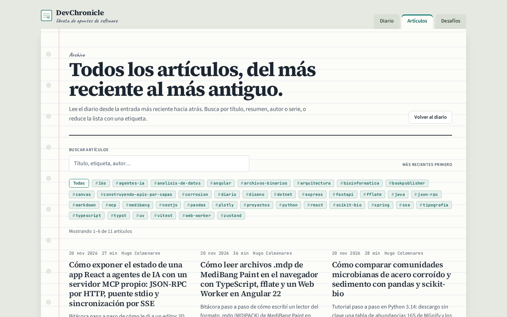
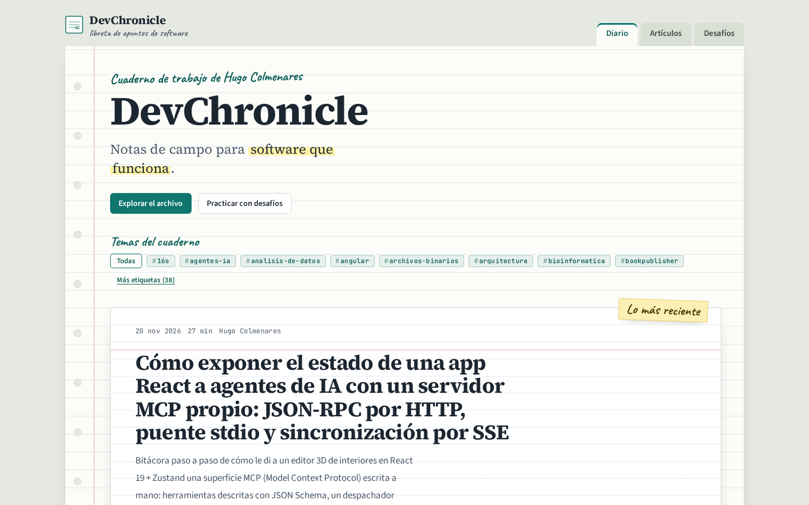
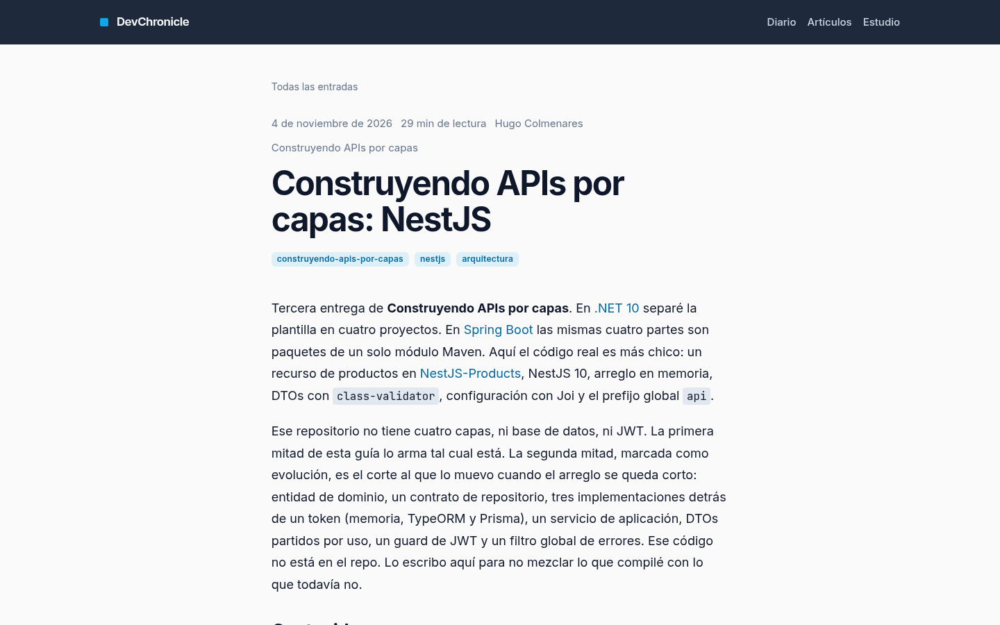
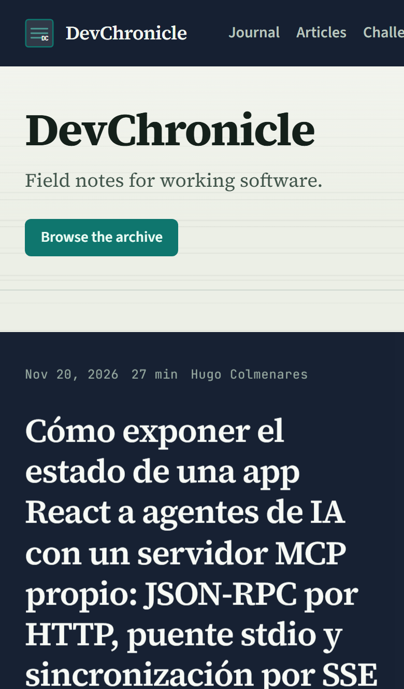
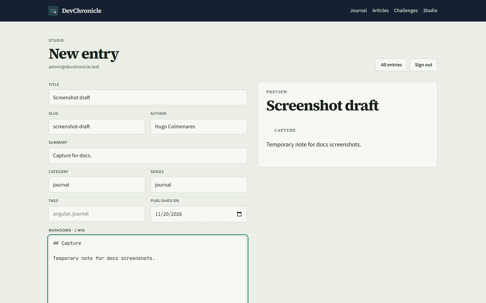
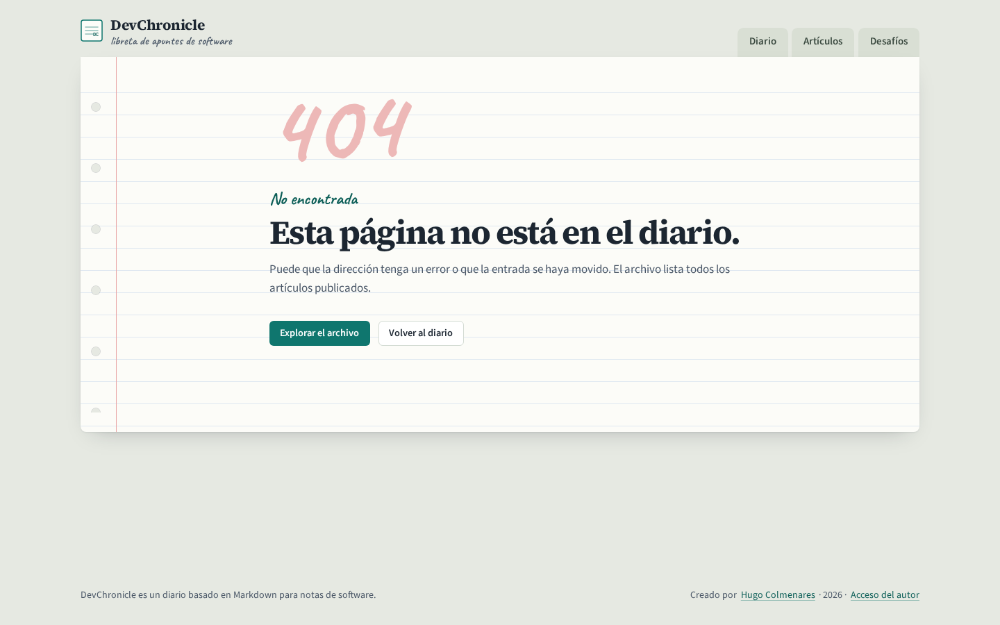
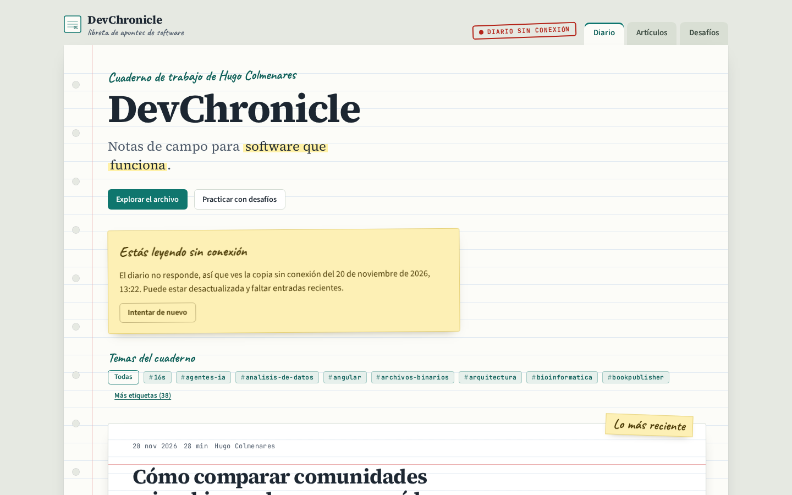
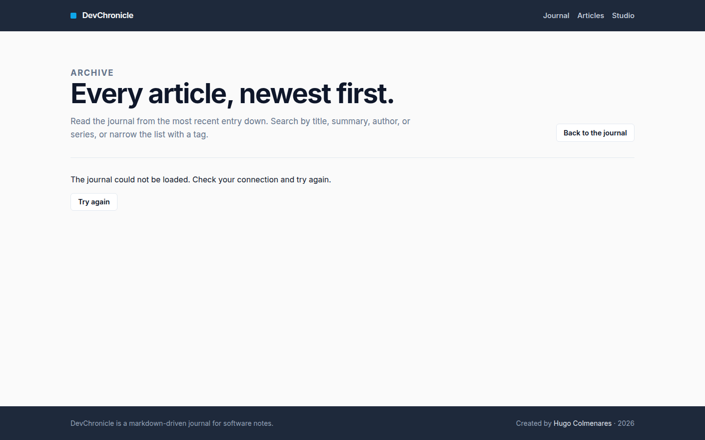
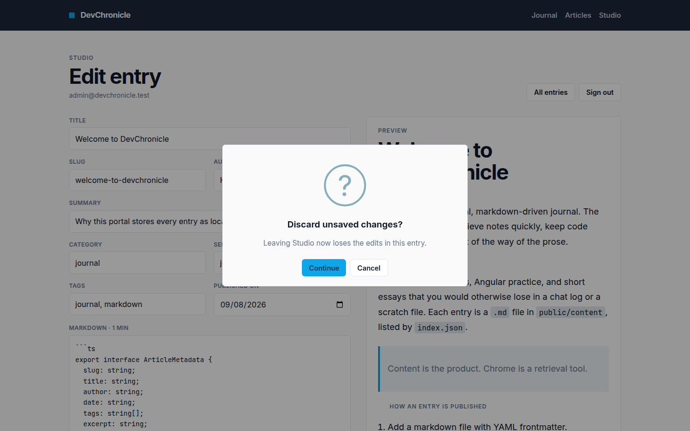

# DevChronicleApp

DevChronicleApp es el cliente Angular 22 de DevChronicle, un diario en Markdown. Las entradas publicadas viven en Cloud Firestore. El navegador compila el Markdown a HTML y lo presenta como una **libreta de apuntes**: hoja con renglones y línea de margen, pestañas separadoras, notas adhesivas para los avisos y modo oscuro automático. Source Serif 4, Source Sans 3, Caveat (solo para acentos manuscritos) y JetBrains Mono se sirven desde `public/fonts`.

El plan Spark es el destino del despliegue: Firebase Authentication (Google) para el autor, Firestore para las entradas y Firebase Hosting para la SPA. La app no usa Cloud Functions, Cloud Storage ni otros productos de pago. La API en Rust ya no es la fuente en ejecución. `public/content` sigue siendo la fuente de importación y, en cada build, genera la copia sin conexión que se muestra (siempre señalada) si Firestore no responde.

Las notas operativas están en `docs/files`. Repositorios relacionados: [DevChronicle](https://github.com/HugoFernandoColmenares/DevChronicle) y [DevChronicleApi](https://github.com/HugoFernandoColmenares/DevChronicleApi). El identificador del proyecto de Firebase es `devchronicle-hugo`. Los emuladores locales usan `demo-devchronicle`.

## Documentación

| Documento                                                          | Contenido                                                                  |
| :----------------------------------------------------------------- | :------------------------------------------------------------------------- |
| [`docs/files/architecture.md`](docs/files/architecture.md)         | Topología en ejecución, rutas, modelo de datos y comandos de compilación   |
| [`docs/files/design.md`](docs/files/design.md)                     | Libreta de apuntes: tokens, tipografía, composición y estados sin conexión |
| [`docs/files/audit.md`](docs/files/audit.md)                       | Hallazgos ordenados (de críticos a bajos) con capturas como evidencia      |
| [`docs/files/improvement-plan.md`](docs/files/improvement-plan.md) | Plan por fases (mejoras rápidas → seguridad → diseño → extras)             |
| [`docs/files/PENDIENTES.md`](docs/files/PENDIENTES.md)             | Cambios que quedan por aplicar, con pasos y forma de verificarlos          |
| [`docs/screenshots/`](docs/screenshots/)                           | Capturas de escritorio y móvil de los estados públicos y del Estudio       |

Las notas operativas (`autenticacion.md`, `modelo-de-datos.md`, `robustez-mvp.md` y otras) conviven en `docs/files` con el conjunto de auditoría.

## Superficies

La portada abre con la marca y la línea del producto, sigue con «Temas del cuaderno» (una nube de etiquetas con las primeras 8 visibles y el botón «Más etiquetas») y luego presenta la entrada más reciente como una ficha con la nota adhesiva «Lo más reciente», un riel de entradas recientes y el resto de los apuntes. Las etiquetas filtran el catálogo sin salir de la página.

El archivo en `/articles` lista todas las entradas publicadas, de la más reciente a la más antigua. Tiene búsqueda de texto en vivo, filtros por etiqueta y una paginación que vuelve a la primera página cada vez que cambia el filtro.





La ruta de artículo (`/post/:slug`) mantiene el cuerpo dentro de 70 caracteres, carga el resaltado de sintaxis de forma diferida y ofrece un control para copiar en cada bloque de código.



En pantallas estrechas las pestañas ocupan todo el ancho, la hoja pierde las perforaciones y la cuadrícula se apila.



`/admin` es el Estudio de autoría. Requiere iniciar sesión con Google, y la cuenta debe tener un documento `admins/{uid}`. La pestaña «Estudio» solo aparece para esas cuentas; el resto entra desde «Acceso del autor», en el pie. El editor muestra una vista previa del Markdown antes de publicar y detecta si otra pestaña guardó antes.



Las URL desconocidas muestran una vista 404 en lugar de redirigir a la portada.



Cada ruta define su título, descripción, enlace canónico, etiquetas Open Graph y JSON-LD, mientras que `/admin` se mantiene en `noindex`. `robots.txt` y `sitemap.xml` se generan en la compilación a partir de `NG_APP_SITE_URL` (el mapa del sitio incluye la portada, el archivo y cada artículo de `public/content`), y `public/social/devchronicle-cover.png` es la tarjeta para compartir del sitio. Los rastreadores sociales no ejecutan el cliente, así que las vistas previas por artículo requerirían prerenderizado; consulta [`docs/files/acabado-publico.md`](docs/files/acabado-publico.md).

## Resiliencia

Las vistas públicas reintentan dos veces, con espera creciente (400 ms y 800 ms), los fallos transitorios de Firestore. Si el diario sigue sin responder, la cabecera muestra el sello **Diario sin conexión** y la página carga la copia sin conexión (`/offline/journal.json`, generada en el build desde `public/content`) bajo una nota adhesiva que dice la fecha de la copia, que puede estar desactualizada y ofrece **Intentar de nuevo**. Si tampoco hay copia, se muestra el estado de error con el mismo botón. Una caída nunca se presenta en silencio. Sin red y sin caché, Firestore responde con una lista vacía marcada como "desde caché"; la app la trata como una caída y no como un diario vacío. Los fallos permanentes (entrada inexistente, slug inválido, permisos) no se reintentan.





El Estudio recuerda el último estado del formulario cargado o guardado. Salir con ediciones pendientes pide confirmación, y recargar o cerrar la pestaña activa la advertencia `beforeunload` del navegador. Guardar, publicar o eliminar marca el editor como limpio, así la siguiente navegación no se interrumpe. Consulta [`docs/files/robustez-mvp.md`](docs/files/robustez-mvp.md) para ver el resto de pendientes.



## Requisitos

- Node.js 22 o superior
- npm 12 o superior (este repositorio fija `packageManager`)
- Un JDK 21 para ejecutar el emulador de Firestore

## Instalación

```bash
cp .env.example .env
npm install
```

`.env` está ignorado por git. Ahí van las claves de configuración web, que son públicas en el cliente compilado. No pongas el JSON de una cuenta de servicio en el repositorio. `npm run build` escribe `src/environments/environment.production.ts` a partir de esas variables. `ng serve` no las necesita: el entorno de desarrollo habla con los emuladores.

## Emuladores

```bash
npm run emulators
npm run import:emulator
npm run seed:admin
npm start
```

La app queda en `http://127.0.0.1:4200/`. La interfaz de los emuladores queda en `http://127.0.0.1:4000/`. Inicia los emuladores con el proyecto `demo-devchronicle` (el script de npm ya lo hace). El alias por defecto en `.firebaserc` es el proyecto en la nube, no el de los emuladores.

En el widget de inicio de sesión del emulador de Auth, usa `admin@devchronicle.test` después de `npm run seed:admin`.

### Verificación local

Ejecuta los cuatro comandos anteriores y recorre la superficie con datos reales del emulador:

1. `/` muestra la entrada destacada, el riel de recientes, las entradas publicadas que trajo el importador y los filtros por etiqueta.
2. `/articles` muestra 6 entradas por página (por ejemplo "Mostrando 1–6 de 11 artículos" después de un `import:emulator` completo). Buscar `nestjs` devuelve una entrada, y cambiar un filtro reinicia la paginación.
3. `/post/construyendo-apis-por-capas-nestjs` muestra el cuerpo en Markdown, 19 encabezados `h2` y bloques de código con la barra `TS`/`HTML` y el control de copiar.
4. `/ruta-inexistente` y `/post/no-existe` muestran la vista 404 con `noindex` y enlaces al archivo y al diario.
5. `/admin` acepta `admin@devchronicle.test`; la lista muestra todas las entradas importadas y el editor previsualiza el Markdown antes de publicar.
6. Edita el título o el Markdown y pulsa **Todas las entradas**: el Estudio pregunta antes de descartar. Cancelar conserva el borrador; confirmar sale.
7. Detén el emulador de Firestore y recarga `/` o `/articles`: aparece el sello «Diario sin conexión» y la nota adhesiva con la copia sin conexión (hace falta haber corrido `npm start` o `npm run build` para generarla). Vuelve a iniciar Firestore y usa **Intentar de nuevo**; el catálogo se recupera sin recargar.
8. Cada ruta define su propio `<title>`, descripción, canónico, etiquetas Open Graph y JSON-LD.

Las imágenes de `docs/screenshots` salen de este flujo local con `npm run screenshots` (1440 px de ancho y iPhone 12 para móvil), siempre con la cuenta falsa del emulador.

## Scripts

```bash
npm start
```

Sirve la compilación de desarrollo contra los emuladores.

```bash
npm run build
```

Escribe un paquete optimizado en `dist/DevChronicle`.

```bash
npm test
npm run test:import
npm run test:rules
npm run lint
```

`test` ejecuta la suite de Vitest con el constructor de pruebas unitarias de Angular. `test:import` verifica el analizador de Markdown que usa el importador y que la copia sin conexión coincide con `public/content`. `test:rules` inicia el emulador de Firestore y ejecuta `@firebase/rules-unit-testing`. `lint` ejecuta Prettier. `npm run test:e2e` corre la prueba de humo de Playwright (con axe) contra los emuladores.

```bash
npm run import:emulator
node scripts/import-content.mjs --project devchronicle-hugo
```

El importador hace upsert de `public/content/*.md` por slug. Una importación a la nube requiere `--project` y `GOOGLE_APPLICATION_CREDENTIALS` o `FIREBASE_SERVICE_ACCOUNT`.

## Arquitectura

| Ruta                     | Responsabilidad                                                                         |
| :----------------------- | :-------------------------------------------------------------------------------------- |
| `src/app/core`           | Modelos, lecturas y escrituras en Firestore, autenticación con Google, Markdown, avisos |
| `src/app/features`       | Catálogo de la portada, archivo paginado, visor de artículos, desafíos y Estudio        |
| `src/app/shared`         | Tarjetas, etiquetas, copiar, esqueleto, sello y nota sin conexión, cabecera y pie       |
| `public/content`         | Archivos Markdown que se importan a Firestore                                           |
| `firestore.rules`        | Lectura pública de entradas publicadas, escrituras de admins, `admins` solo por consola |
| `firestore.indexes.json` | `status` + `publishedAt` para el catálogo público                                       |
| `firebase.json`          | Reescritura de la SPA en Hosting y puertos de los emuladores                            |
| `docs/files`             | Arquitectura, diseño, auditoría y plan, más las notas operativas                        |

El enrutamiento vive en `src/app/app.routes.ts`. El catálogo es `/`. El archivo es `/articles` (el alias `/articulos` redirige ahí). El visor es `/post/:slug`. Los desafíos son `/challenges` (el alias `/desafios` redirige ahí). El Estudio es `/admin`. La ruta comodín muestra la vista 404, y `/404` es un alias explícito.

Los componentes usan entradas con signals, vistas diferidas para el HTML compilado y detección de cambios sin zonas. La salida del analizador se purifica con DOMPurify antes de enlazarla con `[innerHTML]`. Solo se consulta una entrada cuando el slug cumple `[a-z0-9-]+`.

Los avisos al usuario pasan por `NotificationService` (`src/app/core/services/notification.service.ts`), que da a SweetAlert2 la paleta de la libreta.

## Lectura de entradas

El catálogo escucha `entries` donde `status == published`, ordenado por `publishedAt`. Al abrir una entrada se lee ese documento y `entries/{slug}/body/current`, y luego se compila el Markdown en el navegador. El documento del cuerpo guarda el Markdown sin frontmatter para que la lista sea liviana y cada documento quede por debajo del límite de 1 MiB de Firestore. Consulta `docs/files/modelo-de-datos.md`.

Si no se puede llegar a Firestore, la cabecera muestra «Diario sin conexión» y la página usa la copia sin conexión, marcada como tal, o avisa que no se pudo cargar el diario si tampoco hay copia.

## Autoría

El Estudio crea, edita, publica, despublica (guardando como borrador) y elimina entradas. Los admins son documentos en `admins/{uid}` creados desde la consola de Firebase. Las reglas de seguridad rechazan las escrituras del cliente en esa colección.

## Despliegue

Cada push a `main` ejecuta `.github/workflows/firebase-hosting.yml`: lint, pruebas unitarias, importador, reglas, E2E contra emuladores, build y despliegue de Hosting, reglas e índices. Si faltan los secretos de Firebase, omite el despliegue en lugar de fallar. La importación del Markdown a Firestore al desplegar es opcional (`IMPORT_MARKDOWN_ON_DEPLOY=true`) para no pisar lo editado en el Estudio. Hay además vista previa por PR, chequeo de disponibilidad y exportación semanal; App Check queda listo detrás de `FIREBASE_APPCHECK_SITE_KEY`. Los secretos y la configuración inicial del proyecto están en `docs/files/hosting.md`.

## Autor

Hugo Fernando Colmenares. Repositorios públicos: [HugoFernandoColmenares](https://github.com/HugoFernandoColmenares?tab=repositories).

Este repositorio es [DevChronicleApp](https://github.com/HugoFernandoColmenares/DevChronicleApp).

| Proyecto                                                                     | Rol                                                 |
| :--------------------------------------------------------------------------- | :-------------------------------------------------- |
| [DevChronicleApp](https://github.com/HugoFernandoColmenares/DevChronicleApp) | Cliente Angular, Firestore, Auth, Hosting           |
| [DevChronicleApi](https://github.com/HugoFernandoColmenares/DevChronicleApi) | API anterior en Rust y SQLite                       |
| [DevChronicle](https://github.com/HugoFernandoColmenares/DevChronicle)       | Orquestación con Docker Compose de la pila anterior |

## Licencia

Proyecto privado. Todos los derechos reservados, salvo que el propietario del repositorio indique lo contrario.
