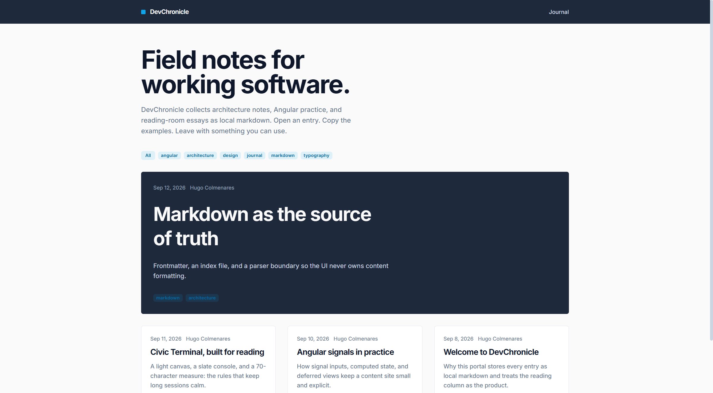
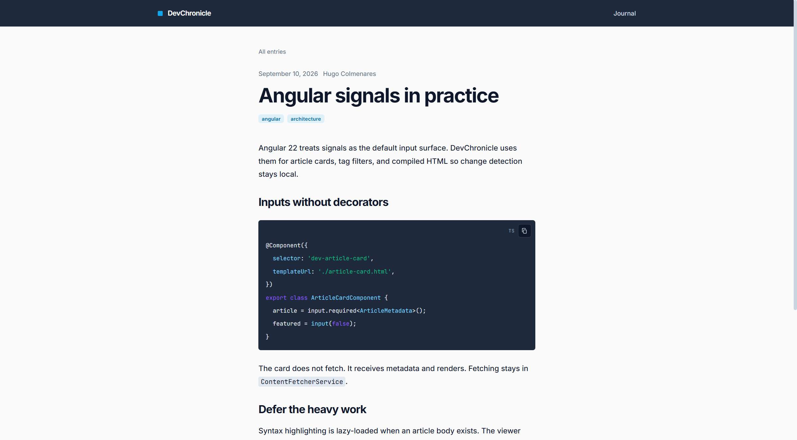
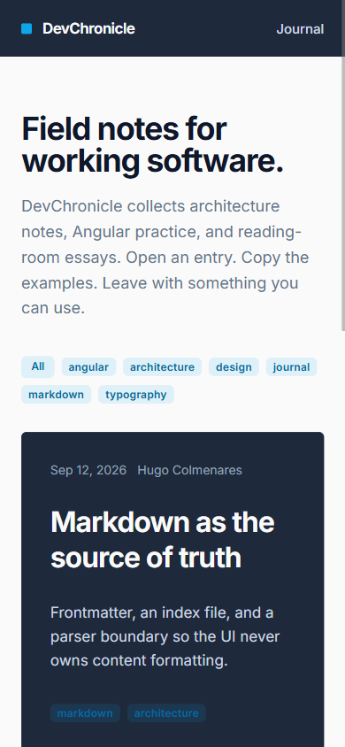

# DevChronicle

DevChronicle is a markdown-driven journal built with Angular 22. The reader loads published entries from `/api/v1`. Core services compile the Markdown body and render a Civic Terminal reading surface: a light canvas, slate chrome, and dark code fences. Inter and JetBrains Mono are served from `public/fonts`.

Created by [Hugo Colmenares](https://github.com/HugoFernandoColmenares).

## Surfaces

The landing page lists the latest entry as a featured slate card, then the remaining articles in a responsive grid. Tags filter the catalog without leaving the page.



The article route (`/post/:slug`) keeps the body at a maximum of 70 characters, lazy-loads syntax highlighting, and offers a copy control on each fence.



Narrow viewports stack the grid and wrap the display heading.



## Requirements

- Node.js 22 or later
- npm 12 or later (the repository pins `packageManager`)

## Setup

```bash
copy .env-template .env
npm install
```

On macOS or Linux use `cp .env-template .env`.

`.env` is ignored by git. Use it for local values such as `NG_APP_SITE_NAME`, `NG_APP_API_BASE`, and `NG_APP_ANALYTICS_ID`. The running application reads the mirrored defaults in `src/environments/environment.ts`. Development builds replace that file with `environment.development.ts`. `ng serve` forwards `/api` to `http://127.0.0.1:8080` through `proxy.conf.json`.

## Scripts

```bash
npm start
```

Serves the app at `http://localhost:4200/`.

```bash
npm run build
```

Writes an optimized bundle to `dist/DevChronicle`.

```bash
npm test
```

Runs the Vitest suite through the Angular unit-test builder.

## Architecture

The layout follows a flat, feature-focused tree:

| Path | Responsibility |
| :--- | :--- |
| `src/app/core` | Models, API fetching, markdown parsing, Highlight.js loading, notifications |
| `src/app/features` | Landing catalog and article viewer |
| `src/app/shared` | Cards, tags, copy control, skeleton, site header and footer |
| `public/content` | Seed corpus (`index.json` and `.md`). The running client does not request it |
| `public/fonts` | Vendored Inter and JetBrains Mono |

Routing lives in `src/app/app.routes.ts`. The catalog is `/`. The viewer is `/post/:slug`. Unknown paths redirect home.

Components use signal inputs, deferred views for compiled HTML, and zoneless change detection. Parser output is purified with DOMPurify before it is bound with `[innerHTML]`. Slugs must match `[a-z0-9-]+` before a content request is made.

User-facing alerts go through `NotificationService` (`src/app/core/services/notification.service.ts`), which styles SweetAlert2 to the Civic Terminal palette.

Internal briefs in `docs/files/design_guidelines.md` and `docs/files/architecture_guidelines.md` are local-only and are listed in `.gitignore`. Docker Compose and the web MVP live at the repository root, specified in `../docs/files/mvp-rust-sqlite-docker.md`. The Tauri shell and the shared Rust engine live in `backend/`, specified in `../backend/docs/files/hybrid-web-desktop.md`.

## Publishing an entry

The catalog is `GET /api/v1/articles`. An entry is `GET /api/v1/articles/{slug}` and returns `{ metadata, markdown }` with no frontmatter in the body. Title, date, author, and tags come from `metadata`. Creating and editing go through the author token on the API; this client has no admin form.

`public/content` stays as the seed input for that API. A missing article (`404`) shows “Article not found”. A network failure shows “Unable to load the journal”.

## License

Private project. All rights reserved unless the repository owner states otherwise.
