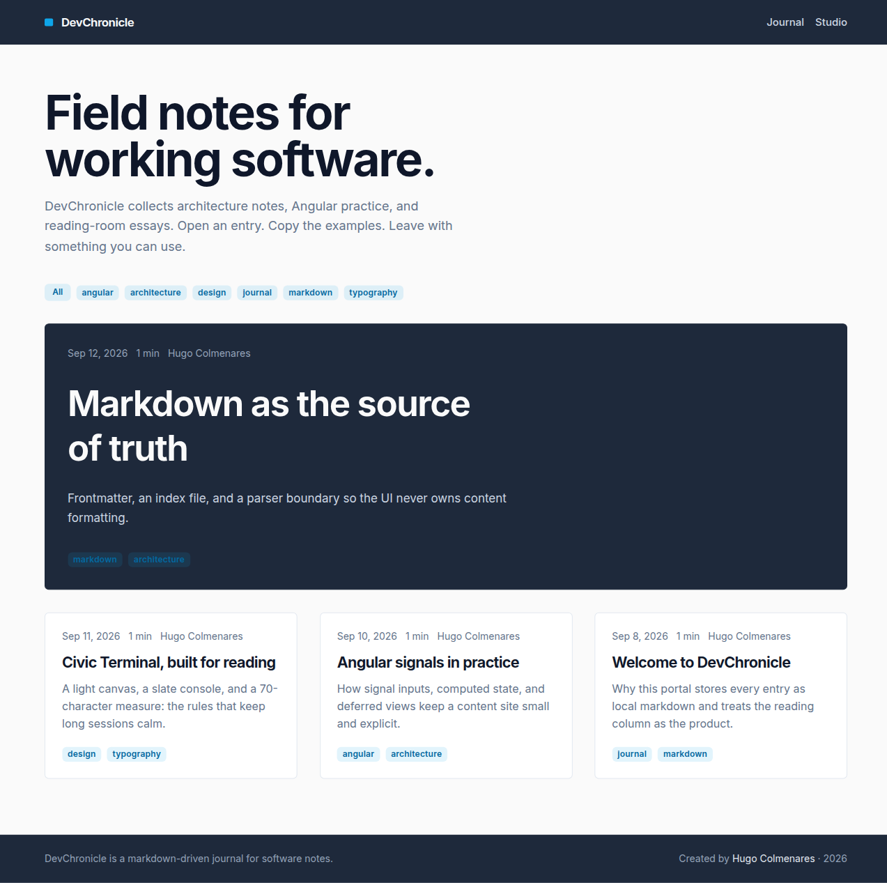
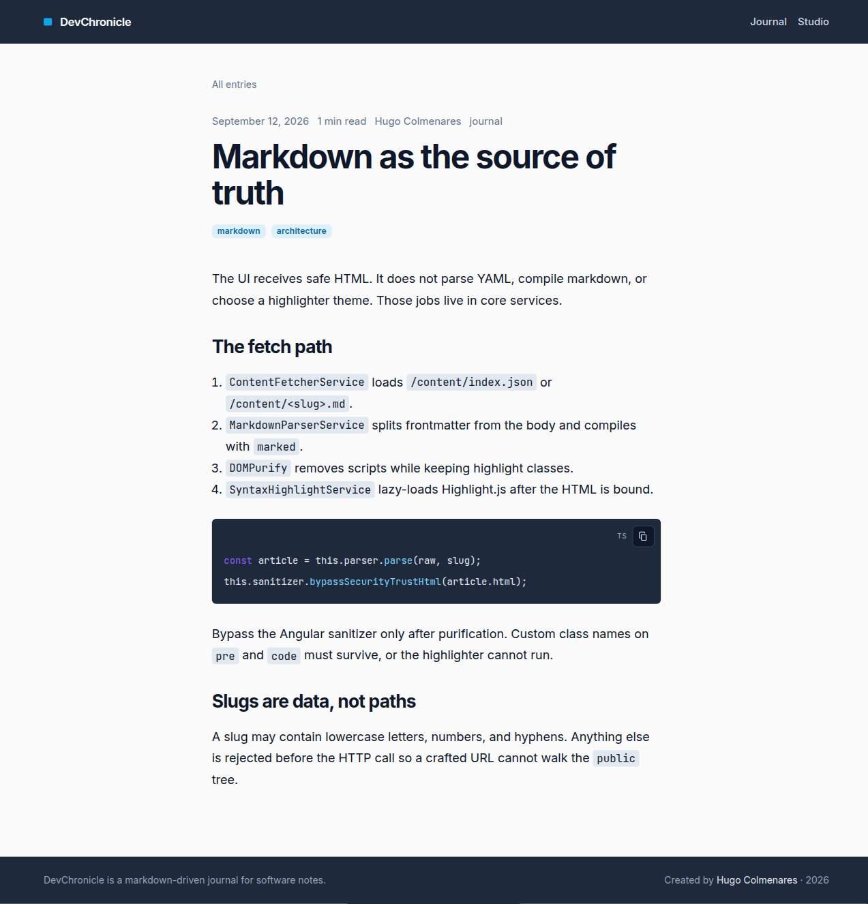
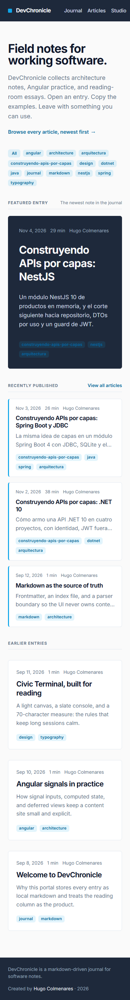
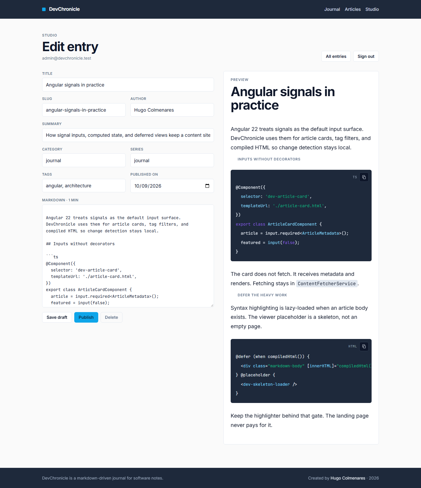

# DevChronicleApp

DevChronicleApp is the Angular 22 client for DevChronicle, a markdown journal. Published entries live in Cloud Firestore. The browser compiles Markdown to HTML and renders the Civic Terminal reading surface: a light canvas, slate chrome, and dark code fences. Inter and JetBrains Mono are served from `public/fonts`.

The Spark plan is the deployment target: Firebase Authentication (Google) for the author, Firestore for entries, and Firebase Hosting for the SPA. The app does not use Cloud Functions, Cloud Storage, or other paid products. The Rust API and the local `index.json` fallback are no longer the runtime source. `public/content` remains the import source.

Operational notes in Spanish live in `docs/files`. Related repositories: [DevChronicle](https://github.com/HugoFernandoColmenares/DevChronicle) and [DevChronicleApi](https://github.com/HugoFernandoColmenares/DevChronicleApi). The Firebase project id placeholder is `devchronicle-hugo`. Local emulators use `demo-devchronicle`.

## Surfaces

The landing page lists the latest published entry as a featured slate card, then the remaining articles in a responsive grid. Tags filter the catalog without leaving the page.



The article route (`/post/:slug`) keeps the body within 70 characters, lazy-loads syntax highlighting, and offers a copy control on each fence.



Narrow viewports stack the grid and wrap the display heading.



`/admin` is the authoring studio. Google sign-in is required, and the account must have an `admins/{uid}` document. The editor previews Markdown before publish.



## Requirements

- Node.js 22 or later
- npm 12 or later (this repository pins `packageManager`)
- A JDK 21 when running the Firestore emulator

## Setup

```bash
cp .env.example .env
npm install
```

`.env` is ignored by git. Web config keys belong there. They are public in the built client. Do not put a service-account JSON in the repository. `npm run build` writes `src/environments/environment.production.ts` from those variables. `ng serve` does not need them: the development environment talks to the emulators.

## Emulators

```bash
npm run emulators
npm run import:emulator
npm run seed:admin
npm start
```

The app is at `http://127.0.0.1:4200/`. Emulator UI is at `http://127.0.0.1:4000/`. Start the emulators with project `demo-devchronicle` (the npm script does this). The default alias in `.firebaserc` is the future cloud project, not the emulator project.

In the Auth emulator sign-in widget, use `admin@devchronicle.test` after `npm run seed:admin`.

## Scripts

```bash
npm start
```

Serves the development build against the emulators.

```bash
npm run build
```

Writes an optimized bundle to `dist/DevChronicle`.

```bash
npm test
npm run test:import
npm run test:rules
npm run lint
```

`test` runs the Vitest suite through the Angular unit-test builder. `test:import` checks the Markdown parser used by the importer. `test:rules` starts the Firestore emulator and runs `@firebase/rules-unit-testing`. `lint` runs Prettier.

```bash
npm run import:emulator
node scripts/import-content.mjs --project devchronicle-hugo
```

The importer upserts `public/content/*.md` by slug. A cloud import requires `--project` and `GOOGLE_APPLICATION_CREDENTIALS` or `FIREBASE_SERVICE_ACCOUNT`.

## Architecture

| Path                     | Responsibility                                                                   |
| :----------------------- | :------------------------------------------------------------------------------- |
| `src/app/core`           | Models, Firestore reads and writes, Google auth, Markdown parsing, notifications |
| `src/app/features`       | Landing catalog, article viewer, studio                                          |
| `src/app/shared`         | Cards, tags, copy control, skeleton, offline status, site header and footer      |
| `public/content`         | Markdown files imported into Firestore                                           |
| `firestore.rules`        | Public read of published entries, admin writes, console-only `admins`            |
| `firestore.indexes.json` | `status` + `publishedAt` for the public catalog                                  |
| `firebase.json`          | Hosting SPA rewrite and emulator ports                                           |
| `docs/files`             | Spanish notes, one file per aspect                                               |

Routing lives in `src/app/app.routes.ts`. The catalog is `/`. The viewer is `/post/:slug`. Studio is `/admin`. Unknown paths redirect home.

Components use signal inputs, deferred views for compiled HTML, and zoneless change detection. Parser output is purified with DOMPurify before it is bound with `[innerHTML]`. A content request is sent only when the slug matches `[a-z0-9-]+`.

User-facing alerts go through `NotificationService` (`src/app/core/services/notification.service.ts`), which styles SweetAlert2 to the Civic Terminal palette.

## Reading entries

The catalog listens to `entries` where `status == published`, ordered by `publishedAt`. Opening an entry reads that document and `entries/{slug}/body/current`, then compiles the Markdown in the browser. The body document holds the Markdown without frontmatter so the list stays small and each document stays under the 1 MiB Firestore limit. See `docs/files/modelo-de-datos.md`.

If Firestore cannot be reached, the header shows “Journal offline” and the page reports that the journal could not be loaded. There is no local file fallback.

## Authoring

Studio creates, edits, publishes, unpublishes (by saving a draft), and deletes entries. Admins are documents in `admins/{uid}` created from the Firebase console. Security rules reject client writes to that collection.

## Deploy

Pushes to `main` run `.github/workflows/firebase-hosting.yml`. The workflow builds even when Firebase secrets are missing, and it skips Hosting deploy instead of failing. The secrets and the one-time project setup are listed in `docs/files/hosting.md`.

## Author

Hugo Fernando Colmenares. Public repositories: [HugoFernandoColmenares](https://github.com/HugoFernandoColmenares?tab=repositories).

This repository is [DevChronicleApp](https://github.com/HugoFernandoColmenares/DevChronicleApp).

| Project                                                                      | Role                                               |
| :--------------------------------------------------------------------------- | :------------------------------------------------- |
| [DevChronicleApp](https://github.com/HugoFernandoColmenares/DevChronicleApp) | Angular client, Firestore, Auth, Hosting           |
| [DevChronicleApi](https://github.com/HugoFernandoColmenares/DevChronicleApi) | Previous Rust API and SQLite                       |
| [DevChronicle](https://github.com/HugoFernandoColmenares/DevChronicle)       | Docker Compose orchestration of the previous stack |

## License

Private project. All rights reserved unless the repository owner states otherwise.
