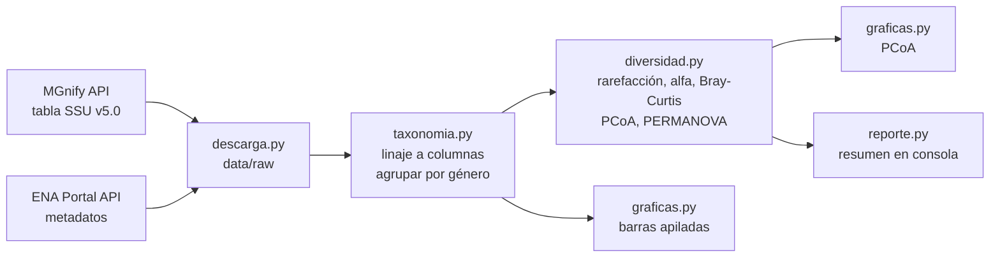

¡Hola! Hoy arranco una línea nueva en DevChronicle: tutoriales de biotecnología con análisis de datos. Antes de dedicarme de lleno al desarrollo trabajé en el área de biotecnología de la CIC (Corporación para la Investigación de la Corrosión), y desde ahí me quedó la curiosidad por una pregunta muy concreta: ¿qué bichos viven sobre un metal que se está corroyendo, y en qué se diferencian de los que viven al lado, en el sedimento? Aclaro desde ya: no soy microbiólogo. Lo que traigo aquí es la parte que sí sé hacer, que es tomar datos públicos, limpiarlos y sacarles números con código.

Hoy vamos a ver, paso a paso, cómo comparar comunidades microbianas de muestras de acero corroído y de sedimento marino usando **pandas** y **scikit-bio**. Los datos son de un estudio público de unos 10 años sobre la corrosión de cadenas de amarre de acero instaladas a unos 2 km de profundidad. No son míos: los publicaron Rajala, Cheng, Rice y Lauro en *Microbiome* (2022), y están en los repositorios de EMBL-EBI. Así que acompáñenme.

**Sobre el código.** El código completo está en el artículo, archivo por archivo, y también en un repositorio público: [EpiBio](https://github.com/HugoFernandoColmenares/EpiBio) (licencia MIT). Es el mismo proyecto, con el paquete de Python llamado `epibio`, y así lo nombro a lo largo del tutorial. Lo armé y lo corrí el 20 de noviembre de 2026 en un proyecto `uv` local. Todas las salidas que muestro son las que me dio esa corrida; si ustedes lo corren otro día, MGnify podría haber reprocesado el estudio y los números podrían moverse un poco. Lo que no corrí lo marco como **Evolución**.

<a id="contenido"></a>

## Contenido

1. [El problema](/post/comparar-comunidades-microbianas-acero-corroido-sedimento-pandas-scikit-bio#problema)
2. [Los datos: de dónde salen y qué son](/post/comparar-comunidades-microbianas-acero-corroido-sedimento-pandas-scikit-bio#datos)
3. [Prerrequisitos](/post/comparar-comunidades-microbianas-acero-corroido-sedimento-pandas-scikit-bio#prerrequisitos)
4. [Stack y arquitectura](/post/comparar-comunidades-microbianas-acero-corroido-sedimento-pandas-scikit-bio#arquitectura)
5. [Instalación con uv](/post/comparar-comunidades-microbianas-acero-corroido-sedimento-pandas-scikit-bio#instalacion)
6. [Carpetas y principios](/post/comparar-comunidades-microbianas-acero-corroido-sedimento-pandas-scikit-bio#carpetas)
7. [Paso 1: descargar sin clave](/post/comparar-comunidades-microbianas-acero-corroido-sedimento-pandas-scikit-bio#descarga)
8. [Paso 2: partir el linaje taxonómico](/post/comparar-comunidades-microbianas-acero-corroido-sedimento-pandas-scikit-bio#linaje)
9. [Paso 3: diversidad alfa, beta, PCoA y PERMANOVA](/post/comparar-comunidades-microbianas-acero-corroido-sedimento-pandas-scikit-bio#diversidad)
10. [Paso 4: gráficas con plotly](/post/comparar-comunidades-microbianas-acero-corroido-sedimento-pandas-scikit-bio#graficas)
11. [Paso 5: el reporte de punta a punta](/post/comparar-comunidades-microbianas-acero-corroido-sedimento-pandas-scikit-bio#reporte)
12. [Probarlo y leer los resultados](/post/comparar-comunidades-microbianas-acero-corroido-sedimento-pandas-scikit-bio#probar)
13. [Decisiones técnicas](/post/comparar-comunidades-microbianas-acero-corroido-sedimento-pandas-scikit-bio#decisiones)
14. [Cómo agrego otro estudio](/post/comparar-comunidades-microbianas-acero-corroido-sedimento-pandas-scikit-bio#otro-estudio)
15. [Errores típicos y trampas](/post/comparar-comunidades-microbianas-acero-corroido-sedimento-pandas-scikit-bio#errores)
16. [Qué aprendí](/post/comparar-comunidades-microbianas-acero-corroido-sedimento-pandas-scikit-bio#aprendi)
17. [Siguientes pasos (Evolución)](/post/comparar-comunidades-microbianas-acero-corroido-sedimento-pandas-scikit-bio#siguientes)
18. [Checklist, resumen y enlaces](/post/comparar-comunidades-microbianas-acero-corroido-sedimento-pandas-scikit-bio#resumen)

<a id="problema"></a>

## 1. El problema

Cuando uno escucha «corrosión», piensa en química: oxígeno, agua, sal y metal. Pero hay un tipo de corrosión en la que los microorganismos tienen un papel importante. Se le llama **MIC** (*microbially influenced corrosion*, corrosión influenciada por microorganismos). Entre los sospechosos de siempre están las **bacterias sulfatorreductoras**, que viven sin oxígeno y «respiran» sulfato.

La pregunta de un análisis como este es sencilla de decir: si tomo muestras de la superficie de una cadena de acero corroída y muestras del sedimento que la rodea, ¿las comunidades de microorganismos se parecen o no? ¿Cuáles géneros dominan en cada lado?

Para responderla con código necesito tres cosas:

- Una **tabla de abundancias**: cuántas lecturas de ADN se asignaron a cada grupo de organismos en cada muestra.
- Unos **metadatos**: qué es cada muestra (cadena por dentro, cadena por fuera, sedimento).
- Un par de herramientas estadísticas para comparar comunidades sin perderme en fórmulas.

Bien, ya tenemos la pregunta. Ahora vamos a ver de dónde salen los datos.

<a id="datos"></a>

## 2. Los datos: de dónde salen y qué son

Uso dos fuentes públicas de EMBL-EBI, las dos sin clave ni registro:

| Fuente | Identificador | Qué me da |
| --- | --- | --- |
| MGnify (API v1) | Estudio `MGYS00006080` (secundario `SRP302406`) | Tabla de abundancias taxonómicas SSU, pipeline 5.0: `SRP302406_taxonomy_abundances_SSU_v5.0.tsv` |
| ENA Portal API | Proyecto `PRJNA693108` | Qué es cada corrida (`run_accession`), su alias y su descripción |

La ficha del estudio en MGnify dice: *«Sulfate-dependant microbially induced corrosion of mild steel in the deep sea: a 10-year microbiome study.»*, centro Nanyang Technological University, 9 muestras. La publicación asociada es:

> Rajala P, Cheng DQ, Rice SA, Lauro FM. *Sulfate-dependant microbially induced corrosion of mild steel in the deep sea: a 10-year microbiome study.* Microbiome 10, 4 (2022). DOI: [10.1186/s40168-021-01196-6](https://doi.org/10.1186/s40168-021-01196-6). PubMed 35027090.

Los datos se usan bajo los [términos de uso de EMBL-EBI](https://www.ebi.ac.uk/about/terms-of-use/). Si ustedes publican algo con ellos, citen el artículo y las bases de datos.

Un detalle importante: el proyecto en la ENA tiene **15 corridas**, pero no todas son iguales. Hay 9 de tipo `AMPLICON` (secuenciación del gen 16S, que es la «huella» que se usa para identificar bacterias y arqueas) y 6 de tipo `WGS` (metagenoma completo). La tabla SSU de MGnify corresponde a las 9 de amplicón. Esto lo descubrí al consultar la ENA, y por eso el código filtra por `library_strategy == "AMPLICON"`.

Las 9 muestras quedan así (los alias son los que trae la ENA):

| Alias | Descripción en la ENA | Grupo que le asigno |
| --- | --- | --- |
| MC1a, MC2a, MC3a | *outer of the deep sea mooring chain link* 1, 2 y 3 | cadena-externa |
| MC1b, MC2b, MC3b | *inner of the deep sea mooring chain link* 1, 2 y 3 | cadena-interna |
| Sediment_2-4, Sediment_4-7, Sediment_7-9 | capas de sedimento de 2–4, 4–7 y 7–9 cm | sedimento |

O sea: tres eslabones de cadena, cada uno muestreado por fuera (`a`) y por dentro (`b`), más tres capas de sedimento. Pocas muestras, y eso lo vamos a tener muy presente al interpretar.

<a id="prerrequisitos"></a>

## 3. Prerrequisitos

Uso **Python 3.14** y **uv** (un gestor de proyectos y paquetes de Python muy rápido). Compruebo las versiones así:

```bash
uv --version
uv run python --version
```

En mi máquina dieron:

```text
uv 0.13.8 (x86_64-unknown-linux-gnu)
Python 3.14.10
```

Si no tienen Python 3.14, no pasa nada: `uv` lo descarga solo cuando el proyecto lo pide. También necesitan conexión a internet para la primera descarga de datos (son unos pocos cientos de KB).

Si prefieren clonar en vez de teclear todo, el repo [EpiBio](https://github.com/HugoFernandoColmenares/EpiBio) se instala así:

```bash
git clone https://github.com/HugoFernandoColmenares/EpiBio.git
cd EpiBio
uv sync
uv run epibio
```

<a id="arquitectura"></a>

## 4. Stack y arquitectura

Estas son las versiones exactas que resolvió `uv` el 20 de noviembre de 2026:

| Paquete | Versión | Para qué |
| --- | --- | --- |
| pandas | 3.1.1 | Tablas, agrupaciones, uniones |
| scikit-bio | 0.7.4 | Diversidad alfa y beta, PCoA, PERMANOVA, rarefacción |
| numpy / scipy | 2.5.5 / 1.18.1 | Llegan como dependencias de scikit-bio |
| plotly | 7.1.0 | Gráficas en HTML interactivo |
| httpx | 0.28.1 | Descargas HTTP con timeout |
| pytest | 9.2.0 | Pruebas del parser del linaje |

El flujo completo es este:



Básicamente son cuatro módulos pequeños y un reporte que los llama en orden. No hay servidor, ni base de datos, ni notebook obligatorio: es un paquete de Python que se corre con un comando.

<a id="instalacion"></a>

## 5. Instalación con uv

Creo el proyecto como paquete (`--package`) para que tenga la carpeta `src/` y se pueda importar como `epibio` desde cualquier lado:

```bash
mkdir EpiBio && cd EpiBio
uv init --name epibio --package --python 3.14 .
uv add pandas scikit-bio plotly httpx
uv add --dev pytest
mkdir -p data/raw tests docs
```

¿Por qué cada flag? `--package` me da la estructura `src/epibio/` y un *build backend* (el que empaqueta el proyecto), `--python 3.14` fija la versión en `.python-version`, y `--dev` deja pytest fuera de las dependencias de producción. `uv` crea solo el entorno virtual en `.venv/` y el archivo `uv.lock` con las versiones exactas.

El `pyproject.toml` que quedó (solo cambié la descripción a mano en mi copia; aquí lo dejo tal cual lo generó `uv`):

```toml
[project]
name = "epibio"
version = "0.1.0"
description = "Add your description here"
readme = "README.md"
requires-python = ">=3.14"
dependencies = [
    "httpx>=0.28.1",
    "pandas>=3.1.1",
    "plotly>=7.1.0",
    "scikit-bio>=0.7.4",
]

[project.scripts]
epibio = "epibio:main"

[build-system]
requires = ["uv_build>=0.13.8,<0.14.0"]
build-backend = "uv_build"

[dependency-groups]
dev = [
    "pytest>=9.2.0",
]
```

En el repo, el `pyproject.toml` lleva además descripción, licencia MIT, autor, palabras clave y la sección `[tool.pytest.ini_options]` (`testpaths` y `pythonpath`). Las dependencias son las mismas.

Y agrego al `.gitignore` la carpeta de datos crudos, porque se regenera con un comando y no tiene sentido versionarla:

```text
# Datos descargados (se regeneran con python -m epibio.descarga)
data/raw/
```

En el repo uso `data/raw/*` junto con `!data/raw/.gitkeep`: se ignora el contenido, pero la carpeta existe al clonar.

<a id="carpetas"></a>

## 6. Carpetas y principios

```text
EpiBio/
├── pyproject.toml
├── uv.lock
├── data/raw/                 # TSV descargados + DESCARGAS.txt (no se versiona)
├── docs/                     # gráficas HTML y salidas guardadas
├── src/epibio/
│   ├── __init__.py           # punto de entrada del comando `epibio`
│   ├── descarga.py           # MGnify + ENA, sin claves
│   ├── taxonomia.py          # linaje → columnas, agrupar, normalizar
│   ├── diversidad.py         # scikit-bio: alfa, beta, PCoA, PERMANOVA
│   ├── graficas.py           # plotly a HTML
│   └── reporte.py            # orquesta todo e imprime el resumen
└── tests/test_taxonomia.py
```

Los principios, atados a archivos concretos:

- **Una responsabilidad por módulo (SRP).** `descarga.py` no sabe nada de estadística y `diversidad.py` no sabe de dónde vienen los datos. Si mañana cambio MGnify por una tabla propia, solo toco la descarga.
- **DRY.** Partir el linaje se hace en una sola función, `partir_linaje`, que usan la agrupación por género y las pruebas.
- **KISS.** Funciones, no clases. Aquí no hay estado que proteger, así que una clase solo agregaría ceremonia.

Muy bien, ya tenemos el proyecto armado. Ahora vamos al código, archivo por archivo.

<a id="descarga"></a>

## 7. Paso 1: descargar sin clave

Este módulo baja la tabla de MGnify y los metadatos de la ENA, y anota la fecha de cada descarga. Lo guardo en `src/epibio/descarga.py`:

```python
"""Descarga la tabla de MGnify y los metadatos de la ENA (sin claves)."""
from datetime import datetime, timezone
from io import StringIO
from pathlib import Path

import httpx
import pandas as pd

MGNIFY = "https://www.ebi.ac.uk/metagenomics/api/v1"
ENA = "https://www.ebi.ac.uk/ena/portal/api/filereport"

ESTUDIO = "MGYS00006080"
PROYECTO = "PRJNA693108"
TABLA = "SRP302406_taxonomy_abundances_SSU_v5.0.tsv"

RAW = Path("data/raw")


def _get(url: str, params: dict | None = None) -> str:
    # Un solo cliente con timeout y User-Agent propio: es lo mínimo amable con EMBL-EBI.
    with httpx.Client(timeout=60, headers={"User-Agent": "epibio/0.1"}) as client:
        r = client.get(url, params=params, follow_redirects=True)
        r.raise_for_status()
        return r.text


def descargar_tabla(destino: Path = RAW) -> Path:
    destino.mkdir(parents=True, exist_ok=True)
    url = f"{MGNIFY}/studies/{ESTUDIO}/pipelines/5.0/file/{TABLA}"
    ruta = destino / TABLA
    ruta.write_text(_get(url), encoding="utf-8")
    _anotar(destino, url)
    return ruta


def descargar_metadatos(destino: Path = RAW) -> Path:
    destino.mkdir(parents=True, exist_ok=True)
    params = {
        "accession": PROYECTO,
        "result": "read_run",
        "fields": "run_accession,sample_alias,sample_title,library_strategy,read_count",
        "format": "tsv",
    }
    texto = _get(ENA, params)
    meta = pd.read_csv(StringIO(texto), sep="\t")
    # El proyecto mezcla amplicones 16S y metagenomas (WGS); la tabla SSU de MGnify es de amplicones.
    meta = meta[meta["library_strategy"] == "AMPLICON"]
    ruta = destino / "metadatos_ena.tsv"
    meta.to_csv(ruta, sep="\t", index=False)
    _anotar(destino, f"{ENA}?accession={PROYECTO}")
    return ruta


def _anotar(destino: Path, url: str) -> None:
    # Guardo cuándo bajé cada archivo: MGnify reprocesa estudios y la tabla puede cambiar.
    ahora = datetime.now(timezone.utc).isoformat(timespec="seconds")
    with open(destino / "DESCARGAS.txt", "a", encoding="utf-8") as f:
        f.write(f"{ahora}\t{url}\n")


if __name__ == "__main__":
    print(descargar_tabla())
    print(descargar_metadatos())
```

Lo importante de este archivo:

- **`_get`** abre un cliente `httpx` con timeout de 60 segundos y un *User-Agent* propio. Es lo mínimo para ser un buen vecino con un servicio público.
- **`descargar_tabla`** arma la URL del archivo dentro del pipeline 5.0. ¿Cómo supe el nombre exacto del archivo? Consultando `GET /studies/MGYS00006080/downloads`, que lista dos archivos: el de filo (`..._phylum_taxonomy_abundances_SSU_v5.0.tsv`) y el completo, que es el que uso.
- **`descargar_metadatos`** pide a la ENA un TSV con los campos que necesito y se queda solo con los amplicones.
- **`_anotar`** escribe la fecha UTC de cada descarga en `data/raw/DESCARGAS.txt`. Parece un detalle, pero con datos científicos es clave saber *qué versión* de la tabla analicé.

Lo corro:

```bash
uv run python -m epibio.descarga
```

Salida:

```text
data/raw/SRP302406_taxonomy_abundances_SSU_v5.0.tsv
data/raw/metadatos_ena.tsv
```

Y así quedó la bitácora de descargas (hora UTC; en Bogotá eran las 9:25 a. m.):

```text
2026-11-20T14:25:25+00:00	https://www.ebi.ac.uk/metagenomics/api/v1/studies/MGYS00006080/pipelines/5.0/file/SRP302406_taxonomy_abundances_SSU_v5.0.tsv
2026-11-20T14:25:31+00:00	https://www.ebi.ac.uk/ena/portal/api/filereport?accession=PRJNA693108
```

La tabla tiene 624 líneas: una de encabezado y 623 linajes. Las primeras filas se ven así (recorto columnas):

```text
#SampleID	SRR13485162	SRR13485163	SRR13485154	...
sk__Archaea	6	9	26	...
sk__Archaea;k__;p__Candidatus_Diapherotrites	0	0	37	...
```

<a id="linaje"></a>

## 8. Paso 2: partir el linaje taxonómico

Fíjense en la primera columna. Cada fila es un **linaje**: una cadena tipo `sk__Bacteria;k__;p__Proteobacteria;...;g__Desulfovibrio`, donde cada prefijo es un rango (superreino, reino, filo, clase, orden, familia, género, especie). Y aquí viene la trampa: no todas las filas llegan al mismo nivel. Hay filas que se quedan en `sk__Archaea` y otras que bajan hasta especie. ¿Qué pasa si agrupo por género sin cuidado? Que mezclo peras con manzanas.

Por eso escribo una función que convierte el linaje en un diccionario con todos los rangos, y deja `None` donde no hay dato. Va en `src/epibio/taxonomia.py`:

```python
"""Limpieza de la tabla de abundancias: linaje en columnas y agrupación por rango."""
import pandas as pd

RANGOS = ["superreino", "reino", "filo", "clase", "orden", "familia", "genero", "especie"]
PREFIJOS = ["sk", "k", "p", "c", "o", "f", "g", "s"]


def partir_linaje(linaje: str) -> dict[str, str | None]:
    """'sk__Bacteria;k__;p__Proteobacteria' -> {'superreino': 'Bacteria', 'reino': None, 'filo': ...}."""
    resultado: dict[str, str | None] = dict.fromkeys(RANGOS)
    for pedazo in linaje.split(";"):
        prefijo, _, nombre = pedazo.partition("__")
        if prefijo in PREFIJOS and nombre:
            resultado[RANGOS[PREFIJOS.index(prefijo)]] = nombre
    return resultado


def leer_tabla(ruta) -> pd.DataFrame:
    """Lee el TSV de MGnify: filas = linajes, columnas = corridas (SRR...)."""
    tabla = pd.read_csv(ruta, sep="\t", index_col=0)
    tabla.index.name = "linaje"
    return tabla


def agrupar_por(tabla: pd.DataFrame, rango: str) -> pd.DataFrame:
    """Suma conteos por rango; lo que no llega a ese nivel queda como 'Sin asignar'."""
    nombres = [partir_linaje(l)[rango] or "Sin asignar" for l in tabla.index]
    return tabla.groupby(nombres).sum()


def abundancia_relativa(tabla: pd.DataFrame) -> pd.DataFrame:
    """Cada columna (muestra) pasa a proporciones que suman 1."""
    return tabla / tabla.sum(axis=0)
```

Qué hace cada parte:

- **`partir_linaje`** usa `str.partition("__")`, que separa en el primer `__` y nunca falla aunque no haya nombre. Si el nombre viene vacío (como `k__` en bacterias, que MGnify deja vacío), lo deja en `None`.
- **`agrupar_por`** suma todas las filas que comparten el mismo género. Lo que no llega a género va a la bolsa **«Sin asignar»**, en vez de desaparecer. Así no pierdo lecturas y la abundancia relativa sigue sumando 1.
- **`abundancia_relativa`** divide cada columna por su total. Es la forma más simple de comparar muestras con distinta cantidad de lecturas.

Como esta función es la base de todo, le escribo pruebas en `tests/test_taxonomia.py`:

```python
import pandas as pd

from epibio.taxonomia import abundancia_relativa, agrupar_por, partir_linaje


def test_linaje_completo():
    linaje = "sk__Bacteria;k__;p__Proteobacteria;c__Deltaproteobacteria;o__Desulfovibrionales;f__Desulfovibrionaceae;g__Desulfovibrio"
    r = partir_linaje(linaje)
    assert r["superreino"] == "Bacteria"
    assert r["reino"] is None  # MGnify deja k__ vacío en bacterias
    assert r["genero"] == "Desulfovibrio"
    assert r["especie"] is None


def test_linaje_corto_no_inventa_rangos():
    r = partir_linaje("sk__Archaea")
    assert r["superreino"] == "Archaea"
    assert r["filo"] is None


def test_agrupar_y_normalizar():
    tabla = pd.DataFrame(
        {"A": [3, 1, 6], "B": [0, 2, 2]},
        index=["sk__Bacteria;p__X;g__Uno", "sk__Bacteria;p__X;g__Uno", "sk__Bacteria;p__Y"],
    )
    generos = agrupar_por(tabla, "genero")
    assert generos.loc["Uno", "A"] == 4
    assert generos.loc["Sin asignar", "B"] == 2
    rel = abundancia_relativa(generos)
    assert rel.sum(axis=0).round(6).tolist() == [1.0, 1.0]
```

```bash
uv run pytest -q
```

```text
...                                                                      [100%]
3 passed in 0.21s
```

El repo suma pruebas para `diversidad.py` y `reporte.py` (`tests/test_diversidad.py`, `tests/test_reporte.py`), así que allí `uv run pytest -q` da 8 pruebas en verde.

Bien, ya tenemos la tabla limpia. Ahora vamos a la parte estadística.

<a id="diversidad"></a>

## 9. Paso 3: diversidad alfa, beta, PCoA y PERMANOVA

Aquí entra **scikit-bio**, una librería de Python para bioinformática. Antes del código, cuatro ideas en palabras normales:

- **Diversidad alfa**: qué tan diversa es *una* muestra. Uso dos medidas: la **riqueza** (cuántos grupos distintos hay) y el índice de **Shannon** (que además tiene en cuenta si unos pocos grupos dominan; más alto = más diverso y parejo).
- **Diversidad beta**: qué tan distintas son *dos* muestras entre sí. Uso la distancia de **Bray-Curtis**, que va de 0 (idénticas) a 1 (no comparten nada).
- **PCoA** (*principal coordinates analysis*): toma esa matriz de distancias y la «aplana» en un plano de dos ejes, para poder ver qué muestras quedan cerca de cuáles.
- **PERMANOVA**: una prueba que pregunta si los grupos (cadena externa, interna, sedimento) son más distintos entre sí de lo que saldría al azar. Lo hace barajando las etiquetas muchas veces (permutaciones).

Y una más: la **rarefacción**. Las muestras tienen cantidades de lecturas muy distintas (ya lo vamos a ver: de unas 5.700 a más de 73.000). Una muestra con más lecturas tiende a mostrar más grupos solo por haber «mirado más». Para que la comparación sea justa, submuestreo todas a la misma profundidad: la de la muestra más pequeña.

Este es `src/epibio/diversidad.py`:

```python
"""Diversidad alfa, beta (Bray-Curtis), PCoA y PERMANOVA con scikit-bio."""
import numpy as np
import pandas as pd
from skbio.diversity import alpha_diversity, beta_diversity
from skbio.stats import subsample_counts
from skbio.stats.distance import permanova
from skbio.stats.ordination import pcoa

SEMILLA = 42


def rarefaccion(tabla: pd.DataFrame, profundidad: int | None = None) -> pd.DataFrame:
    """Submuestrea cada muestra a la misma cantidad de lecturas (la de la muestra más pequeña)."""
    profundidad = profundidad or int(tabla.sum(axis=0).min())
    rng = np.random.default_rng(SEMILLA)
    columnas = {}
    for muestra in tabla.columns:
        conteos = tabla[muestra].to_numpy(dtype=int)
        columnas[muestra] = subsample_counts(conteos, profundidad, seed=rng)
    return pd.DataFrame(columnas, index=tabla.index)


def alfa(tabla: pd.DataFrame) -> pd.DataFrame:
    """Shannon y riqueza observada por muestra. scikit-bio quiere muestras en filas."""
    muestras = tabla.T
    return pd.DataFrame(
        {
            "shannon": alpha_diversity("shannon", muestras.values, ids=muestras.index),
            "riqueza": alpha_diversity("observed_features", muestras.values, ids=muestras.index),
        }
    )


def bray_curtis(tabla: pd.DataFrame):
    muestras = tabla.T
    return beta_diversity("braycurtis", muestras.values, ids=list(muestras.index))


def ordenar(distancias):
    """PCoA: devuelve coordenadas de los 2 primeros ejes y su % de varianza explicada."""
    resultado = pcoa(distancias)
    coords = resultado.samples.iloc[:, :2].copy()
    coords.columns = ["PC1", "PC2"]
    explicado = resultado.proportion_explained.iloc[:2].to_numpy()
    return coords, explicado


def probar_grupos(distancias, grupos: pd.Series, permutaciones: int = 999):
    """PERMANOVA: ¿la composición difiere entre grupos más de lo esperado al azar?"""
    return permanova(distancias, grupos.loc[list(distancias.ids)], permutations=permutaciones, seed=SEMILLA)
```

Lo que vale la pena mirar:

- **La orientación de la tabla.** MGnify entrega linajes en filas y muestras en columnas. scikit-bio quiere lo contrario: muestras en filas. Por eso todas las funciones hacen `tabla.T` (transponer). Si se les olvida, scikit-bio calcula la «diversidad» de cada bacteria a través de las muestras, que no significa nada.
- **La semilla.** La rarefacción y la PERMANOVA son aleatorias. Con `SEMILLA = 42` (y un generador de numpy compartido), cada corrida da lo mismo. Sin semilla, los números se moverían un poquito cada vez y el artículo no sería reproducible.
- **`subsample_counts`** tiene la firma `(counts, n, replace=False, seed=None)` en scikit-bio 0.7.4. Sin reemplazo es lo que se entiende normalmente por rarefacción.
- **`probar_grupos`** reordena las etiquetas con `grupos.loc[list(distancias.ids)]`, para que coincidan con el orden de la matriz.

<a id="graficas"></a>

## 10. Paso 4: gráficas con plotly

Quiero dos gráficas: barras apiladas con los géneros más abundantes por muestra, y la dispersión del PCoA coloreada por grupo. Uso plotly porque guarda HTML interactivo que se abre en cualquier navegador sin servidor. Va en `src/epibio/graficas.py`:

```python
"""Gráficas en HTML con plotly (se abren en cualquier navegador, sin servidor)."""
from pathlib import Path

import pandas as pd
import plotly.express as px


def barras_apiladas(relativa: pd.DataFrame, meta: pd.DataFrame, top: int = 10, destino: Path = Path("docs")) -> Path:
    # Me quedo con los géneros más abundantes en promedio; el resto va a "Otros".
    orden = relativa.mean(axis=1).sort_values(ascending=False)
    principales = [g for g in orden.index if g != "Sin asignar"][:top]
    recorte = relativa.loc[principales].copy()
    recorte.loc["Otros"] = 1 - recorte.sum(axis=0)
    largo = recorte.reset_index(names="genero").melt(id_vars="genero", var_name="run", value_name="proporcion")
    largo = largo.merge(meta[["run_accession", "sample_alias"]], left_on="run", right_on="run_accession")
    fig = px.bar(largo, x="sample_alias", y="proporcion", color="genero", title=f"Top {top} géneros por muestra")
    return _guardar(fig, destino / "barras_generos.html")


def dispersion_pcoa(coords: pd.DataFrame, explicado, meta: pd.DataFrame, destino: Path = Path("docs")) -> Path:
    datos = coords.join(meta.set_index("run_accession")[["sample_alias", "grupo"]])
    fig = px.scatter(
        datos, x="PC1", y="PC2", color="grupo", text="sample_alias",
        labels={"PC1": f"PC1 ({explicado[0]:.1%})", "PC2": f"PC2 ({explicado[1]:.1%})"},
        title="PCoA (Bray-Curtis)",
    )
    fig.update_traces(textposition="top center")
    return _guardar(fig, destino / "pcoa.html")


def _guardar(fig, ruta: Path) -> Path:
    ruta.parent.mkdir(parents=True, exist_ok=True)
    fig.write_html(ruta, include_plotlyjs="cdn")
    return ruta
```

Dos detalles: `melt` pasa la tabla de formato ancho (una columna por muestra) a formato largo (una fila por género y muestra), que es lo que plotly espera. Y `include_plotlyjs="cdn"` hace que cada HTML pese poco (16 KB y 12 KB en mi corrida) porque la librería se carga desde el CDN de plotly en vez de ir embebida. La contracara: sin internet, las gráficas no se dibujan.

<a id="reporte"></a>

## 11. Paso 5: el reporte de punta a punta

Ahora junto todo en `src/epibio/reporte.py`. Este archivo también decide los grupos a partir del alias:

```python
"""Corre todo el análisis de punta a punta e imprime un resumen en consola."""
import pandas as pd

from epibio import descarga, diversidad, graficas, taxonomia

SULFATORREDUCTORES = ("Desulfovibrio", "Desulfobulbus", "Desulfobacter", "Desulfuromonas", "Desulfosarcina")


def clasificar(alias: str) -> str:
    # MC1a = cadena 1, cara externa; MC1b = cara interna; Sediment_x-y = capa de sedimento.
    if alias.startswith("Sediment"):
        return "sedimento"
    return "cadena-externa" if alias.endswith("a") else "cadena-interna"


def main() -> None:
    ruta_tabla = descarga.RAW / descarga.TABLA
    if not ruta_tabla.exists():
        descarga.descargar_tabla()
    ruta_meta = descarga.RAW / "metadatos_ena.tsv"
    if not ruta_meta.exists():
        descarga.descargar_metadatos()

    tabla = taxonomia.leer_tabla(ruta_tabla)
    meta = pd.read_csv(ruta_meta, sep="\t")
    meta["grupo"] = meta["sample_alias"].map(clasificar)
    tabla = tabla[meta["run_accession"]]  # mismo orden que los metadatos
    print(f"Tabla: {tabla.shape[0]} linajes x {tabla.shape[1]} muestras")
    print("Lecturas asignadas por muestra:")
    print(tabla.sum(axis=0).rename(meta.set_index("run_accession")["sample_alias"]).to_string())

    generos = taxonomia.agrupar_por(tabla, "genero")
    relativa = taxonomia.abundancia_relativa(generos)
    top = relativa.drop(index="Sin asignar", errors="ignore").mean(axis=1).sort_values(ascending=False).head(8)
    print("\nGéneros más abundantes (promedio de abundancia relativa):")
    print(top.round(4).to_string())

    srb = relativa.loc[relativa.index.intersection(SULFATORREDUCTORES)]
    print("\nSulfatorreductores por grupo (promedio):")
    print(srb.T.groupby(meta.set_index("run_accession")["grupo"]).mean().T.round(4).to_string())

    rarificada = diversidad.rarefaccion(tabla)
    print(f"\nRarefacción a {int(rarificada.sum(axis=0).iloc[0])} lecturas por muestra")
    alfa = diversidad.alfa(rarificada).join(meta.set_index("run_accession")[["sample_alias", "grupo"]])
    print("\nDiversidad alfa:")
    print(alfa.round(2).to_string())
    print("\nPromedio por grupo:")
    print(alfa.groupby("grupo")[["shannon", "riqueza"]].mean().round(2).to_string())

    distancias = diversidad.bray_curtis(rarificada)
    coords, explicado = diversidad.ordenar(distancias)
    print(f"\nPCoA: PC1 explica {explicado[0]:.1%}, PC2 explica {explicado[1]:.1%}")
    grupos = meta.set_index("run_accession")["grupo"]
    print("\nPERMANOVA (999 permutaciones):")
    print(diversidad.probar_grupos(distancias, grupos).to_string())

    print("\nGráficas:")
    print(graficas.barras_apiladas(relativa, meta))
    print(graficas.dispersion_pcoa(coords, explicado, meta))


if __name__ == "__main__":
    main()
```

Y el `__init__.py`, para que el comando `epibio` que declaró `uv` en `[project.scripts]` funcione:

```python
"""Análisis de comunidades microbianas del estudio MGYS00006080 (MGnify)."""


def main() -> None:
    from epibio.reporte import main as reporte

    reporte()
```

Una nota honesta sobre `SULFATORREDUCTORES`: es una lista mía, corta, de géneros clásicos de sulfatorreductoras para tener una primera mirada. No es una clasificación funcional. En los resultados van a ver géneros como *Desulfocapsa* o *Desulfoconvexum* que no metí en la lista. Si alguien con formación en microbiología lee esto, la lista es lo primero que conviene revisar.

<a id="probar"></a>

## 12. Probarlo y leer los resultados

Lo corro:

```bash
uv run python -m epibio.reporte
```

Esta es la salida completa de mi corrida (20 nov 2026):

```text
Tabla: 623 linajes x 9 muestras
Lecturas asignadas por muestra:
Sediment_4-7     5702
MC2a            49024
Sediment_2-4     5717
MC3b            44085
MC2b            38431
MC1b            55728
MC1a            67361
Sediment_7-9    10166
MC3a            73492

Géneros más abundantes (promedio de abundancia relativa):
Desulfovibrio      0.1425
Desulfocapsa       0.0578
Desulfoconvexum    0.0336
Psychrobacter      0.0303
Colwellia          0.0191
Thiohalophilus     0.0161
Fusibacter         0.0150
Alcanivorax        0.0067

Sulfatorreductores por grupo (promedio):
grupo           cadena-externa  cadena-interna  sedimento
Desulfobacter           0.0004          0.0003     0.0000
Desulfobulbus           0.0010          0.0003     0.0000
Desulfovibrio           0.1634          0.2635     0.0006
Desulfuromonas          0.0000          0.0006     0.0002

Rarefacción a 5702 lecturas por muestra

Diversidad alfa:
             shannon  riqueza  sample_alias           grupo
SRR13485163     3.31      167  Sediment_4-7       sedimento
SRR13485155     2.05       86          MC2a  cadena-externa
SRR13485164     3.05      156  Sediment_2-4       sedimento
SRR13485165     2.75      157          MC3b  cadena-interna
SRR13485154     3.16      193          MC2b  cadena-interna
SRR13485156     2.72      145          MC1b  cadena-interna
SRR13485157     2.03       76          MC1a  cadena-externa
SRR13485162     3.15      153  Sediment_7-9       sedimento
SRR13485166     2.72      103          MC3a  cadena-externa

Promedio por grupo:
                shannon  riqueza
grupo                           
cadena-externa     2.27    88.33
cadena-interna     2.88   165.00
sedimento          3.17   158.67

PCoA: PC1 explica 64.8%, PC2 explica 13.4%

PERMANOVA (999 permutaciones):
method name               PERMANOVA
test statistic name        pseudo-F
sample size                       9
number of groups                  3
test statistic             7.441973
p-value                       0.009
number of permutations          999

Gráficas:
docs/barras_generos.html
docs/pcoa.html
```

¿Cómo leo esto sin pasarme de la raya? Vamos por partes:

- **Lecturas.** Los sedimentos tienen muchas menos lecturas asignadas (5.702 a 10.166) que las cadenas (38.431 a 73.492). Esa diferencia es justamente la razón de la rarefacción, y explica que la profundidad común quede en 5.702 (la de `Sediment_4-7`).
- **Desulfovibrio manda.** Es el género más abundante en promedio (14,25 % de las lecturas). Pero el promedio esconde lo interesante: en la cara interna de las cadenas llega en promedio al 26,35 %, en la externa al 16,34 %, y en el sedimento apenas al 0,06 %. Ese contraste es exactamente el tipo de cosa que uno quiere ver en un estudio de MIC, y coincide con lo que encontré en una prueba previa con los mismos datos.
- **Ojo con «Sin asignar».** Al agrupar por género, en promedio el 62,87 % de las lecturas no llega a nivel de género (387 de los 623 linajes no tienen `g__`). Lo calculé aparte con la misma tabla. Las proporciones de arriba son sobre el total, incluido ese bloque. No es un error del código: es una limitación normal del 16S, que a veces solo identifica hasta familia u orden.
- **Diversidad alfa.** El sedimento es el más diverso (Shannon promedio 3,17) y la cara externa de la cadena el menos (2,27; riqueza 88). Shannon en scikit-bio 0.7.4 usa logaritmo natural por defecto: lo comprobé con `shannon([1, 1])`, que da 0,693 (ln 2). Si comparan con un artículo que usa log base 2, los números no coinciden.
- **PCoA.** El primer eje explica el 64,8 % de la variación. Al mirar las coordenadas, los tres sedimentos quedan en PC1 ≈ −0,49 a −0,53, y las seis muestras de cadena en valores positivos (0,16 a 0,39). En palabras normales: el eje principal separa sedimento de cadena.
- **PERMANOVA.** pseudo-F de 7,44 y p = 0,009 con 999 permutaciones. Sugiere que los grupos difieren en composición. Ahora, ¿eso cierra la discusión? No. Son 9 muestras en 3 grupos de 3, y con tan pocas muestras la prueba tiene poco poder y es sensible a que un grupo esté más disperso que otro. Lo tomo como «consistente con lo que se ve en el PCoA», no como una conclusión.

Una advertencia final: esto **no** prueba que *Desulfovibrio* cause la corrosión de estas cadenas. Muestra que está mucho más presente en el acero que en el sedimento. Para hablar de causas está el artículo original, que además usa los metagenomas y un modelo metabólico.

Si abren `docs/pcoa.html` en el navegador, verán los dos grupos separados a lo largo del eje horizontal, y `docs/barras_generos.html` muestra el bloque de *Desulfovibrio* en las cadenas, que casi no aparece en los sedimentos.

<a id="decisiones"></a>

## 13. Decisiones técnicas

Resumo las cuatro decisiones que más pesaron, con su porqué:

**1. Usar la tabla ya procesada de MGnify en vez de procesar las lecturas crudas.** Procesar FASTQ (los archivos de secuencias) hasta una tabla de abundancias exige herramientas pesadas y mucho cómputo. MGnify ya hizo ese trabajo con su pipeline 5.0. Para un primer tutorial, quiero enseñar el análisis, no la instalación de un pipeline. El precio: dependo de cómo MGnify clasificó, y por eso aparece el bloque «Sin asignar».

```python
url = f"{MGNIFY}/studies/{ESTUDIO}/pipelines/5.0/file/{TABLA}"
```

**2. Unir metadatos desde la ENA y filtrar por tipo de biblioteca.** Sin metadatos, los `SRR...` son solo códigos. Y sin el filtro, metería corridas WGS que no están en la tabla.

```python
meta = meta[meta["library_strategy"] == "AMPLICON"]
```

**3. No tirar lo que no llega a género.** Mandarlo a «Sin asignar» mantiene la suma en 1 y hace visible cuánto no sabemos.

```python
nombres = [partir_linaje(l)[rango] or "Sin asignar" for l in tabla.index]
```

**4. Rarefacción con semilla fija antes de alfa y beta.** Compara muestras en igualdad de condiciones y hace la corrida reproducible. Ojo: la rarefacción es un tema discutido en la literatura (tira datos de las muestras grandes). La uso porque es simple de explicar; en Evolución dejo alternativas.

```python
profundidad = profundidad or int(tabla.sum(axis=0).min())
rng = np.random.default_rng(SEMILLA)
```

<a id="otro-estudio"></a>

## 14. Cómo agrego otro estudio de punta a punta

La idea es que el código no esté amarrado a este estudio. Para analizar otro, los pasos son:

1. Buscar el estudio en MGnify y anotar su ID (`MGYS...`) y el proyecto de la ENA (`PRJ...`), que aparece en el campo `bioproject` de `GET /studies/<ID>`.
2. Consultar `GET /studies/<ID>/downloads` y copiar el nombre del archivo `..._taxonomy_abundances_SSU_v5.0.tsv` (o el de la versión de pipeline que tenga).
3. Cambiar `ESTUDIO`, `PROYECTO` y `TABLA` en `descarga.py`.
4. Reescribir `clasificar` en `reporte.py` según cómo nombre las muestras ese estudio. Esa es la única parte que depende de leer los metadatos con calma.
5. Borrar `data/raw/` y correr `uv run python -m epibio.reporte`.

**Evolución:** lo limpio sería pasar `ESTUDIO`, `PROYECTO` y `TABLA` por argumentos de línea de comandos y la regla de grupos por un archivo de configuración. Hoy están como constantes, a propósito, para que el código se lea de corrido.

<a id="errores"></a>

## 15. Errores típicos y trampas

- **Olvidar transponer.** scikit-bio quiere muestras en filas. Si le pasan la tabla tal como viene de MGnify, no da error: da números sin sentido. Es la trampa más peligrosa, justamente porque no falla.
- **Mezclar rangos.** Agrupar por el último pedazo del linaje mezcla géneros con filos. Por eso `partir_linaje` mira el prefijo de cada pedazo.
- **Confundir abundancia relativa con absoluta.** Que *Desulfovibrio* sea el 26 % en una muestra no dice cuántas células hay. Con 16S solo vemos proporciones.
- **Muestras con pocas lecturas.** Aquí el mínimo es 5.702 y es razonable. Si una muestra tuviera, digamos, unas decenas de lecturas, la rarefacción arrastraría a todas a esa profundidad. En ese caso conviene excluirla y decirlo.
- **Nombres que cambian.** La taxonomía se actualiza. Hoy, una búsqueda en NCBI de `Desulfovibrio vulgaris[orgn]` se traduce a `"Nitratidesulfovibrio vulgaris"[Organism]` (lo comprobé con E-utilities el 20 nov 2026). Si cruzan esta tabla con otra base de datos, puede que el mismo organismo aparezca con otro nombre.
- **El logaritmo de Shannon.** Base e en scikit-bio 0.7.4. Si necesitan base 2, `alpha_diversity` pasa parámetros extra a la métrica: `alpha_diversity("shannon", muestras.values, ids=muestras.index, base=2)`. Lo probé con `[[1, 1]]` y da 1,0, como debe ser en base 2.
- **Matriz y etiquetas desordenadas.** La PERMANOVA cruza etiquetas por ID. Por eso reordeno con `grupos.loc[list(distancias.ids)]`.

<a id="aprendi"></a>

## 16. Qué aprendí

- **Los metadatos son la mitad del análisis.** La parte que más me hizo pensar no fue la estadística, sino entender qué era cada muestra y descubrir que el proyecto mezclaba amplicones y metagenomas.
- **Guardar la fecha de descarga es barato y salva discusiones.** Con datos que se reprocesan, «lo bajé el 20 de noviembre» es parte del resultado.
- **Las librerías científicas cambian sus valores por defecto.** El logaritmo de Shannon es un buen ejemplo: si no lo compruebo, comparo números que no son comparables.
- **Con 9 muestras hay que ser humilde.** Un p-valor bajo con tres muestras por grupo es una pista, no una prueba.
- **Python puro alcanza para mucho.** Sin pipelines pesados, con pandas y scikit-bio ya se puede contar una historia clara con datos reales.

<a id="siguientes"></a>

## 17. Siguientes pasos (Evolución)

El repo público ya existe: [EpiBio](https://github.com/HugoFernandoColmenares/EpiBio), con `uv.lock`, las gráficas en `docs/`, un README con la atribución a MGnify, la ENA y el artículo original, y pruebas para `diversidad.py` con una tabla sintética pequeña. Lo siguiente no está construido todavía; es el plan de la serie:

- **Alternativas a la rarefacción**: comparar con un enfoque composicional (por ejemplo, transformaciones logarítmicas centradas) y ver si el PCoA cambia.
- **Exportar a BIOM** con `biom-format` para abrir los datos en otras herramientas.
- **Siguiente entrega de la serie:** descargar secuencias de GenBank con Biopython respetando los límites de NCBI (3 solicitudes por segundo sin clave), con caché y reintentos.
- **Más adelante:** una API pequeña con FastAPI que sirva estos resultados y una SPA en Angular que los dibuje, para mostrar de punta a punta cómo un dato de laboratorio llega a una aplicación web.

<a id="resumen"></a>

## 18. Checklist, resumen y enlaces

**Checklist**

- [ ] `uv --version` y Python 3.14 disponibles.
- [ ] Proyecto creado con `uv init --package` y dependencias con `uv add`.
- [ ] `data/raw/` en el `.gitignore`.
- [ ] Tabla de MGnify y metadatos de la ENA descargados, con `DESCARGAS.txt`.
- [ ] `uv run pytest -q` en verde.
- [ ] Reporte corrido y salida guardada.
- [ ] Gráficas abiertas en el navegador.
- [ ] Interpretación con las advertencias: abundancia relativa, «Sin asignar», 9 muestras.
- [ ] Atribución al estudio y a EMBL-EBI.

**Resumen.** Como acabamos de ver, con cuatro módulos pequeños se puede pasar de dos APIs públicas a una comparación clara entre comunidades microbianas. Bajé la tabla de MGnify y los metadatos de la ENA sin clave, partí el linaje con cuidado de no mezclar rangos, normalicé, rarifiqué con semilla fija y usé scikit-bio para diversidad alfa, Bray-Curtis, PCoA y PERMANOVA. En estos datos, el sedimento es más diverso, el primer eje del PCoA separa sedimento de cadena, y *Desulfovibrio* es muchísimo más abundante sobre el acero que en el sedimento.

**Enlaces**

- Código: [EpiBio en GitHub](https://github.com/HugoFernandoColmenares/EpiBio) (MIT) y en este artículo.
- Estudio en MGnify: [MGYS00006080](https://www.ebi.ac.uk/metagenomics/studies/MGYS00006080) · API: [https://www.ebi.ac.uk/metagenomics/api/v1/studies/MGYS00006080](https://www.ebi.ac.uk/metagenomics/api/v1/studies/MGYS00006080)
- Proyecto en la ENA: [PRJNA693108](https://www.ebi.ac.uk/ena/browser/view/PRJNA693108)
- Artículo original: Rajala P, Cheng DQ, Rice SA, Lauro FM. *Microbiome* 10, 4 (2022). [doi:10.1186/s40168-021-01196-6](https://doi.org/10.1186/s40168-021-01196-6)
- Términos de uso de EMBL-EBI: [https://www.ebi.ac.uk/about/terms-of-use/](https://www.ebi.ac.uk/about/terms-of-use/)
- scikit-bio: [https://scikit.bio](https://scikit.bio)

Muchas gracias por acompañarme en este primer tutorial de la serie. Nos estaremos viendo en el próximo, con GenBank y Biopython.
