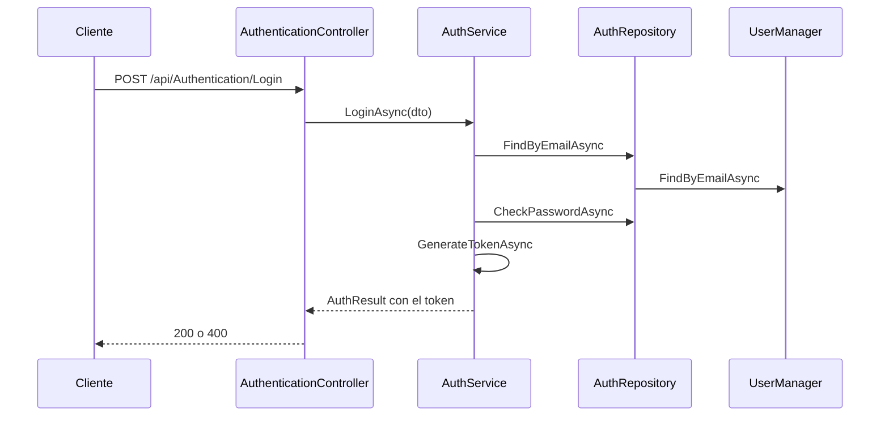
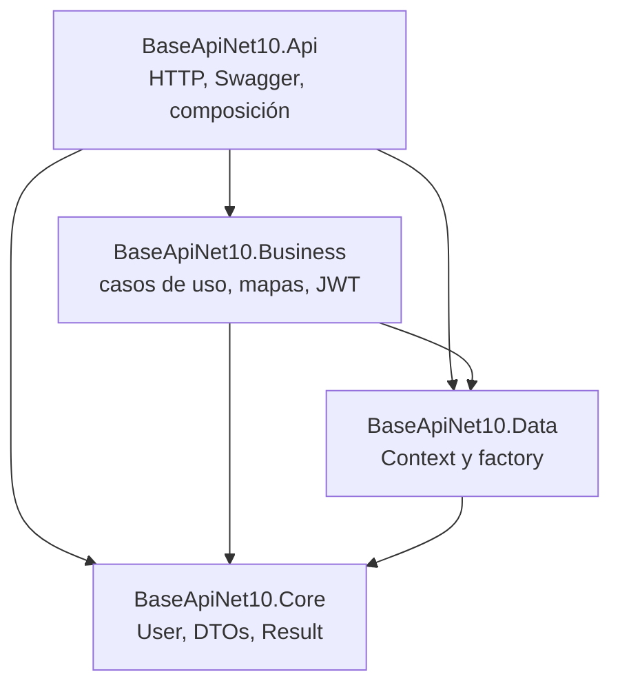

Esta es la primera entrega de la serie **Construyendo APIs por capas**. Aquí explico cómo armo una API de autenticación en .NET 10 para reutilizarla como plantilla. El código de referencia es [BaseApiNetCore10](https://github.com/FeithNoir/BaseApiNetCore10). Cuando el corte de una entidad de negocio se ve mejor en otro repositorio, uso [pasteleriaapi](https://github.com/HugoFernandoColmenares/pasteleriaapi) y, para el punto de partida más viejo, [SchoolAPI](https://github.com/HugoFernandoColmenares/SchoolAPI).

La siguiente entrega, [Spring Boot y JDBC](/post/construyendo-apis-por-capas-spring), repite la misma idea en Java. Donde el código real no coincide con el esquema que tengo en la cabeza, lo digo en el paso correspondiente y lo recojo al final. No voy a fingir que el repositorio está más ordenado de lo que está.

<a id="contenido"></a>

## Contenido

1. [Prerrequisitos](/post/construyendo-apis-por-capas-dotnet#prerrequisitos)
2. [Qué estoy construyendo](/post/construyendo-apis-por-capas-dotnet#que-estoy-construyendo)
3. [Instalar el SDK y los paquetes](/post/construyendo-apis-por-capas-dotnet#instalar-el-sdk)
4. [La solución y las carpetas](/post/construyendo-apis-por-capas-dotnet#solucion-y-carpetas)
5. [SOLID, DRY y KISS en este proyecto](/post/construyendo-apis-por-capas-dotnet#solid-dry-kiss)
6. [Por qué cuatro partes](/post/construyendo-apis-por-capas-dotnet#cuatro-partes)
7. [Entidades y la convención de nombres](/post/construyendo-apis-por-capas-dotnet#entidades)
8. [DTOs separados por uso](/post/construyendo-apis-por-capas-dotnet#dtos)
9. [Contratos](/post/construyendo-apis-por-capas-dotnet#contratos)
10. [La conexión, el factory y los secretos](/post/construyendo-apis-por-capas-dotnet#conexion)
11. [Business: repositorio, servicio y mapeo](/post/construyendo-apis-por-capas-dotnet#business)
12. [Helpers: JWT, hash, correo y errores](/post/construyendo-apis-por-capas-dotnet#helpers)
13. [La API: controladores, Swagger y curl](/post/construyendo-apis-por-capas-dotnet#api)
14. [Cómo agrego una entidad de punta a punta](/post/construyendo-apis-por-capas-dotnet#extender)
15. [Dónde el código no coincide con el esquema](/post/construyendo-apis-por-capas-dotnet#diferencias)
16. [Resumen](/post/construyendo-apis-por-capas-dotnet#resumen)

<a id="prerrequisitos"></a>

## Prerrequisitos

Necesitas esto antes de escribir una línea de la solución:

- SDK de .NET 10. Los paquetes del repositorio están fijados en **10.0.2** (Swashbuckle va en **10.1.0**).
- Un editor. Yo uso la terminal y Visual Studio, pero `dotnet` alcanza.
- `curl` o el archivo `.http` para probar los endpoints.
- SQLite. No instalas un servidor: el proveedor `Microsoft.EntityFrameworkCore.Sqlite` crea el archivo.

En Linux instalo el SDK por el canal 10.0, sin fijar un parche inventado. El script deja el SDK en `$HOME/.dotnet`.

```bash
curl -fsSL https://dot.net/v1/dotnet-install.sh -o /tmp/dotnet-install.sh
bash /tmp/dotnet-install.sh --channel 10.0
echo 'export DOTNET_ROOT="$HOME/.dotnet"' >> ~/.bashrc
echo 'export PATH="$HOME/.dotnet:$PATH"' >> ~/.bashrc
source ~/.bashrc
dotnet --version
```

En Windows uso el instalador del SDK 10 desde [https://dotnet.microsoft.com/download/dotnet/10.0](https://dotnet.microsoft.com/download/dotnet/10.0) y compruebo con `dotnet --version`.

La herramienta de migraciones va aparte, en la misma versión que Entity Framework:

```bash
dotnet tool install --global dotnet-ef --version 10.0.2
dotnet ef --version
```

Si `dotnet ef` no aparece, cierra la terminal y ábrela de nuevo para que tome el path de los tools globales.

<a id="que-estoy-construyendo"></a>

## Qué estoy construyendo

BaseApiNet10 no es la pastelería. Es el cascarón de autenticación que copio cuando empiezo un monolito: registro, login, confirmación de correo, olvido de contraseña, roles y un JWT. La base por defecto es SQLite. La pastelería, en .NET 8, ya tiene ingredientes, recetas, inventario y el mismo corte de proyectos. SchoolAPI es el antepasado: .NET 8, MySQL cableado dentro de `Program.cs`, y la lógica de correo todavía sentada en el proyecto web.

El recorrido de un login, como está escrito hoy, es este:



Guarda este dibujo. Más abajo verás que `FindByEmailAsync` del repositorio lanza si el usuario no existe, así que la flecha no siempre vuelve como un `null` limpio. Lo anoto cuando lleguemos a Business.

<a id="instalar-el-sdk"></a>

## Instalar el SDK y los paquetes

Creo la carpeta de trabajo y la solución en formato `slnx`, que es el que usa el repositorio (`BaseApiNet10.slnx`), no el `.sln` clásico de SchoolAPI.

```bash
mkdir BaseApiNet10 && cd BaseApiNet10
dotnet new sln -n BaseApiNet10 --format slnx
dotnet new webapi -n BaseApiNet10.Api -o BaseApiNet10.Api --use-controllers
dotnet new classlib -n BaseApiNet10.Core -o BaseApiNet10.Core
dotnet new classlib -n BaseApiNet10.Data -o BaseApiNet10.Data
dotnet new classlib -n BaseApiNet10.Business -o BaseApiNet10.Business
dotnet sln BaseApiNet10.slnx add BaseApiNet10.Api/BaseApiNet10.Api.csproj
dotnet sln BaseApiNet10.slnx add BaseApiNet10.Core/BaseApiNet10.Core.csproj
dotnet sln BaseApiNet10.slnx add BaseApiNet10.Data/BaseApiNet10.Data.csproj
dotnet sln BaseApiNet10.slnx add BaseApiNet10.Business/BaseApiNet10.Business.csproj
```

`dotnet new webapi` en .NET 10 genera minimal APIs si no pasas `--use-controllers`. Esta plantilla usa controladores, así que el flag va. Borro el `WeatherForecast` que deja la plantilla: en el repositorio no existe, aunque `BaseApiNet10.Api.http` todavía pide `GET /weatherforecast/`. Ese archivo `.http` quedó viejo. No lo uses como contrato.

Las referencias entre proyectos, en este orden:

```bash
dotnet add BaseApiNet10.Data/BaseApiNet10.Data.csproj reference BaseApiNet10.Core/BaseApiNet10.Core.csproj
dotnet add BaseApiNet10.Business/BaseApiNet10.Business.csproj reference BaseApiNet10.Core/BaseApiNet10.Core.csproj
dotnet add BaseApiNet10.Business/BaseApiNet10.Business.csproj reference BaseApiNet10.Data/BaseApiNet10.Data.csproj
dotnet add BaseApiNet10.Api/BaseApiNet10.Api.csproj reference BaseApiNet10.Business/BaseApiNet10.Business.csproj
dotnet add BaseApiNet10.Api/BaseApiNet10.Api.csproj reference BaseApiNet10.Core/BaseApiNet10.Core.csproj
dotnet add BaseApiNet10.Api/BaseApiNet10.Api.csproj reference BaseApiNet10.Data/BaseApiNet10.Data.csproj
```

Core no referencia a nadie. Data no referencia a Business. Business no referencia a Api. Si mañana Api referencia solo a Business, mejor: hoy el `.csproj` de la API referencia los tres porque `Program.cs` nombra `Context` y los DTO viven en Core.

Paquetes, con las versiones exactas del repositorio. Los ejecuto desde la raíz de la solución.

Core carga Identity porque `User` hereda de `IdentityUser`:

```bash
dotnet add BaseApiNet10.Core package Microsoft.AspNetCore.Identity.UI --version 10.0.2
dotnet add BaseApiNet10.Core package Microsoft.Extensions.Identity.Stores --version 10.0.2
```

Data es Entity Framework, SQLite y el paquete de Identity que conoce el `DbContext`:

```bash
dotnet add BaseApiNet10.Data package Microsoft.AspNetCore.Identity.EntityFrameworkCore --version 10.0.2
dotnet add BaseApiNet10.Data package Microsoft.EntityFrameworkCore --version 10.0.2
dotnet add BaseApiNet10.Data package Microsoft.EntityFrameworkCore.Design --version 10.0.2
dotnet add BaseApiNet10.Data package Microsoft.EntityFrameworkCore.Sqlite --version 10.0.2
dotnet add BaseApiNet10.Data package Microsoft.EntityFrameworkCore.Tools --version 10.0.2
```

Business mapea, firma JWT y manda correo. MailKit 4.14.1 es el que está en el `.csproj`, no una versión “la última”:

```bash
dotnet add BaseApiNet10.Business package AutoMapper --version 14.0.0
dotnet add BaseApiNet10.Business package MailKit --version 4.14.1
dotnet add BaseApiNet10.Business package Microsoft.AspNetCore.Authentication.JwtBearer --version 10.0.2
```

La API publica Swagger y necesita el diseño de EF para las migraciones lanzadas desde el proyecto web. Swashbuckle 10 ya no se instala como un solo metapaquete en esta plantilla: van `SwaggerGen` y `SwaggerUI` por separado, en 10.1.0. pasteleriaapi, en .NET 8, todavía usa el metapaquete `Swashbuckle.AspNetCore` 6.5.0.

```bash
dotnet add BaseApiNet10.Api package Microsoft.AspNetCore.Authentication.JwtBearer --version 10.0.2
dotnet add BaseApiNet10.Api package Microsoft.AspNetCore.OpenApi --version 10.0.2
dotnet add BaseApiNet10.Api package Microsoft.EntityFrameworkCore.Design --version 10.0.2
dotnet add BaseApiNet10.Api package Swashbuckle.AspNetCore.SwaggerGen --version 10.1.0
dotnet add BaseApiNet10.Api package Swashbuckle.AspNetCore.SwaggerUI --version 10.1.0
```

`Microsoft.VisualStudio.Azure.Containers.Tools.Targets` 1.23.0 está en el `.csproj` de la API porque el Dockerfile se depuró desde Visual Studio. Si no vas a abrir el contenedor desde el IDE, puedes omitirlo. El Dockerfile sí está: `mcr.microsoft.com/dotnet/sdk:10.0` para compilar y `mcr.microsoft.com/dotnet/aspnet:10.0` para correr, puertos 8080 y 8081.

User secrets se inicializan en la API. El comando escribe un `UserSecretsId` nuevo. No copies el GUID de mi repositorio: no es una contraseña, pero tampoco te sirve en tu máquina.

```bash
dotnet user-secrets init --project BaseApiNet10.Api/BaseApiNet10.Api.csproj
dotnet user-secrets list --project BaseApiNet10.Api/BaseApiNet10.Api.csproj
```

<a id="solucion-y-carpetas"></a>

## La solución y las carpetas

Cuando termino de acomodar archivos, el árbol queda así. Los `Class1.cs` que genera `dotnet new classlib` se borran.

```text
BaseApiNet10.slnx
BaseApiNet10.Api/
  Controllers/
    AuthenticationController.cs
    RoleController.cs
  Program.cs
  appsettings.json
  appsettings.Development.json
  Properties/launchSettings.json
BaseApiNet10.Core/
  Entities/Models/User.cs
  Entities/Auth/AuthResult.cs
  DTOs/Auth/
    UserRegistrationRequestDto.cs
    UserLoginRequestDto.cs
    UserForggotPasswordRequestDto.cs
    ResetPasswordRequestDto.cs
    ConfirmEmailDto.cs
    RoleDto.cs
  Extensions/
    Result.cs
    PagedList.cs
BaseApiNet10.Data/
  Context.cs
  ContextFactory.cs
  Migrations/
BaseApiNet10.Business/
  Interfaces/Repositories/IRepository.cs
  Interfaces/Repositories/IAuthRepository.cs
  Interfaces/Services/IAuthService.cs
  Repositories/AuthRepository.cs
  Services/AuthService.cs
  MappingProfiles/MappingConfig.cs
  Auxiliar/
    JwtConfig.cs
    SmtpSettings.cs
    EmailServices.cs
    AuthenticationAndEmailServices.cs
  DoI/DependencyInjection.cs
```

El nombre `DoI` es el que usé para la inyección de dependencias. No es “DOI” de un paper: es la carpeta donde vive `AddCustomServices`. En pasteleriaapi el archivo está en el mismo sitio y, además, no tiene `namespace`: es una clase estática global. En BaseApiNet10 `DependencyInjection` sí tiene namespace `BaseApiNet10.Business.DoI`. `ContextFactory`, en cambio, está escrito sin namespace en los dos repos. Por eso `Program.cs` llama `AddDbContext` sin un `using` extra: el método de extensión cae en el espacio global.

<a id="solid-dry-kiss"></a>

## SOLID, DRY y KISS en este proyecto

No los cito para decorar. Los uso para decidir dónde vive cada archivo de esta solución.

**S, una razón para cambiar.** `AuthenticationController` traduce HTTP. `AuthService` decide si el correo ya existe, qué rol se asigna y cómo se arma el token. `AuthRepository` habla con `UserManager`. `Context` habla con SQLite. Si mañana cambio el texto del correo, no abro el controlador. Si cambio la tabla, no abro el servicio.

**O, extender sin reescribir el login.** Un ingrediente nuevo no se mete dentro de `AuthService`. Se agrega otro par interfaz/implementación, como hice en la pastelería con `IIngredientService`. El login se queda quieto.

**L, la implementación cumple el contrato.** `AuthService` implementa `IAuthService`. El problema real está en el registro del contenedor: el controlador pide la clase concreta, no la interfaz. Lo explico en contratos. Mientras tanto, no sustituyas `AuthRepository` por otra clase que lance otras excepciones y esperes que el servicio las entienda: el servicio está escrito como si `FindByEmailAsync` pudiera devolver null, y el repositorio no lo hace.

**I, interfaces chicas.** `IAuthRepository` no tiene `GetAll` ni paginación. Esas operaciones están en `IRepository<T>`, que dejé preparado y que esta API de auth no usa. Meter el reset de contraseña en un repositorio genérico de `User` habría hinchado un contrato que las entidades normales no necesitan.

**D, depender de abstracciones.** El servicio recibe `IAuthRepository`, `IMapper`, `IOptions<JwtConfig>` y `IEmailSender`. No hace `new AuthRepository()` ni abre un `SqliteConnection`. La API depende de eso solo a medias, porque el controlador pide `AuthService` y no `IAuthService`.

**DRY.** El hash de la contraseña no lo escribo otra vez. `UserManager.CreateAsync` y `CheckPasswordAsync` ya usan el `PasswordHasher` de Identity (PBKDF2). Un helper mío de SHA256 al lado sería un segundo mecanismo y, peor, uno peor. El mapeo de registro vive en un solo `CreateMap`. La validación del token vive en `AddJwtBearer`, no copiada en cada acción.

**KISS.** SQLite en un archivo para la plantilla. Un solo esquema JWT, sin issuer ni audience en desarrollo (`ValidateIssuer` y `ValidateAudience` están en `false`, con un comentario que dice que en producción deben ir en `true`). CORS con `AllowAnyOrigin` para no pelear con el front mientras pruebo. Eso es simple. No es la configuración que dejo publicada: un origen abierto no distingue un front mío de cualquier página. Cuando el cliente ya tiene dominio, la política nombra ese origen.

SchoolAPI viola KISS en el arranque: JWT, SMTP, MySQL y AutoMapper están escritos dentro de `Program.cs`. BaseApiNet10 saca eso a dos métodos, `AddDbContext` y `AddCustomAuthenticationAndEmailServices`. El archivo de arranque queda en el orden, no en el detalle.

<a id="cuatro-partes"></a>

## Por qué cuatro partes



| Proyecto | Qué entra | Qué no entra |
| :--- | :--- | :--- |
| Core | Entidades, DTOs, `Result<T>`, `PagedList<T>`, `AuthResult` | EF, HTTP, SMTP, JWT |
| Data | `Context`, `ContextFactory`, migraciones | Reglas de “el correo ya existe”, armado del token |
| Business | Interfaces, repositorios, servicios, AutoMapper, correo, opciones JWT | Atributos de ruta, códigos HTTP |
| Api | `Program.cs`, controladores, Swagger, CORS | SQL, `CreateMap`, `JwtSecurityToken` |

Separo así por tres motivos concretos.

Primero, puedo correr una migración sin levantar un controlador. `dotnet ef` apunta a Data como proyecto y a Api como startup, porque el startup es quien sabe leer configuración.

Segundo, Core se puede referenciar desde un cliente o desde pruebas sin arrastrar MailKit. En la pastelería ese proyecto se llama `Pasteleria.Shared`, no Core. En SchoolAPI la carpeta se llama `SchoolAPI.Share` y el namespace `SchoolAPI.Shared`. El rol es el mismo: tipos que cruzan el borde.

Tercero, Business puede cambiar de SQLite a otro proveedor sin que el controlador se entere, siempre que el repositorio siga cumpliendo la interfaz. Hoy `AuthRepository` ni siquiera usa `Context` directo: usa `UserManager<User>`, y el `UserManager` usa el `Context` por dentro. Data sigue siendo necesario porque `AddIdentity(...).AddEntityFrameworkStores<Context>()` lo exige.

pasteleriaapi reparte igual, con `net8.0` y el paquete `Pomelo.EntityFrameworkCore.MySql` 8.0.3 además de SQLite. El factory deja MySQL comentado y SQLite activo. SchoolAPI no tiene factory: el `UseMySql` está en `Program.cs` con `MySqlServerVersion(new Version(8, 0, 27))`.

<a id="entidades"></a>

## Entidades y la convención de nombres

Esta es la convención que quiero en todos los proyectos de la serie. La tercera columna dice cómo quedó escrito en los repos, porque no siempre obedecí la primera.

| Pieza | Convención | Cómo quedó en el código |
| :--- | :--- | :--- |
| Entidad | Singular, PascalCase, un archivo por clase | `User`, `Ingredient` |
| Clave | `Id`. `Guid` en entidades mías; `string` si hereda de Identity | `User.Id` viene de `IdentityUser`. En la API Java el campo se llama `guid` |
| Auditoría | `CreatedAt`, `UpdatedAt`, `IsDeleted`, `DeletedAt` en una `BaseEntity` | pasteleriaapi sí. `User` de BaseApiNet10 no hereda de `BaseEntity` |
| DTO de alta | `Create{Entidad}Dto` o `{Accion}RequestDto` | `CreateIngredientDto`, `UserRegistrationRequestDto` |
| DTO de listado | `List{Entidad}Dto` | `ListIngredientDto`. Auth no tiene listado de usuarios |
| DTO de detalle | `{Entidad}Dto` | `IngredientDto`, `RoleDto` |
| DTO de edición | `Update{Entidad}Dto` | `UpdateIngredientDto` existe. El `PUT` de ingredientes recibe `IngredientDto` |
| DTO de borrado | No lo uso. El id va en la ruta | `DELETE api/Role/{id}` |
| Repositorio | `I{Entidad}Repository` | `IAuthRepository`, `IIngredientRepository` |
| Servicio | `I{Entidad}Service` | `IAuthService`, `IIngredientService` |
| Controlador | `{Entidad}Controller`, ruta `api/[controller]` | `AuthenticationController` responde en `api/Authentication` |
| Resultado interno | `Result<T>` o un resultado de caso de uso | `AuthResult` en auth, `Result<T>` en la pastelería |
| Sobre HTTP | `ApiResponse<T>` cuando hay paginación y mensaje | pasteleriaapi. BaseApiNet10 devuelve el `AuthResult` directo |

`User` vive en `BaseApiNet10.Core/Entities/Models/User.cs`:

```cs
using Microsoft.AspNetCore.Identity;
using System.ComponentModel.DataAnnotations;

namespace BaseApiNet10.Core.Entities.Models
{
    public class User : IdentityUser
    {
        [Required]
        public string FirstName { get; set; } = string.Empty;
        [Required]
        public string LastName { get; set; } = string.Empty;
        public string FullName { get; set; } = string.Empty;
        public string Company { get; set; } = string.Empty;
        public string Charge { get; set; } = string.Empty;
        public string Gender { get; set; } = string.Empty;
    }
}
```

Identity ya trae `Id`, `Email`, `UserName`, `PasswordHash`, `EmailConfirmed` y el resto de columnas de `AspNetUsers`. Yo agrego nombre, empresa y cargo. `Gender` está en la entidad y no está en el DTO de registro: hoy nadie lo llena por la API.

`Charge` es el cargo de la persona, no un cobro. Lo dejé con esa palabra en el modelo y en el claim del token.

La migración `init` que está commiteada crea las tablas estándar de Identity (`AspNetUsers`, `AspNetRoles`, `AspNetUserRoles` y las de claims, logins y tokens). No crea `FirstName`, `LastName`, `FullName`, `Company`, `Charge` ni `Gender`. El `ContextModelSnapshot` tampoco las tiene. El modelo de clases y la migración quedaron desfasados. Si corres `database update` sobre ese `init` y después registras un usuario, EF va a querer escribir columnas que SQLite no tiene.

Después de definir `User`, genera otra migración. No reutilices a ciegas el `init` viejo si estás creando la base de cero y ya tienes las propiedades en la clase: borra la carpeta `Migrations` solo si todavía no hay un entorno con datos, y genera una sola migración limpia. Si ya hay datos, agrega una migración nueva:

```bash
cd BaseApiNet10.Api
dotnet ef migrations add UserProfile \
  --project ../BaseApiNet10.Data/BaseApiNet10.Data.csproj \
  --startup-project .
dotnet ef database update \
  --project ../BaseApiNet10.Data/BaseApiNet10.Data.csproj \
  --startup-project .
```

Ese es el mismo comando que documenta el README para aplicar migraciones, con el proyecto de Data explícito.

<a id="dtos"></a>

## DTOs separados por uso

Un DTO no es “la entidad con otro nombre”. Es el contrato de una operación. Si reutilizo `User` en el `POST` de registro, el cliente puede mandar `PasswordHash`, `EmailConfirmed` o un `Id` ajeno. Identity igual ignora parte de eso, pero el modelo de entrada queda mintiendo.

Razones técnicas, no de estilo:

- El alta lleva `Password`. El detalle jamás lo devuelve. El login solo lleva correo y contraseña.
- El listado de una tabla de admin no necesita las navegaciones. En ingredientes, `ListIngredientDto` omite proveedor y descripción larga.
- El update a veces no debe poder cambiar el id, o debe poder cambiar campos que el alta calcula.
- La validación (`[Required]`, rangos) vive en el DTO de entrada. La entidad guarda invariantes de persistencia.

En esta plantilla de auth los nombres salen por caso de uso, no por el patrón `EntityGetByIdDto`. El archivo de registro calcula `FullName` y `UserName` para no pedírselos al cliente:

```cs
namespace BaseApiNet10.Core.DTOs.Auth
{
    public class UserRegistrationRequestDto
    {
        private string _firstName = string.Empty;
        private string _lastName = string.Empty;

        public string FirstName
        {
            get => _firstName;
            set
            {
                _firstName = value;
                UpdateFullName();
                UpdateUserName();
            }
        }

        public string LastName
        {
            get => _lastName;
            set
            {
                _lastName = value;
                UpdateFullName();
                UpdateUserName();
            }
        }

        public string Charge { get; set; } = string.Empty;
        public string Company { get; set; } = string.Empty;
        public string Email { get; set; } = string.Empty;
        public string Password { get; set; } = string.Empty;
        public string FullName { get; private set; } = string.Empty;
        public string UserName { get; private set; } = string.Empty;

        private void UpdateFullName()
        {
            FullName = $"{_firstName} {_lastName}".Trim();
        }

        private void UpdateUserName()
        {
            if (!string.IsNullOrEmpty(_firstName))
            {
                UserName = $"{_firstName[0]}{_lastName}".ToLower();
            }
        }
    }
}
```

`Hugo` + `Colmenares` produce el usuario `hcolmenares`. La inicial se toma de `FirstName` sin revisar cultura ni caracteres de más de una unidad. Es KISS, y se queda corto con nombres vacíos o con símbolos.

Login y el resto son bolsas de datos. El typo `Forggot` está en el nombre de la clase. Lo dejé así en el repo; si lo renombras, cambia también el `using` del controlador y la interfaz.

```cs
using System.ComponentModel.DataAnnotations;

namespace BaseApiNet10.Core.DTOs.Auth
{
    public class UserLoginRequestDto
    {
        [Required]
        public string Email { get; set; } = string.Empty;
        [Required]
        public string Password { get; set; } = string.Empty;
    }

    public class UserForggotPasswordRequestDto
    {
        [Required]
        public string Email { get; set; } = string.Empty;
    }

    public class ResetPasswordRequestDto
    {
        public string Email { get; set; } = string.Empty;
        public string Token { get; set; } = string.Empty;
        public string Password { get; set; } = string.Empty;
    }

    public class ConfirmEmailDto
    {
        public string UserId { get; set; } = string.Empty;
        public string Code { get; set; } = string.Empty;
    }

    public class RoleDto
    {
        public string Name { get; set; } = string.Empty;
    }
}
```

No hay `UserDeleteDto`. Borrar un usuario no está expuesto. Borrar un rol usa el id de la ruta.

`AuthResult` es la respuesta de estos casos, no un DTO de entidad:

```cs
namespace BaseApiNet10.Core.Entities.Auth
{
    public class AuthResult
    {
        public string Token { get; set; } = string.Empty;
        public string Message { get; set; } = string.Empty;
        public bool Result { get; set; }
        public List<string> Errors { get; set; } = new List<string>();
    }
}
```

`Result<T>` y `PagedList<T>` están en Core aunque el login no los use. Los escribí para las listas de administración. La pastelería sí los usa: `GetAllIngredientsAsync` devuelve `Result<PagedList<ListIngredientDto>>`.

<a id="contratos"></a>

## Contratos

En el esquema que recuerdo, `IRepository` e `IService` viven en Data. En este código no. Viven en Business:

- `BaseApiNet10.Business/Interfaces/Repositories/IRepository.cs`
- `BaseApiNet10.Business/Interfaces/Repositories/IAuthRepository.cs`
- `BaseApiNet10.Business/Interfaces/Services/IAuthService.cs`

Data solo conoce el contexto. El repositorio de auth no consulta un `DbSet<User>`: envuelve `UserManager`. Poner esa interfaz en Data me obligaría a meter Identity UI en un proyecto cuyo trabajo es SQLite, o a hacer que Data dependa de Business. La dirección queda Business → Data, nunca al revés.

El genérico que dejé listo:

```cs
namespace BaseApiNet10.Business.Interfaces.Repositories
{
    public interface IRepository<T> where T : class
    {
        Task<List<T>> GetAll();
        Task<T> GetById(string id);
        Task Create(T entity);
        Task Update(T entity);
        Task Delete(T entity);
    }
}
```

`AuthRepository` no lo implementa. Auth tiene operaciones que un CRUD no tiene: token de confirmación, token de reset, chequear contraseña, leer roles. Forzarlas en `IRepository<User>` ensucia el contrato de ingredientes. En SchoolAPI el genérico de servicio sí existe, `IService<T>` con `AddRegisterAsync`, `EditRegisterAsync`, `GetAllAsync`, `GetByIdAsync` y `DeleteRegisterAsync`, y devuelve `APIResponse`. La pastelería abandonó ese genérico y escribió `IIngredientRepository` con `Guid`, paginación y borrado lógico. Las dos ideas conviven en mi historial. Para una entidad nueva sigo la de la pastelería, no el `IRepository<T>` de string que BaseApiNet10 no usa.

```cs
public interface IAuthRepository
{
    Task<User> FindByEmailAsync(string email);
    Task<User> FindByIdAsync(string userId);
    Task<IdentityResult> CreateUserAsync(User user, string password);
    Task<IdentityResult> AddToRoleAsync(User user, string role);
    Task<IdentityResult> ConfirmEmailAsync(User user, string token);
    Task<string> GenerateEmailConfirmationTokenAsync(User user);
    Task<string> GeneratePasswordResetTokenAsync(User user);
    Task<IdentityResult> ResetPasswordAsync(User user, string token, string newPassword);
    Task<bool> CheckPasswordAsync(User user, string password);
    Task<IList<string>> GetRolesAsync(User user);
}

public interface IAuthService
{
    Task<AuthResult> RegisterAsync(UserRegistrationRequestDto request, string baseUrl);
    Task<AuthResult> ForgotPasswordAsync(UserForggotPasswordRequestDto request);
    Task<AuthResult> ResetPasswordAsync(ResetPasswordRequestDto model);
    Task<AuthResult> LoginAsync(UserLoginRequestDto dto);
    Task<AuthResult> ConfirmEmailAsync(string userId, string code);
}
```

La abstracción sirve para probar el servicio con un doble del repositorio y para cambiar Identity de sitio sin reescribir el controlador. En la práctica, el registro del contenedor todavía no usa la interfaz del servicio:

```cs
services.AddAutoMapper(typeof(MappingConfig));
services.AddScoped<IAuthRepository, AuthRepository>();
services.AddScoped<AuthService>();
```

`AddScoped<AuthService>()` registra la clase. `AuthenticationController` pide `AuthService`, no `IAuthService`. La interfaz existe y la clase la implementa, pero el contenedor no está obligado a pasar por ella. En pasteleriaapi sí registré `AddScoped<IAuthService, AuthService>()` y `AddScoped<IIngredientService, IngredientService>()`, y el controlador de ingredientes pide la interfaz. Si extiendes BaseApiNet10, registra la interfaz. El código publicado de auth no lo hace.

<a id="conexion"></a>

## La conexión, el factory y los secretos

No abro la base en el controlador y no dejo el `UseSqlite` largo dentro de `Program.cs`. El factory es un método de extensión sobre `IServiceCollection`. `Program.cs` solo lo invoca. Sigue siendo el composition root: alguien tiene que llamar al método. La diferencia con SchoolAPI es que el detalle del proveedor se fue de `Program.cs`.

`BaseApiNet10.Data/ContextFactory.cs` no tiene namespace:

```cs
using BaseApiNet10.Data;
using Microsoft.EntityFrameworkCore;
using Microsoft.Extensions.Configuration;
using Microsoft.Extensions.DependencyInjection;

public static class ContextFactory
{
    public static void AddDbContext(this IServiceCollection services, IConfiguration configuration)
    {
        services.AddDbContext<Context>((serviceProvider, options) =>
        {
            options.UseSqlite(configuration.GetConnectionString("connection"));
        });
    }
}
```

La clave que lee el factory es `ConnectionStrings:connection`. En el `appsettings.json` del repositorio la clave está escrita `conection`, sin la segunda `n`. Esas dos cadenas no son la misma clave. Si copias el JSON del repo y no alineas el nombre, `GetConnectionString("connection")` vuelve null y SQLite no abre donde crees. En un proyecto nuevo usa `connection` en los tres sitios: JSON, user-secrets y factory.

`Context` además hace esto:

```cs
public class Context : IdentityDbContext<User, IdentityRole, string>
{
    public Context(DbContextOptions options) : base(options) { }

    protected override void OnConfiguring(DbContextOptionsBuilder optionsBuilder)
    {
        optionsBuilder.UseSqlite();
    }
}
```

Ese `UseSqlite()` no lleva cadena. La cadena la pone el factory. En un proyecto nuevo no copies la llamada vacía: deja el proveedor solo en el factory. La dejo anotada porque en el archivo del repo las dos conviven.

`appsettings.json` lleva forma y valores que no son secretos. La cadena y la firma del JWT no van aquí.

```json
{
  "Logging": {
    "LogLevel": {
      "Default": "Information",
      "Microsoft.AspNetCore": "Warning"
    }
  },
  "AllowedHosts": "*",
  "ConnectionStrings": {
    "connection": ""
  },
  "JwtConfig": {
    "ExpiryTime": "01:00"
  },
  "SmtpSettings": {
    "Server": "",
    "Port": 587,
    "SenderName": "",
    "SenderEmail": "",
    "UserName": "",
    "Password": ""
  }
}
```

Los valores reales se cargan con user-secrets en desarrollo. El orden de ASP.NET Core hace que user-secrets pisen el JSON cuando el entorno es Development. En producción uso variables de entorno, con el mismo nombre de clave y doble guion bajo:

```bash
cd BaseApiNet10.Api
dotnet user-secrets set "ConnectionStrings:connection" "Data Source=base_api_net_ten.db"
dotnet user-secrets set "JwtConfig:Secret" "cambia-esta-cadena-por-una-larga-y-aleatoria"
dotnet user-secrets set "SmtpSettings:Server" "smtp.example.com"
dotnet user-secrets set "SmtpSettings:Port" "587"
dotnet user-secrets set "SmtpSettings:SenderName" "Base API"
dotnet user-secrets set "SmtpSettings:SenderEmail" "noreply@example.com"
dotnet user-secrets set "SmtpSettings:UserName" "smtp-user"
dotnet user-secrets set "SmtpSettings:Password" "smtp-password-de-tu-proveedor"
```

En un servidor:

```bash
export ConnectionStrings__connection="Data Source=/var/lib/baseapi/app.db"
export JwtConfig__Secret="cambia-esta-cadena-por-una-larga-y-aleatoria"
export SmtpSettings__Password="smtp-password-de-tu-proveedor"
```

Esos valores de ejemplo no son los de ningún entorno mío. Genera el secreto JWT con algo como `openssl rand -base64 48` y no lo pegues en el JSON.

Por qué el secreto no va en `appsettings` aunque el archivo “solo esté en tu máquina”: ese JSON se commitea. Un secreto dentro de un commit se queda en el historial aunque el siguiente commit lo borre. Quien clona el repositorio, o quien lee un fork viejo, se lo lleva. User-secrets viven fuera del árbol, en el perfil del usuario, y las variables de entorno las inyecta el host. El `.csproj` ya marca `UserSecretsId` para que el host de desarrollo las lea. No hace falta repetirlas en `appsettings.Development.json`: el de este repo solo baja el nivel de log.

El perfil HTTP escucha en `http://localhost:5293`. El HTTPS, en `https://localhost:7219` y también en el 5293. Está en `Properties/launchSettings.json`.

Si más adelante apuntas a MySQL, no pegues la contraseña en el JSON. El factory de la pastelería ya tiene el hueco, comentado, con la versión de servidor que usaba SchoolAPI:

```cs
options.UseSqlite(configuration.GetConnectionString("connection"));
// options.UseMySql(
//     configuration.GetConnectionString("connection"),
//     new MySqlServerVersion(new Version(8, 0, 27)));
```

La cadena de MySQL, el día que la actives, sale de user-secrets:

```bash
dotnet user-secrets set "ConnectionStrings:connection" \
  "Server=localhost;Port=3306;Database=pasteleria;User=app;Password=pon-aqui-la-clave"
```

<a id="business"></a>

## Business: repositorio, servicio y mapeo

El repositorio es el único que conoce `UserManager`. No formatea HTTP. El servicio sí transforma: DTO a entidad, entidad a token, errores de Identity a una lista de strings.

```cs
public class AuthRepository : IAuthRepository
{
    private readonly UserManager<User> _userManager;

    public AuthRepository(UserManager<User> userManager)
    {
        _userManager = userManager;
    }

    public async Task<User> FindByEmailAsync(string email)
    {
        return await _userManager.FindByEmailAsync(email) ?? throw new Exception("User Not Found");
    }

    public async Task<IdentityResult> CreateUserAsync(User user, string password)
    {
        return await _userManager.CreateAsync(user, password);
    }

    public async Task<bool> CheckPasswordAsync(User user, string password)
    {
        return await _userManager.CheckPasswordAsync(user, password);
    }

    // El resto delega igual: AddToRole, ConfirmEmail, tokens de correo y reset, GetRoles.
}
```

`FindByEmailAsync` y `FindByIdAsync` lanzan si Identity devuelve null. El servicio, en cambio, está escrito así:

```cs
var emailExist = await _authRepository.FindByEmailAsync(request.Email);
if (emailExist != null)
{
    return new AuthResult
    {
        Result = false,
        Errors = new List<string> { "Ya existe este correo." }
    };
}
```

Esa rama no corre cuando el correo no existe: la excepción sale antes. Cuando el correo sí existe, `FindByEmail` devuelve el usuario y el servicio responde 400 con “Ya existe este correo.”. Cuando no existe, el cliente recibe el error no controlado de la excepción, no un `AuthResult`. Lo mismo pasa en olvido de contraseña, reset y confirmación: todos preguntan por null. Login pregunta null y además `CheckPasswordAsync`; si el correo no está, tampoco llega a la comparación, lanza.

Lo dejo escrito como está para que veas el código del repo, y lo marco como algo que hay que corregir antes de copiar la plantilla a un producto: el repositorio debería devolver `User?` y el servicio decidir el `AuthResult`. Si cambias solo el servicio, la excepción sigue ganando.

El alta, cuando el usuario sí se crea:

```cs
var newUser = _mapper.Map<User>(request);
var isCreated = await _authRepository.CreateUserAsync(newUser, request.Password);

if (isCreated.Succeeded)
{
    await _authRepository.AddToRoleAsync(newUser, "Visitante");
    await SendVerificationEmail(newUser, baseUrl);
    return new AuthResult { Result = true };
}
```

`CreateAsync` hashea la contraseña. No guardo `request.Password` en la entidad. El rol `"Visitante"` tiene que existir antes. Esta plantilla no lo siembra. La pastelería siembra `Visitor`, `User` y `Admin` en `OnModelCreating`, y el nombre no coincide con `"Visitante"`. Crea el rol por la API de roles antes del primer registro, o `AddToRoleAsync` falla y el usuario puede quedar creado sin rol, porque el alta ya hizo `CreateAsync`.

El mapa es chico. AutoMapper 14 se registra con `AddAutoMapper(typeof(MappingConfig))`.

```cs
public class MappingConfig : Profile
{
    public MappingConfig()
    {
        CreateMap<UserRegistrationRequestDto, User>()
            .ForMember(dest => dest.FullName, opt => opt.MapFrom(src => src.FullName))
            .ForMember(dest => dest.UserName, opt => opt.MapFrom(src => src.UserName));
    }
}
```

`FullName` y `UserName` tienen setter privado. El `ForMember` está ahí para dejar explícito que salen del DTO. El resto de las propiedades con el mismo nombre (`FirstName`, `LastName`, `Email`, `Charge`, `Company`) las copia por convención. `Password` no está en `User`: Identity la recibe como argumento aparte. `Gender` no está en el DTO, así que queda vacío.

`DependencyInjection.AddCustomServices` es el método que `Program.cs` llama después del factory. No registra el `DbContext`. No registra JWT. Cada helper tiene su método para que el arranque se lea de arriba hacia abajo.

<a id="helpers"></a>

## Helpers: JWT, hash, correo y errores

### Hash

No hay una clase `PasswordHasher` mía. El hash ocurre dentro de `UserManager.CreateAsync(user, password)` y la verificación dentro de `CheckPasswordAsync`. Las opciones de contraseña de Identity quedan en el default porque `AddIdentity` no las cambia: largo mínimo 6, dígito, minúscula, mayúscula y un carácter que no sea letra ni número. `RequireConfirmedAccount` está en `false`. Aun así, `LoginAsync` rechaza el login si `EmailConfirmed` es false. Son dos interruptores distintos. El de Identity no reemplaza el `if` del servicio.

### JWT

`JwtConfig` solo tiene `Secret`. `ExpiryTime` está en configuración (`01:00`) y `GenerateTokenAsync` no lo lee: el token vence con `DateTime.UtcNow.AddHours(1)`. Si cambias el JSON, el token no se entera.

La firma se registra en `AuthenticationAndEmailServices`:

```cs
services.Configure<JwtConfig>(configuration.GetSection("JwtConfig"));
services.Configure<SmtpSettings>(configuration.GetSection("SmtpSettings"));
services.AddSingleton<IEmailSender, EmailServices>();

services.AddAuthentication(options =>
{
    options.DefaultAuthenticateScheme = JwtBearerDefaults.AuthenticationScheme;
    options.DefaultChallengeScheme = JwtBearerDefaults.AuthenticationScheme;
    options.DefaultScheme = JwtBearerDefaults.AuthenticationScheme;
})
.AddJwtBearer(jwt =>
{
    var key = Encoding.ASCII.GetBytes(
        configuration.GetSection("JwtConfig:Secret").Value
        ?? throw new Exception("Error finding JWT Configuration."));

    jwt.SaveToken = true;
    jwt.TokenValidationParameters = new TokenValidationParameters
    {
        ValidateIssuerSigningKey = true,
        IssuerSigningKey = new SymmetricSecurityKey(key),
        ValidateIssuer = false,
        ValidateAudience = false,
        RequireExpirationTime = false,
        ValidateLifetime = true,
    };
});
```

Si el secreto no está, la API no arranca: el `throw` es a propósito. Mejor fallar al componer el host que firmar con una clave vacía. `Encoding.ASCII` en la validación y `Encoding.UTF8` al firmar coinciden mientras el secreto sea ASCII. Un secreto con caracteres fuera de ASCII no va a validar igual de los dos lados. Genera el secreto en base64 o en hex.

El token se arma en el servicio, no en el controlador:

```cs
private async Task<string> GenerateTokenAsync(User user)
{
    var roles = await _authRepository.GetRolesAsync(user);
    var roleClaim = roles.FirstOrDefault() ?? "Visitante";

    var claims = new List<Claim>
    {
        new Claim("id", user.Id),
        new Claim(JwtRegisteredClaimNames.Sub, user.FullName),
        new Claim(JwtRegisteredClaimNames.Email, user.Email ?? ""),
        new Claim(JwtRegisteredClaimNames.Jti, Guid.NewGuid().ToString()),
        new Claim(JwtRegisteredClaimNames.Iat, DateTime.Now.ToUniversalTime().ToString()),
        new Claim("Role", roleClaim)
    };

    if (!string.IsNullOrEmpty(user.FirstName)) claims.Add(new Claim("FirstName", user.FirstName));
    if (!string.IsNullOrEmpty(user.LastName)) claims.Add(new Claim("LastName", user.LastName));
    if (!string.IsNullOrEmpty(user.Charge)) claims.Add(new Claim("Charge", user.Charge));
    if (!string.IsNullOrEmpty(user.Gender)) claims.Add(new Claim("Gender", user.Gender));

    var key = new SymmetricSecurityKey(Encoding.UTF8.GetBytes(_jwtConfig.Secret));
    var credentials = new SigningCredentials(key, SecurityAlgorithms.HmacSha256);
    var token = new JwtSecurityToken(
        claims: claims,
        expires: DateTime.UtcNow.AddHours(1),
        signingCredentials: credentials);

    return new JwtSecurityTokenHandler().WriteToken(token);
}
```

No hay issuer ni audience. El claim de rol se llama `"Role"`, no `ClaimTypes.Role`. Un `[Authorize(Roles = "Visitante")]` no va a ver ese claim hasta que le digas al `JwtBearer` cuál es el `RoleClaimType`, o hasta que emitas `ClaimTypes.Role`. Hoy, además, ningún controlador tiene `[Authorize]`. La autenticación está en el pipeline y los endpoints están abiertos. `UseAuthentication` y `UseAuthorization` corren, y no hay nada que los consulte.

Eso alcanza para entregar un token a un front. No alcanza para proteger `RoleController`. Cuando cierres la plantilla, el orden en `Program.cs` ya es el correcto: CORS, redirección, autenticación, autorización, controladores. Falta el atributo y alinear el nombre del claim.

### Correo

`EmailServices` implementa `IEmailSender` con MailKit. `SmtpSettings` tiene `Port`. `ConnectAsync` solo recibe el servidor:

```cs
await client.ConnectAsync(_smtpSettings.Server);
await client.AuthenticateAsync(_smtpSettings.UserName, _smtpSettings.Password);
```

El puerto de la configuración no entra en esa llamada. Si tu proveedor no escucha en el puerto por defecto de MailKit, el envío falla aunque `SmtpSettings:Port` esté bien. Al corregirlo, pasa el puerto y `SecureSocketOptions` según el proveedor. No dejes la contraseña SMTP en el JSON.

El cuerpo del correo de confirmación arma una URL con `baseUrl`. En el controlador, `baseUrl` es un campo de instancia inicializado en `""` y nunca se asigna desde el request. El enlace sale como `/confirm-email?userId=...&code=...`, sin host. El código del token sí se codifica en Base64 URL con `WebEncoders`, y `ConfirmEmailAsync` lo decodifica antes de pasarlo a Identity. Esa parte está bien. El host no.

### Errores

BaseApiNet10 no tiene un manejador global. Una excepción del repositorio sale como error de servidor. La pastelería, en `Pasteleria.Api/Middleware/GlobalExceptionHandler.cs`, implementa `IExceptionHandler`, lo registra con `AddExceptionHandler<GlobalExceptionHandler>()` y `AddProblemDetails()`, y al inicio del pipeline llama `app.UseExceptionHandler()`. La respuesta es un `ApiResponse<object>` con `IsSuccess = false` y el mensaje. No copies el `exception.Message` crudo a producción si puede incluir detalle de SQL; en esa clase hoy sí se incluye, para desarrollo.

`Result<T>` es el helper para errores esperados, los que no son excepciones: no encontrado, validación de negocio.

```cs
public static Result<T> Success(T data) => new Result<T>(true, data, new List<string>());
public static Result<T> Failure(List<string> errors) => new Result<T>(false, default, errors);
```

Auth usa `AuthResult` en lugar de `Result<T>`. Misma idea, otro tipo: `Result` booleano, `Token`, `Message`, `Errors`.

<a id="api"></a>

## La API: controladores, Swagger y curl

`Program.cs` queda como composición. El comentario del repo dice que el contexto entra “utilizando ContextFactory”.

```cs
var builder = WebApplication.CreateBuilder(args);

builder.Services.AddControllers();
builder.Services.AddEndpointsApiExplorer();
builder.Services.AddSwaggerGen(options =>
{
    options.SwaggerDoc("v1", new OpenApiInfo { Title = "BaseApiNet10", Version = "v1" });
});

builder.Services.AddDbContext(builder.Configuration);
builder.Services.AddCustomServices();
builder.Services.AddCustomAuthenticationAndEmailServices(builder.Configuration);

builder.Services.AddIdentity<User, IdentityRole>(options =>
{
    options.SignIn.RequireConfirmedAccount = false;
})
.AddEntityFrameworkStores<Context>()
.AddDefaultTokenProviders();

builder.Services.AddCors(options =>
{
    options.AddPolicy("CorsPolicy", policy =>
        policy.AllowAnyOrigin().AllowAnyMethod().AllowAnyHeader());
});

var app = builder.Build();

if (app.Environment.IsDevelopment())
{
    app.UseSwagger();
    app.UseSwaggerUI(options =>
    {
        options.SwaggerEndpoint("v1/swagger.json", "BaseApiNet10 V1");
    });
}

app.UseCors("CorsPolicy");
app.UseHttpsRedirection();
app.UseAuthentication();
app.UseAuthorization();
app.MapControllers();
app.Run();
```

Swagger solo en Development. Con el perfil `http`:

```bash
cd BaseApiNet10.Api
dotnet run --launch-profile http
```

Abre `http://localhost:5293/swagger`. El documento sale de Swashbuckle, no del `MapOpenApi` de la plantilla mínima. `Microsoft.AspNetCore.OpenApi` está referenciado; el UI que uso es el de Swagger.

`AuthenticationController` traduce `AuthResult.Result` a 200 o 400. Pide la clase `AuthService`.

| Método y ruta | Cuerpo | Qué hace |
| :--- | :--- | :--- |
| `POST /api/Authentication/Register` | `UserRegistrationRequestDto` | Crea el usuario, intenta el rol Visitante y el correo |
| `POST /api/Authentication/Login` | `UserLoginRequestDto` | Devuelve el JWT si el correo está confirmado |
| `POST /api/Authentication/ForgotPassword` | `UserForggotPasswordRequestDto` | Devuelve el token de reset en el JSON |
| `POST /api/Authentication/ResetPassword` | `ResetPasswordRequestDto` | Aplica el token y la clave nueva |
| `POST /api/Authentication/ConfirmEmail` | `ConfirmEmailDto` | Decodifica el código y confirma |

`RoleController` no pasa por un servicio. Inyecta `RoleManager<IdentityRole>` y hace el CRUD ahí. Es el atajo que la separación en cuatro proyectos intenta evitar. Funciona para una tabla de catálogo de dos campos. En cuanto el rol tenga reglas, ese controlador va a crecer hacia Business. El `PUT` declara `Put(string id, [FromBody] RoleDto updateDto)` sin `{id}` en la ruta. El id hay que mandarlo como query (`?id=`) o el valor llega vacío. El `GET` y el `DELETE` sí usan `{id}`.

`ConfirmEmail` mira `Errors.Count`, no `Result`. Si la confirmación falla y el servicio solo llena `Message` (es lo que pasa cuando Identity rechaza el token), `Errors` sigue vacío y el controlador responde 200. Revisa `Result` además de la lista.

El token de reset sale en el cuerpo de `ForgotPassword`. En un producto eso se manda solo por correo. Aquí el servicio ni siquiera llama a `IEmailSender` en el olvido: devuelve el token para poder probar el flujo sin SMTP. Úsalo en local, no lo dejes así de cara a internet.

Pruebas con curl. Primero el rol, después el alta. La contraseña de ejemplo cumple el default de Identity. No es una clave de ningún entorno.

```bash
curl -s -X POST http://localhost:5293/api/Role \
  -H 'Content-Type: application/json' \
  -d '{"name":"Visitante"}'
```

```bash
curl -s -X POST http://localhost:5293/api/Authentication/Register \
  -H 'Content-Type: application/json' \
  -d '{
    "firstName": "Hugo",
    "lastName": "Colmenares",
    "charge": "Desarrollador",
    "company": "Taller",
    "email": "hugo@example.com",
    "password": "Clave.Segura1"
  }'
```

Si la base no tiene las columnas de perfil, este `POST` falla al guardar. Corrige la migración antes de culpar al DTO. Si el rol no existe, mira la respuesta de Identity dentro de `errors`.

El login responde que hay que confirmar el correo. En local puedes marcar `EmailConfirmed` en SQLite para seguir, o completar `ConfirmEmail` con el código que habría ido en el enlace. Cuando ya esté confirmado:

```bash
curl -s -X POST http://localhost:5293/api/Authentication/Login \
  -H 'Content-Type: application/json' \
  -d '{"email":"hugo@example.com","password":"Clave.Segura1"}'
```

El JSON trae `token`, `result` y `errors`. Para llamar un endpoint que más adelante marques con `[Authorize]`:

```bash
curl -s http://localhost:5293/api/Role \
  -H "Authorization: Bearer PEGA_AQUI_EL_TOKEN"
```

Hoy ese header no cambia la respuesta de `Role`, porque el controlador no exige autenticación. Lo dejo en el ejemplo para cuando cierres el atributo.

Olvido y reset:

```bash
curl -s -X POST http://localhost:5293/api/Authentication/ForgotPassword \
  -H 'Content-Type: application/json' \
  -d '{"email":"hugo@example.com"}'

curl -s -X POST http://localhost:5293/api/Authentication/ResetPassword \
  -H 'Content-Type: application/json' \
  -d '{
    "email": "hugo@example.com",
    "token": "PEGA_EL_TOKEN_DEL_PASO_ANTERIOR",
    "password": "OtraClave.Segura2"
  }'
```

<a id="extender"></a>

## Cómo agrego una entidad de punta a punta

Auth no es el mejor ejemplo de un alta completa: el usuario ya trae el molde de Identity. Cuando agregué ingredientes en pasteleriaapi seguí este corte. Los namespaces de ese repo son `Pasteleria.Shared`, `Pasteleria.Data`, `Pasteleria.Business` y `Pasteleria.Api`, en `net8.0`. Si lo portas a la plantilla .NET 10, Shared se vuelve Core y el target pasa a `net10.0`. El orden de los archivos es el mismo.

1. La entidad en Shared (o Core), colgando de `BaseEntity` con `Guid` e `IsDeleted`.
2. Los DTOs `Create`, `List`, detalle y `Update` en el mismo proyecto.
3. `DbSet` y filtro global `!IsDeleted` en el `Context`.
4. Interfaz del repositorio en Business, no en Data.
5. Implementación que usa el `Context` inyectado. El borrado marca `IsDeleted` y `DeletedAt`. Para encontrar un registro ya borrado uso `IgnoreQueryFilters`.
6. Interfaz del servicio que devuelve `Result<T>` y habla en DTOs.
7. Implementación que mapea con AutoMapper, asigna el `Guid` y no deja salir la entidad.
8. `AddScoped` de las dos interfaces en `AddCustomServices`.
9. Controlador que solo ve `IIngredientService` y envuelve todo en `ApiResponse<T>`.
10. Migración nueva y un curl por verbo.

La entidad:

```cs
public class BaseEntity
{
    public Guid Id { get; set; }
    public DateTime CreatedAt { get; set; } = DateTime.UtcNow;
    public DateTime? UpdatedAt { get; set; }
    public bool IsDeleted { get; set; } = false;
    public DateTime? DeletedAt { get; set; }
}

public class Ingredient : BaseEntity
{
    public string Name { get; set; } = string.Empty;
    public string Description { get; set; } = string.Empty;
    public decimal CostPerUnit { get; set; }
    public string Unit { get; set; } = string.Empty;
    public double Presentation { get; set; }
    public string SupplierInfo { get; set; } = string.Empty;
    public ICollection<RecipeIngredient> RecipeIngredients { get; set; } = new List<RecipeIngredient>();
    public ICollection<InventoryItem> InventoryItems { get; set; } = new List<InventoryItem>();
}
```

DTOs reales del archivo `IngredientDto.cs`. `UpdateIngredientDto` está definido. El `PUT` del controlador no lo usa: recibe `IngredientDto` y compara el id de la ruta con `ingredientDto.Id`.

```cs
public class CreateIngredientDto
{
    public string Name { get; set; } = string.Empty;
    public string Description { get; set; } = string.Empty;
    public decimal CostPerUnit { get; set; }
    public string Unit { get; set; } = string.Empty;
    public string SupplierInfo { get; set; } = string.Empty;
}

public class ListIngredientDto
{
    public Guid Id { get; set; }
    public string Name { get; set; } = string.Empty;
    public string Description { get; set; } = string.Empty;
    public decimal CostPerUnit { get; set; }
    public string Unit { get; set; } = string.Empty;
}

public class IngredientDto
{
    public Guid Id { get; set; }
    public string Name { get; set; } = string.Empty;
    public string Description { get; set; } = string.Empty;
    public decimal CostPerUnit { get; set; }
    public string Unit { get; set; } = string.Empty;
    public string SupplierInfo { get; set; } = string.Empty;
}
```

`Presentation` está en la entidad y no entra en estos DTOs. El listado tampoco lleva `SupplierInfo`. Esa es la razón del corte: cada pantalla ve un subconjunto.

El filtro y el set:

```cs
modelBuilder.Entity<Ingredient>().HasQueryFilter(e => !e.IsDeleted);
public DbSet<Ingredient> Ingredients { get; set; }
```

Contrato del repositorio. Fíjate en el `Guid` y en la tupla de paginación. No reutilicé `IRepository<T>`.

```cs
public interface IIngredientRepository
{
    Task<List<Ingredient>> GetAllAsync();
    Task<(List<Ingredient> Items, int TotalCount)> GetAllPaginatedAsync(int pageNumber, int pageSize);
    Task<Ingredient?> GetByIdAsync(Guid id);
    Task AddAsync(Ingredient entity);
    Task UpdateAsync(Ingredient entity);
    Task DeleteAsync(Guid id);
}
```

El borrado lógico, abreviado al método que importa:

```cs
public async Task DeleteAsync(Guid id)
{
    var result = await _context.Ingredients
        .IgnoreQueryFilters()
        .FirstOrDefaultAsync(i => i.Id == id);
    if (result != null)
    {
        result.IsDeleted = true;
        result.DeletedAt = DateTime.UtcNow;
        _context.Ingredients.Update(result);
        await _context.SaveChangesAsync();
    }
}
```

El servicio asigna el id, mapea y no devuelve la entidad. `UpdateIngredientAsync` carga la fila, copia encima con `_mapper.Map(dto, existing)` y guarda. Si el id no está, `Result.Failure` con un mensaje, no una excepción.

En `MappingConfig` de la pastelería los mapas de ingrediente son reversibles:

```cs
CreateMap<IngredientDto, Ingredient>().ReverseMap();
CreateMap<CreateIngredientDto, Ingredient>().ReverseMap();
CreateMap<ListIngredientDto, Ingredient>().ReverseMap();
CreateMap<UpdateIngredientDto, Ingredient>().ReverseMap();
```

El controlador implementa la ruta `api/Ingredient` por el nombre de la clase. Lista con `pageNumber` y `pageSize` (default 1 y 10), arma un `PaginationDto` desde el `PagedList` y responde `ApiResponse<T>`. El alta devuelve `CreatedAtAction`. El borrado exitoso es `NoContent`, sin cuerpo, aunque el atributo `ProducesResponseType` dice 204 con `ApiResponse<bool>`. La respuesta real es vacía.

Registro:

```cs
services.AddScoped<IIngredientRepository, IngredientRepository>();
services.AddScoped<IIngredientService, IngredientService>();
```

Migración, desde la API de la pastelería, que escucha en el perfil HTTP en `http://localhost:5003`:

```bash
dotnet ef migrations add AddIngredient \
  --project ../Pasteleria.Data/Pasteleria.Data.csproj \
  --startup-project .
dotnet ef database update \
  --project ../Pasteleria.Data/Pasteleria.Data.csproj \
  --startup-project .
```

```bash
curl -s -X POST http://localhost:5003/api/Ingredient \
  -H 'Content-Type: application/json' \
  -d '{"name":"Harina","description":"Todo uso","costPerUnit":2.40,"unit":"kg","supplierInfo":"Local"}'

curl -s "http://localhost:5003/api/Ingredient?pageNumber=1&pageSize=10"
curl -s http://localhost:5003/api/Ingredient/EL_GUID
curl -s -X DELETE http://localhost:5003/api/Ingredient/EL_GUID
```

Después del `DELETE`, el `GET` por id no encuentra la fila: el filtro global la oculta. Sigue en la tabla con `IsDeleted` en true.

### Checklist

- [ ] La entidad y los DTOs están en Core o Shared, sin un `using` de EF ni de MVC.
- [ ] Hay un DTO de alta sin id, un DTO de lista corto y un DTO de detalle. El borrado no tiene DTO.
- [ ] El `DbSet` y, si hay borrado lógico, el `HasQueryFilter`, están en Data.
- [ ] La cadena se lee en el factory con la clave `connection`, y el valor está en user-secrets o en el entorno.
- [ ] `appsettings.json` no contiene secreto, contraseña ni cadena con clave.
- [ ] La interfaz del repositorio y la del servicio están en Business. El controlador depende de la interfaz del servicio.
- [ ] `AddScoped` registra interfaz e implementación.
- [ ] El servicio mapea. El repositorio no devuelve DTOs. El controlador no devuelve entidades.
- [ ] Hay una migración nueva que incluye las columnas que declaraste. El snapshot coincide con las clases.
- [ ] Swagger, en Development, muestra el verbo. Un curl de alta, lectura, edición y borrado responde lo que el controlador dice, no lo que el comentario XML dice.
- [ ] Si el endpoint debe exigir rol, el claim se llama como `TokenValidationParameters.RoleClaimType` y el atributo `[Authorize]` está puesto. En BaseApiNet10 hoy no lo está.
- [ ] El rol que el alta asigna existe en la base. `"Visitante"` no aparece solo.

<a id="diferencias"></a>

## Dónde el código no coincide con el esquema

Lo junto aquí para no perderlo entre los pasos.

- Los contratos están en Business. Data no tiene `IRepository` ni `IService`.
- `IRepository<T>` no lo implementa nadie en BaseApiNet10. Auth tiene su propia interfaz. La pastelería tampoco lo usa: cada entidad tiene la suya, con `Guid`.
- `IAuthService` no es el token de DI. Se registra `AuthService` y el controlador pide la clase. En la pastelería las dos capas sí se registran por interfaz.
- Los DTOs de auth se llaman `*RequestDto`, con el typo `UserForggotPasswordRequestDto`. No hay `UserGetListDto` ni `UserDeleteDto`. En ingredientes existen `Create`, `List`, `Update` y el DTO de detalle, pero el `PUT` recibe el de detalle.
- El factory no reemplaza a `Program.cs`: `Program.cs` llama `AddDbContext`. SchoolAPI ni siquiera tiene factory; el `UseMySql` está en el arranque.
- La clave del JSON commiteado es `conection`. El factory lee `connection`.
- `Context.OnConfiguring` llama `UseSqlite()` sin cadena.
- Las propiedades de perfil de `User` no están en la migración `init` ni en el snapshot.
- No hay `[Authorize]` en ningún controlador. El claim de rol se llama `"Role"`.
- `JwtConfig:ExpiryTime` no se usa. El vencimiento está fijo en una hora. `RequireExpirationTime` es `false` y `ValidateLifetime` es `true`.
- `SmtpSettings.Port` no se pasa a `ConnectAsync`. `baseUrl` en el controlador es `""`.
- `FindByEmailAsync` lanza. Las ramas `== null` del servicio no corren para un correo ausente.
- `ConfirmEmail` mira solo `Errors`, así que un fallo con lista vacía responde 200.
- `RoleController` usa `RoleManager` directo. Su `PUT` no tiene `{id}` en la ruta.
- El hash es el de Identity, no una clase helper. No hay manejador global de excepciones en BaseApiNet10; sí en la API de la pastelería.
- El archivo `.http` pide `/weatherforecast/`, que esta API no expone.
- El proyecto de tipos compartidos se llama Core aquí, Shared en la pastelería, y la carpeta `SchoolAPI.Share` con namespace `SchoolAPI.Shared`.
- BaseApiNet10 es `net10.0` y SQLite. pasteleriaapi es `net8.0`, SQLite activo, MySQL comentado, Pomelo 8.0.3 referenciado. SchoolAPI habla MySQL 8.0.27 desde `Program.cs`.
- El registro asigna `"Visitante"`. La pastelería siembra `Visitor`, `User` y `Admin`.

<a id="resumen"></a>

## Resumen

Armo la plantilla en cuatro proyectos para que HTTP, casos de uso, SQLite y los tipos compartidos no se editen en el mismo archivo. Core define `User` y los DTOs de cada operación. Data abre la base en un factory que lee `ConnectionStrings:connection` desde user-secrets o variables de entorno, nunca desde un secreto commiteado. Business mapea, hashea a través de Identity, firma el JWT y habla con `UserManager` detrás de `IAuthRepository`. La API solo compone servicios y traduce `AuthResult` a un status.

El repositorio real se desvía de ese párrafo en los puntos de la sección anterior: la interfaz del servicio no está registrada, la migración no conoce las columnas de perfil, la clave de la cadena está mal escrita, y varios endpoints no exigen el token que el login acaba de emitir. Cuando copio esta plantilla los corrijo antes de sumar entidades. La entidad nueva sigue el corte de ingredientes de pasteleriaapi: DTOs distintos, repositorio con borrado lógico, servicio que mapea, controlador delgado y una migración que sí coincide con las clases.

La serie sigue en [Spring Boot y JDBC](/post/construyendo-apis-por-capas-spring), donde las cuatro partes son paquetes dentro de un solo módulo y la regla de negocio que no es un CRUD es producir una receta o devolver 409.
