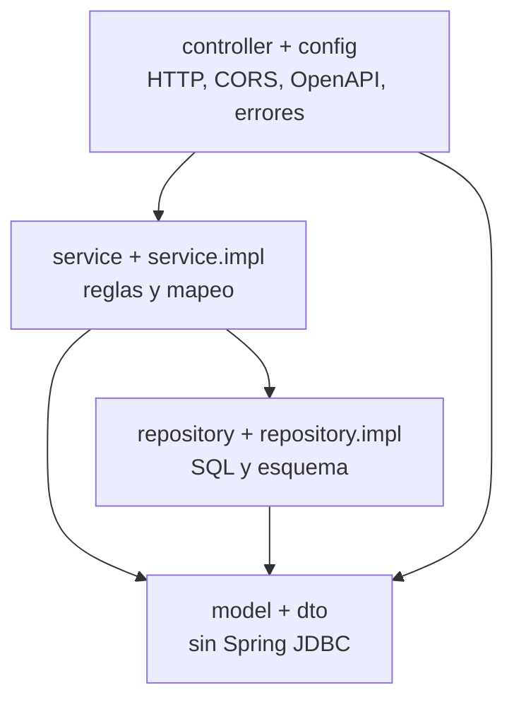

Segunda entrega de **Construyendo APIs por capas**. En [la de .NET 10](/post/construyendo-apis-por-capas-dotnet) separé la plantilla en cuatro proyectos. Aquí la misma idea vive en un solo módulo Maven, porque así está escrita la API de la pastelería.

La base es [pasteleriapi](https://github.com/HugoFernandoColmenares/pasteleriapi): Java 25, Spring Boot 4.1.1, JDBC contra SQLite, ingredientes, recetas y el caso de uso de producir un lote. [pasteleriapi-java](https://github.com/FeithNoir/pasteleriapi-java) es el corte anterior. Lo comparo y no lo uso de guía: se queda en ingredientes, Spring Boot 3.2.3 y Java 17.

No hay JWT en este repositorio. La autenticación está en la lista de lo que todavía no hice. El token de la serie está en la entrega de .NET. Aquí no invento un `SecurityFilterChain` y lo presento como si ya estuviera en `com.pastryapi`.

<a id="contenido"></a>

## Contenido

1. [Prerrequisitos](/post/construyendo-apis-por-capas-spring#prerrequisitos)
2. [Cuál repo y por qué](/post/construyendo-apis-por-capas-spring#cual-repo)
3. [JDK, Maven y dependencias](/post/construyendo-apis-por-capas-spring#instalar)
4. [Un módulo, cinco paquetes](/post/construyendo-apis-por-capas-spring#estructura)
5. [SOLID, DRY y KISS aquí](/post/construyendo-apis-por-capas-spring#solid)
6. [Las cuatro partes, en paquetes](/post/construyendo-apis-por-capas-spring#capas)
7. [Modelo y convención de nombres](/post/construyendo-apis-por-capas-spring#modelo)
8. [DTOs: uno por recurso, no cinco](/post/construyendo-apis-por-capas-spring#dtos)
9. [Contratos del repositorio y del servicio](/post/construyendo-apis-por-capas-spring#contratos)
10. [La conexión como bean, y el secreto que no hace falta](/post/construyendo-apis-por-capas-spring#conexion)
11. [Business: el servicio mapea y produce](/post/construyendo-apis-por-capas-spring#business)
12. [Helpers: errores, página, semilla](/post/construyendo-apis-por-capas-spring#helpers)
13. [Controladores, OpenAPI y curl](/post/construyendo-apis-por-capas-spring#api)
14. [Agregar una entidad, y el checklist](/post/construyendo-apis-por-capas-spring#extender)
15. [Dónde el código no coincide con el esquema](/post/construyendo-apis-por-capas-spring#diferencias)
16. [Resumen](/post/construyendo-apis-por-capas-spring#resumen)

<a id="prerrequisitos"></a>

## Prerrequisitos

- JDK 25. El `pom.xml` fija `<java.version>25</java.version>`. El Dockerfile compila con `eclipse-temurin:25-jdk` y corre con `eclipse-temurin:25-jre`.
- Maven no hace falta instalarlo suelto. El wrapper del repo es Maven **3.9.11** (`distributionUrl` en `.mvn/wrapper/maven-wrapper.properties`, wrapper 3.3.4).
- `curl`.
- Nada de servidor SQL. El archivo `pastry_shop.db` aparece al arrancar.

En Ubuntu, con el repositorio de Adoptium:

```bash
sudo apt-get update
sudo apt-get install -y wget apt-transport-https gpg
wget -qO - https://packages.adoptium.net/artifactory/api/gpg/key/public \
  | sudo gpg --dearmor -o /usr/share/keyrings/adoptium.gpg
echo "deb [signed-by=/usr/share/keyrings/adoptium.gpg] https://packages.adoptium.net/artifactory/deb $(. /etc/os-release && echo "$VERSION_CODENAME") main" \
  | sudo tee /etc/apt/sources.list.d/adoptium.list
sudo apt-get update
sudo apt-get install -y temurin-25-jdk
java -version
```

`java -version` tiene que decir 25. Si el sistema tiene otro JDK por defecto, apunta `JAVA_HOME` al de Temurin 25 antes de `./mvnw`.

<a id="cual-repo"></a>

## Cuál repo y por qué

| | pasteleriapi | pasteleriapi-java |
| :--- | :--- | :--- |
| Dónde | HugoFernandoColmenares/pasteleriapi | FeithNoir/pasteleriapi-java |
| Boot | 4.1.1 | 3.2.3 |
| Java | 25 | 17 |
| Web | `spring-boot-starter-webmvc` | `spring-boot-starter-web` |
| SQLite JDBC | 3.53.4.0 | 3.41.2.2 |
| Lombok | 1.18.48 | el que traiga el BOM, sin versión explícita de procesador |
| OpenAPI | springdoc 3.1.1 | no está |
| Validación | `spring-boot-starter-validation` | no está |
| Actuator | health | no está |
| Recursos | ingredientes, recetas, producir | solo ingredientes |
| Errores | `ApiError` con 400, 404 y 409 | no hay `@RestControllerAdvice` |
| Pruebas | `MvpApiTest` | no hay tests en el árbol |

Boot 4 partió el starter web. Por eso el padre 4.1.1 usa `spring-boot-starter-webmvc` y el test usa `org.springframework.boot.webmvc.test.autoconfigure.AutoConfigureMockMvc`, no el paquete `...boot.test.autoconfigure.web.servlet` de Boot 3. Si copias un tutorial viejo, esos dos nombres no compilan.

<a id="instalar"></a>

## JDK, Maven y dependencias

Puedes clonar y correr, que es lo que hace el README:

```bash
git clone https://github.com/HugoFernandoColmenares/pasteleriapi.git
cd pasteleriapi
chmod +x mvnw
./mvnw spring-boot:run
```

En Windows el wrapper es `mvnw.cmd`. La aplicación queda en el puerto 8080.

Si la estás reconstruyendo, el padre y las versiones que no maneja el BOM van así. Spring Boot administra las versiones de `webmvc`, `validation`, `actuator` y el plugin. Lombok, SQLite y springdoc van fijados porque no salen del BOM en las coordenadas que usé.

```xml
<parent>
    <groupId>org.springframework.boot</groupId>
    <artifactId>spring-boot-starter-parent</artifactId>
    <version>4.1.1</version>
    <relativePath/>
</parent>

<properties>
    <java.version>25</java.version>
    <lombok.version>1.18.48</lombok.version>
    <sqlite-jdbc.version>3.53.4.0</sqlite-jdbc.version>
    <springdoc.version>3.1.1</springdoc.version>
</properties>
```

Dependencias:

```xml
<dependency>
    <groupId>org.springframework.boot</groupId>
    <artifactId>spring-boot-starter-webmvc</artifactId>
</dependency>
<dependency>
    <groupId>org.springframework.boot</groupId>
    <artifactId>spring-boot-starter-validation</artifactId>
</dependency>
<dependency>
    <groupId>org.springframework.boot</groupId>
    <artifactId>spring-boot-starter-actuator</artifactId>
</dependency>
<dependency>
    <groupId>org.xerial</groupId>
    <artifactId>sqlite-jdbc</artifactId>
    <version>${sqlite-jdbc.version}</version>
</dependency>
<dependency>
    <groupId>org.projectlombok</groupId>
    <artifactId>lombok</artifactId>
    <optional>true</optional>
</dependency>
<dependency>
    <groupId>org.springdoc</groupId>
    <artifactId>springdoc-openapi-starter-webmvc-ui</artifactId>
    <version>${springdoc.version}</version>
</dependency>
<dependency>
    <groupId>org.springframework.boot</groupId>
    <artifactId>spring-boot-starter-webmvc-test</artifactId>
    <scope>test</scope>
</dependency>
```

Lombok en JDK 25 hay que declararlo como annotation processor, si no los getters no aparecen:

```xml
<plugin>
    <groupId>org.apache.maven.plugins</groupId>
    <artifactId>maven-compiler-plugin</artifactId>
    <configuration>
        <annotationProcessorPaths>
            <path>
                <groupId>org.projectlombok</groupId>
                <artifactId>lombok</artifactId>
                <version>${lombok.version}</version>
            </path>
        </annotationProcessorPaths>
    </configuration>
</plugin>
```

El plugin de Boot excluye Lombok del jar final. Está en el `pom.xml` del repo. Sin esa exclusión el jar arrastra el procesador.

Compruebo que resuelve y que los tests pasan:

```bash
./mvnw -B dependency:resolve
./mvnw -B verify
```

`verify` corre `MvpApiTest`. Ese test levanta el contexto completo con SQLite en memoria (`jdbc:sqlite:file:mvp-api-tests?mode=memory&cache=shared`) y `app.seed-data=true`. Cubre salud, validación del nombre vacío, CRUD de ingrediente, receta con un ingrediente que no existe (404) y producir hasta que el stock no alcanza (409).

<a id="estructura"></a>

## Un módulo, cinco paquetes

No hay cuatro artefactos. Hay un `pastry-api` y paquetes bajo `com.pastryapi`. Los class libraries de .NET aquí serían módulos de Gradle o Maven. Para esta API de curso el costo de cuatro `pom.xml` no paga: Spring ya inyecta por interfaz dentro del mismo classpath. La regla que sí pago es la dirección de las dependencias.

```text
pom.xml
mvnw
src/main/java/com/pastryapi/
  PastryApiApplication.java
  model/          Ingredient, Recipe, RecipeLine
  dto/            IngredientDto, RecipeDto, RecipeLineDto,
                  ProduceRequest, ProduceResponse, PageResponse, ApiError
  repository/     interfaces, DatabaseInitializer, DemoDataSeeder
  repository/impl/
  service/        interfaces
  service/impl/
  controller/
  config/         DatabaseConfig, WebConfig, OpenAPIConfig, GlobalExceptionHandler
  exception/
src/main/resources/application.properties
src/test/java/com/pastryapi/MvpApiTest.java
```

`PastryApiApplication` es el `Program.cs`: arranca Spring y, en un `CommandLineRunner`, crea tablas y siembra datos.

```java
@SpringBootApplication
public class PastryApiApplication {
    public static void main(String[] args) {
        SpringApplication.run(PastryApiApplication.class, args);
    }

    @Bean
    public CommandLineRunner initDatabase(DatabaseInitializer databaseInitializer,
                                          DemoDataSeeder demoDataSeeder) {
        return args -> {
            databaseInitializer.createTable();
            demoDataSeeder.seedIfEmpty();
        };
    }
}
```

<a id="solid"></a>

## SOLID, DRY y KISS aquí

**S.** `IngredientController` no arma SQL. `IngredientRepositoryImpl` no decide si un nombre repetido es un 409. `IngredientServiceImpl` no elige el status HTTP: lanza `ConflictException` o `ResourceNotFoundException`, y `GlobalExceptionHandler` elige el código. Producir un lote no está dentro del CRUD de ingredientes. Vive en `RecipeServiceImpl.produce`.

**O.** Un recurso nuevo es un paquete de archivos nuevos: modelo, DTO, interfaz, `impl`, controlador. `IngredientServiceImpl` no gana un `if` por cada tabla.

**L.** `IngredientRepositoryImpl` cumple `IngredientRepository`. El controlador no pregunta cuál impl hay. Si el impl lanza `RuntimeException` con el mensaje de SQL, eso se escapa al handler genérico y se convierte en 500. Los errores de negocio tienen que ser las excepciones que el handler conoce, no un `RuntimeException` suelto.

**I.** No hay un `IRepository` gigante. `IngredientRepository` sabe buscar por nombre, estado y stock bajo. `RecipeRepository` sabe si un ingrediente está usado y sabe descontar cantidad. Juntarlos en un CRUD genérico habría escondido `decrementIngredientQuantity`.

**D.** El controlador recibe `IngredientService`. El servicio recibe `IngredientRepository` y `RecipeRepository`. Los dos son interfaces. Spring pone el `@Service` y el `@Repository`. Nadie hace `new IngredientRepositoryImpl()`.

**DRY.** `toDto` y `toEntity` están una vez en el servicio. `whereClause` y `bindFilters` están una vez en el repositorio, y los usan `count` y `search`. `DatabaseInitializer.ensureColumn` evita repetir cuatro `ALTER TABLE` a mano cuando el archivo SQLite es viejo. No metí MapStruct: son dos métodos privados y el modelo es plano. AutoMapper en la API .NET existe porque hay más DTOs por entidad. Aquí sería otra dependencia para el mismo trabajo.

**KISS.** Una conexión SQLite, no un pool. JDBC, no JPA. El esquema es `CREATE TABLE IF NOT EXISTS` al arrancar, no Flyway. Una semilla fija (harina, azúcar, mantequilla, huevos, leche y un “Vanilla sponge”) para que Swagger y la página `static/index.html` tengan qué mostrar. La autenticación no está, y no la simulé con un filtro a medias.

El límite de esa simpleza: `Connection` de JDBC no es thread-safe, y un bean singleton se comparte entre requests. Por eso cada método del repositorio hace `synchronized (connection)`. Funciona para un solo proceso y una demo. No es el diseño de un servicio con concurrencia de verdad. Cuando duela, el bean pasa a ser un `DataSource` y cada método pide una conexión del pool. El contrato del repositorio no cambia.

<a id="capas"></a>

## Las cuatro partes, en paquetes



| Parte .NET | Paquete Java | Qué hace en este repo |
| :--- | :--- | :--- |
| Core | `model` y `dto` | `Ingredient`, `Recipe`, los DTO y `PageResponse` |
| Data | `repository` y `repository.impl` | SQL, `DatabaseInitializer`, semilla |
| Business | `service` y `service.impl` | nombres únicos, stock, producir |
| Api | `controller`, `config`, `exception` | rutas, beans, códigos HTTP |

`exception` lo dejé junto a la API porque lo consume el `@RestControllerAdvice`. El servicio lanza esas clases. Es el mismo compromiso que `AuthResult` en Core en la plantilla .NET: el tipo cruza capas, la traducción a HTTP no.

`config.DatabaseConfig` es el factory. `PastryApiApplication` no llama a `DriverManager`. Pide el bean porque el runner necesita el inicializador, y el inicializador pide la `Connection`.

<a id="modelo"></a>

## Modelo y convención de nombres

La convención de la serie, y al lado el nombre que realmente tiene este código.

| Pieza | Convención que uso en .NET | En esta API |
| :--- | :--- | :--- |
| Entidad | PascalCase, archivo = clase | `Ingredient`, `Recipe`, `RecipeLine` |
| Clave | `Id` | El campo se llama `guid` (`UUID`) |
| Tabla | plural implícito de EF | `ingredients`, `recipes`, `recipe_lines`, nombres explícitos en el SQL |
| Columna | la propiedad | `minimum_quantity`, `updated_at`, `recipe_guid` en snake_case |
| DTO | uno por operación | Un `IngredientDto` para alta, detalle y edición |
| Lista | `ListIngredientDto` | `PageResponse<IngredientDto>`, el mismo DTO dentro |
| Borrado | id en la ruta | `DELETE /api/ingredients/{id}` |
| Repositorio | `IIngredientRepository` | `IngredientRepository` y `IngredientRepositoryImpl` |
| Servicio | igual | `IngredientService` y `IngredientServiceImpl` |
| Ruta | `api/[controller]` | `@RequestMapping("/api/ingredients")` en plural y en minúscula |
| Error | `ApiResponse` o `AuthResult` | `ApiError` |

`Ingredient` es un POJO con Lombok. La regla de stock bajo está en la entidad, no en el controlador:

```java
@Data
@NoArgsConstructor
@AllArgsConstructor
public class Ingredient {
    private UUID guid;
    private String name;
    private String brand;
    private double price;
    private boolean status;
    private String observations;
    private String unit;
    private double quantity;
    private double minimumQuantity;
    private Instant updatedAt;

    public boolean isLowStock() {
        return quantity <= minimumQuantity;
    }
}
```

`status` en true significa que se puede usar. No es el status HTTP. Una receta inactiva no se produce. Un ingrediente con `status` false está descontinuado y producir también falla, con `ConflictException`, antes de mirar cantidades.

`Recipe` tiene `guid`, `name`, `description`, `servings`, `active`, `updatedAt` y `List<RecipeLine> lines`. `RecipeLine` guarda el id del ingrediente, el nombre, la unidad y la cantidad que pide un lote. El nombre y la unidad de la línea se rellenan en el servicio al resolver el id, para no confiar en lo que mande el cliente.

El esquema lo crea `DatabaseInitializer`, no Hibernate. Ingredientes:

```sql
CREATE TABLE IF NOT EXISTS ingredients (
    guid TEXT PRIMARY KEY,
    name TEXT NOT NULL,
    brand TEXT,
    price REAL NOT NULL,
    status INTEGER NOT NULL,
    observations TEXT,
    unit TEXT NOT NULL DEFAULT 'kg',
    quantity REAL NOT NULL DEFAULT 0,
    minimum_quantity REAL NOT NULL DEFAULT 0,
    updated_at TEXT NOT NULL DEFAULT ''
)
```

Recetas y líneas van en el mismo método. `recipe_lines` tiene clave primaria `(recipe_guid, ingredient_guid)` y dos llaves foráneas. `PRAGMA foreign_keys = ON` se ejecuta al abrir la conexión. Sin eso, SQLite acepta la declaración y no la hace cumplir.

`ensureColumn` mira `PRAGMA table_info` y hace `ALTER TABLE` si el archivo se creó con un esquema viejo que no tenía `unit`, `quantity`, `minimum_quantity` o `updated_at`. Es el equivalente pobre de una migración. No hay historial de versiones: o la columna está, o se agrega.

<a id="dtos"></a>

## DTOs: uno por recurso, no cinco

En .NET partí `CreateIngredientDto`, `ListIngredientDto`, `IngredientDto` y `UpdateIngredientDto` para que el alta no llevara id y el listado no llevara proveedor. Aquí usé un solo `IngredientDto` para crear, leer y actualizar. Fue a propósito, por KISS, en un recurso de diez campos donde el alta y el detalle se parecen. El servicio, al crear, ignora el `guid` que venga en el cuerpo y pone un `UUID.randomUUID()`.

Eso tiene un costo que la separación de DTOs evita: el mismo tipo sirve de entrada y de salida, así que `lowStock` y `updatedAt` viajan en el POST aunque el cliente no deba mandarlos. OpenAPI no los marca como solo lectura en `IngredientDto`. En la línea de receta sí lo hice:

```java
@Schema(accessMode = Schema.AccessMode.READ_ONLY)
private String ingredientName;

@Schema(accessMode = Schema.AccessMode.READ_ONLY)
private String unit;
```

La validación está en el DTO, con Jakarta Validation, no en el controlador:

```java
@Data
@Schema(description = "An ingredient in pastry-shop stock")
public class IngredientDto {
    private UUID guid;

    @NotBlank
    private String name;

    private String brand;

    @PositiveOrZero
    private double price;

    private boolean status = true;
    private String observations;

    @NotNull
    @Pattern(regexp = "kg|g|L|ml|unit", message = "unit must be one of: kg, g, L, ml, unit")
    private String unit;

    @PositiveOrZero
    private double quantity;

    @PositiveOrZero
    private double minimumQuantity;

    private Instant updatedAt;
    private boolean lowStock;
}
```

`@Valid` en el argumento del controlador dispara esto. Unidad fuera de esa lista, nombre en blanco, precio negativo o cantidad negativa responden 400 con `ApiError.details` armado desde los `FieldError`. `double` no distingue “no vino el campo” de cero: si omites `price`, queda 0 y `@PositiveOrZero` lo deja pasar. Para un campo obligatorio de verdad uso el objeto `Double` o un DTO de alta distinto. No lo hice en este archivo.

`ProduceRequest` sí es un DTO de una sola operación, y es un `record`:

```java
public record ProduceRequest(
        @NotNull @Min(1) Integer batches
) {}
```

`PageResponse<T>` es el sobre de las listas: `content`, `page`, `size`, `totalElements`, `totalPages`. La página arranca en 0, no en 1. En la API .NET de la pastelería `pageNumber` arranca en 1. No mezcles los dos clientes.

`ApiError` lleva `timestamp`, `status`, `error`, `message`, `path`, `details` y `shortages`. `@JsonInclude(NON_NULL)` esconde las listas cuando el error no es de validación ni de stock.

Si más adelante separo los DTOs como en .NET, los nombres serían `IngredientCreateDto` (sin `guid`, sin `lowStock`, sin `updatedAt`), `IngredientUpdateDto` (sin stock calculado) y el `IngredientDto` actual se quedaría como salida. El controlador de hoy no tiene esas clases. No las dibujo como si existieran.

<a id="contratos"></a>

## Contratos del repositorio y del servicio

En el esquema de cuatro librerías, los contratos me los imaginaba dentro de Data. Aquí el contrato de datos es la interfaz en `repository`, y el contrato de caso de uso es la interfaz en `service`. Las implementaciones están en `impl`. Data no es un jar: es el paquete.

```java
public interface IngredientRepository {
    Ingredient save(Ingredient ingredient);
    Optional<Ingredient> findById(UUID id);
    Ingredient update(Ingredient ingredient);
    void deleteById(UUID id);
    long count(String name, Boolean status, Boolean lowStock);
    List<Ingredient> search(String name, Boolean status, Boolean lowStock, int offset, int limit);
    boolean existsByNameIgnoreCase(String name);
}

public interface IngredientService {
    IngredientDto createIngredient(IngredientDto ingredientDto);
    IngredientDto getIngredientById(UUID id);
    IngredientDto updateIngredient(UUID id, IngredientDto ingredientDto);
    void deleteIngredient(UUID id);
    PageResponse<IngredientDto> search(String name, Boolean status, Boolean lowStock, int page, int size);
}
```

La interfaz del repositorio habla de `Ingredient`. La del servicio habla de `IngredientDto` y de `PageResponse`. Esa es la frontera. El controlador no importa `java.sql`.

`existsByNameIgnoreCase` está en el contrato porque la regla “no repitas el nombre” necesita una consulta, y no quiero que el servicio arme SQL para eso. `RecipeRepository.isIngredientUsed` existe por la regla simétrica: no borres un ingrediente que ya está en una receta.

Abstracción, en concreto: puedo sustituir `IngredientRepositoryImpl` por una versión contra Postgres sin tocar `IngredientServiceImpl`, siempre que los métodos sigan significando lo mismo. Hoy no hay un segundo impl. La interfaz igual evita que el servicio dependa de `PreparedStatement`.

No hay un `IService` genérico. SchoolAPI lo tenía en .NET y lo dejé de usar cuando cada recurso ganó operaciones distintas. Producir lotes no cabe en `GetAll` / `Create` / `Update` / `Delete`.

<a id="conexion"></a>

## La conexión como bean, y el secreto que no hace falta

`DatabaseConfig` es el factory. Lee la URL y devuelve una `Connection`. `PastryApiApplication` no menciona JDBC.

```java
@Configuration
public class DatabaseConfig {
    @Value("${app.datasource.url:jdbc:sqlite:pastry_shop.db}")
    private String dbUrl;

    @Bean
    public Connection connection() throws SQLException {
        try {
            Class.forName("org.sqlite.JDBC");
            Connection connection = DriverManager.getConnection(dbUrl);
            try (Statement stmt = connection.createStatement()) {
                stmt.execute("PRAGMA foreign_keys = ON");
                stmt.execute("PRAGMA busy_timeout = 5000");
            }
            return connection;
        } catch (ClassNotFoundException e) {
            throw new SQLException("SQLite JDBC driver not found.", e);
        }
    }
}
```

`application.properties` no tiene usuario ni clave. La URL sale de una variable, con un default de archivo local:

```properties
spring.application.name=PasteleriApi
server.port=8080
app.datasource.url=${APP_DATASOURCE_URL:jdbc:sqlite:pastry_shop.db}
app.seed-data=true
management.endpoints.web.exposure.include=health
```

En la terminal, antes de arrancar:

```bash
export APP_DATASOURCE_URL="jdbc:sqlite:./pastry_shop.db"
export APP_SEED_DATA="true"
./mvnw spring-boot:run
```

Spring relaja `app.seed-data` a `APP_SEED_DATA`. También puedes exportar `APP_DATASOURCE_URL` y dejar la semilla en el archivo, porque `true` no es un secreto.

Docker hace lo mismo con un volumen, no con una clave dentro de la imagen. `docker-compose.yml`:

```yaml
services:
  pastry-api:
    build: .
    ports:
      - "8080:8080"
    environment:
      APP_DATASOURCE_URL: jdbc:sqlite:/data/pastry_shop.db
    volumes:
      - pastry-data:/data
volumes:
  pastry-data:
```

```bash
docker compose up --build
```

El Dockerfile copia el wrapper, corre `./mvnw dependency:go-offline` y después `./mvnw verify`, y el runtime usa `java --enable-native-access=ALL-UNNAMED -jar app.jar`. `ENV APP_DATASOURCE_URL=jdbc:sqlite:/data/pastry_shop.db` queda en la imagen como default. Sigue sin haber contraseña: SQLite en un archivo no pide una. El día que esta URL lleve usuario y clave, la variable se inyecta en el host y no se escribe en `application.properties`. Ese archivo sí se commitea. Una clave ahí queda en el historial del git aunque el commit siguiente la borre. Por eso el único dato de conexión que dejé en el repo es el default local `jdbc:sqlite:pastry_shop.db`, que no abre ningún servidor.

No uso user-secrets porque eso es de .NET. El equivalente aquí es la variable de entorno, o un archivo fuera del repo que el proceso lea y que esté en `.gitignore`. No hace falta un `application-local.properties` commiteado “con la clave de desarrollo”.

<a id="business"></a>

## Business: el servicio mapea y produce

`IngredientServiceImpl` es el formateador. El repositorio devuelve `Ingredient`. El servicio devuelve `IngredientDto`. No hay AutoMapper: `toDto` copia campo por campo y calcula `lowStock` llamando a `ingredient.isLowStock()`. `toEntity` recorta el nombre con `trim()` y no copia `guid` ni `updatedAt`. Esos dos los pone el método de alta.

Alta:

```java
public IngredientDto createIngredient(IngredientDto dto) {
    if (ingredientRepository.existsByNameIgnoreCase(dto.getName())) {
        throw new ConflictException("An ingredient named '" + dto.getName() + "' already exists");
    }
    Ingredient ingredient = toEntity(dto);
    ingredient.setGuid(UUID.randomUUID());
    ingredient.setUpdatedAt(Instant.now());
    return toDto(ingredientRepository.save(ingredient));
}
```

Borrado: si no existe, 404. Si una receta lo usa, 409. Si no, `DELETE` físico. No hay `IsDeleted`. En la pastelería de .NET el borrado es lógico y un filtro global esconde la fila. Aquí la fila desaparece. Son dos decisiones distintas en dos repos que se llaman parecido. No las mezcles si estás portando un cliente.

La búsqueda normaliza la página. `page` menor que 0 pasa a 0. `size` menor que 1 pasa a 1. `size` mayor que 100 se queda en 100. El offset es `page * size`. El controlador también anota `@Min(0)` y `@Max(100)`, así que un size de 500 ni llega al servicio: falla la validación del parámetro.

Producir es la regla que justifica la capa. `RecipeServiceImpl.produce`:

1. Carga la receta o lanza `ResourceNotFoundException`.
2. Si `active` es false, `ConflictException`.
3. Por cada línea, carga el ingrediente. Si no está, 404. Si está descontinuado, 409.
4. `required = cantidad de la línea * batches`. Si `quantity + 1e-9 < required`, anota un `StockShortage` y sigue, para devolver todas las faltas juntas.
5. Si hubo faltas, `InsufficientStockException` y no descuenta nada.
6. Si no hubo, `decrementIngredientQuantity` por cada línea y devuelve el stock resultante dentro de `ProduceResponse`.

El `1e-9` es la tolerancia de comparar `double`. Las cantidades son `REAL` en SQLite y `double` en Java. No uses esto para dinero. `price` también es `double` en este modelo. Lo dejé así en el MVP. Si el precio se vuelve contable, pasa a `BigDecimal` y la columna deja de ser un cálculo de stock.

`ProduceResponse` lleva `recipeId`, `recipeName`, `batches` y `updatedStock` como lista de `IngredientDto`.

El descuento ocurre en un segundo ciclo, después de validar. No es una transacción explícita: si el proceso muere a la mitad del segundo ciclo, una parte del stock ya se movió. El `synchronized` evita que dos hilos usen la conexión a la vez. No convierte los dos ciclos en una transacción. Para cerrarlo de verdad haría `setAutoCommit(false)`, los updates, y `commit` o `rollback` en el mismo candado. No está escrito. Lo anoto porque el 409 sugiere atomicidad y el código solo la acerca.

La semilla, si `ingredients` está vacía y `app.seed-data` es true, inserta cinco ingredientes y la receta “Vanilla sponge” de 8 porciones: 0.25 kg de harina, 0.20 kg de azúcar, 0.10 kg de mantequilla, 3 huevos y 0.10 L de leche. Los nombres están en inglés en el código (`Flour`, `Sugar`, `Butter`, `Eggs`, `Milk`).

<a id="helpers"></a>

## Helpers: errores, página, semilla

No hay helper de JWT ni de hash. No hay usuarios. El README lo deja como pendiente, junto con pedidos, clientes, proveedores y reportes de costo. Cuando lo agregue, el sitio es un `TokenService` en `service` que firme con una clave leída de `APP_JWT_SECRET`, y un filtro en `config` que no conozca SQL. La entrega de .NET ya tiene el contenido de ese token: id, correo, rol, una hora de vida, HMAC. No lo reescribo aquí como si `pasteleriapi` lo tuviera.

Lo que sí hay:

**Excepciones de negocio.** `ResourceNotFoundException`, `ConflictException`, `InsufficientStockException`. Esta última guarda `List<StockShortage>`. `StockShortage` es un record: id, nombre, unidad, `required`, `available`.

**`GlobalExceptionHandler`.** `@RestControllerAdvice`.

| Excepción | HTTP |
| :--- | :--- |
| `MethodArgumentNotValidException`, `ConstraintViolationException` | 400, con `details` |
| JSON ilegible, tipo mal en el path, `IllegalArgumentException` | 400 |
| `ResourceNotFoundException` | 404 |
| `ConflictException` | 409 |
| `InsufficientStockException` | 409, con `shortages` |
| Cualquier otra | 500, y el mensaje de la excepción |

El 500 devuelve `ex.getMessage()`. En local me sirve. Hacia afuera preferiría un texto fijo y el detalle solo en el log. El handler de la pastelería .NET hace lo mismo con `exception.Message` dentro de `ApiResponse`. Los dos están así.

**CORS.** `WebConfig` no abre todos los orígenes. Permite `http://localhost:8080`, `http://127.0.0.1:8080` y `http://localhost:5173`, métodos `GET`, `POST`, `PUT`, `DELETE`, `OPTIONS`, sobre `/api/**`. El 8080 es la propia UI estática. El 5173 es el hueco para un front de Vite. La plantilla .NET usa `AllowAnyOrigin`. Esta no.

**OpenAPI.** `OpenAPIConfig` publica el título “Pastry Shop API”, versión 1.0. springdoc arma el UI solo con la dependencia. Los `@Tag` y `@Operation` de los controladores salen en ese documento.

**Semilla e inicializador.** Son `@Component` en el paquete repository. No son helpers genéricos: conocen el esquema de esta pastelería. El runner de la aplicación es el único que los llama.

**Mapeo.** Métodos privados `toDto`, `toEntity`, `toIngredientDto` y `resolveLines`. `resolveLines` vuelve a cargar cada ingrediente y arma la línea con el nombre real. Si el id no existe, la alta de la receta responde 404.

<a id="api"></a>

## Controladores, OpenAPI y curl

`IngredientController` y `RecipeController` son `@RestController` y `@Validated`. El servicio se inyecta por constructor. No hay `@Autowired` en un campo.

Ingredientes, en `/api/ingredients`:

| Verbo | Ruta | Respuesta |
| :--- | :--- | :--- |
| `POST` | `/api/ingredients` | 201 y el DTO |
| `GET` | `/api/ingredients?name&status&lowStock&page&size` | `PageResponse` |
| `GET` | `/api/ingredients/{id}` | DTO, o 404 |
| `PUT` | `/api/ingredients/{id}` | DTO |
| `DELETE` | `/api/ingredients/{id}` | 204 vacío |

Recetas, en `/api/recipes`, más `POST /api/recipes/{id}/produce` con `{"batches": 1}`.

`page` por defecto es 0 y `size` es 20. En ingredientes .NET el default de `pageSize` es 10 y la página arranca en 1.

Arranco y miro las tres superficies del README:

```bash
./mvnw spring-boot:run
```

- Banco de trabajo: `http://localhost:8080/`
- Swagger: `http://localhost:8080/swagger-ui.html`
- Salud: `http://localhost:8080/actuator/health`

Con la semilla, el listado ya trae cinco ingredientes. `lowStock=true` deja solo los que están en el umbral o por debajo. Recién sembrados, ninguno lo está: harina tiene 10 y el mínimo es 2.

Alta de un ingrediente que no choca con la semilla:

```bash
curl -s -D - -X POST http://localhost:8080/api/ingredients \
  -H 'Content-Type: application/json' \
  -d '{
    "name": "Cocoa",
    "brand": "Local",
    "price": 12.5,
    "status": true,
    "observations": "Sin azúcar",
    "unit": "kg",
    "quantity": 1.5,
    "minimumQuantity": 0.4
  }'
```

Unidad inválida, para ver el 400:

```bash
curl -s -X POST http://localhost:8080/api/ingredients \
  -H 'Content-Type: application/json' \
  -d '{"name":"Sal","unit":"libra","price":1,"quantity":1,"minimumQuantity":0}'
```

Listado y detalle:

```bash
curl -s "http://localhost:8080/api/ingredients?name=flour&page=0&size=20"
curl -s "http://localhost:8080/api/ingredients?lowStock=true"
curl -s http://localhost:8080/api/ingredients/EL_GUID
```

El filtro `name` usa `LIKE` sin distinguir mayúsculas. `flour` encuentra `Flour`.

Recetas. El cuerpo lleva líneas con `ingredientId` de verdad. Los saco del `GET` de ingredientes. `ingredientName` y `unit` puedo omitirlos: el servicio los resuelve.

```bash
curl -s http://localhost:8080/api/recipes?page=0&size=20

curl -s -X POST http://localhost:8080/api/recipes/EL_GUID_DE_LA_RECETA/produce \
  -H 'Content-Type: application/json' \
  -d '{"batches": 1}'
```

Un lote del bizcocho de vainilla descuenta 0.25 kg de harina, 0.20 de azúcar, 0.10 de mantequilla, 3 huevos y 0.10 L de leche. La respuesta trae el stock nuevo. Si pides más lotes de los que caben, el status es 409 y `shortages` lista ingrediente, unidad, cantidad pedida y cantidad disponible. No se descuenta nada de esa petición fallida.

Borrar el bizcocho y después un ingrediente:

```bash
curl -s -D - -X DELETE http://localhost:8080/api/recipes/EL_GUID_DE_LA_RECETA
curl -s -D - -X DELETE http://localhost:8080/api/ingredients/EL_GUID_DE_HARINA
```

Si borras la harina mientras la receta existe, el segundo `DELETE` responde 409: “Ingredient is used by a recipe and cannot be deleted”.

Health:

```bash
curl -s http://localhost:8080/actuator/health
```

No mando `Authorization`. No hay filtro que lo lea.

<a id="extender"></a>

## Agregar una entidad, y el checklist

Para sumar, por ejemplo, proveedores, repito el corte de ingredientes y no el de producir, salvo que haya una regla que no sea CRUD.

1. `model/Supplier.java` con `guid` y el resto de campos. Sin anotaciones de Spring.
2. `dto/SupplierDto.java` con la validación. Si el alta y el detalle se separan, dos clases, y el servicio deja de aceptar el DTO de salida como entrada.
3. `repository/SupplierRepository.java` con `save`, `findById`, `update`, `deleteById` y la búsqueda que la pantalla pida.
4. `CREATE TABLE IF NOT EXISTS suppliers` dentro de `DatabaseInitializer.createTable`, más `ensureColumn` si ya hay archivos SQLite viejos en circulación.
5. `repository/impl/SupplierRepositoryImpl.java` con `@Repository`, el `Connection` inyectado y `synchronized` en cada uso. `mapRow` es el único sitio que lee el `ResultSet`.
6. `service/SupplierService.java` en DTOs.
7. `service/impl/SupplierServiceImpl.java` con `@Service`, `toDto` / `toEntity`, y excepciones de negocio en vez de `ResponseEntity`.
8. `controller/SupplierController.java` en `/api/suppliers`, `@Valid` en el cuerpo, `@Tag` y `@Operation`.
9. Un caso en `MvpApiTest` o una clase de test nueva, contra la misma URL en memoria.
10. Curl de alta, lista, detalle, edición y borrado. Si hay una regla que choca con otra tabla, un curl que espere 409.

No toco `IngredientRepositoryImpl` para guardar proveedores. No abro `DriverManager` en el servicio. No pongo la URL nueva en una clase Java: sigue siendo `APP_DATASOURCE_URL`.

### Checklist

- [ ] `java -version` es 25 y `./mvnw -v` resuelve Maven 3.9.11.
- [ ] El padre del POM es Spring Boot 4.1.1 y el starter web es `webmvc`.
- [ ] Lombok 1.18.48 está en `annotationProcessorPaths`.
- [ ] El modelo no importa `java.sql`. El controlador no importa `java.sql`.
- [ ] La interfaz del repositorio devuelve entidades. La del servicio devuelve DTOs.
- [ ] `DatabaseConfig` lee `app.datasource.url`. El default no lleva usuario ni clave.
- [ ] `application.properties` commiteado no tiene contraseñas. Lo que sea secreto va en el entorno.
- [ ] Cada método que usa la `Connection` compartida está en `synchronized`.
- [ ] `PRAGMA foreign_keys = ON` corre al abrir.
- [ ] Las excepciones de negocio tienen un `@ExceptionHandler` con el status que quiero. Un `RuntimeException` de SQL cae en el 500.
- [ ] `./mvnw verify` pasa, incluida la regla nueva.
- [ ] Swagger en `/swagger-ui.html` muestra el recurso.
- [ ] Un 409 de stock trae `shortages` y no modifica cantidades.
- [ ] CORS nombra orígenes. No quedó `allowedOriginPatterns("*")` “mientras pruebo”.
- [ ] Sigo sin un JWT falso en el código. Cuando exista, la clave será `APP_JWT_SECRET` o equivalente, no una constante en `OpenAPIConfig`.

<a id="diferencias"></a>

## Dónde el código no coincide con el esquema

- Un solo módulo Maven. Las cuatro partes son paquetes, no `Core` / `Data` / `Business` / `Api`.
- JDBC y una `Connection` singleton. No hay EF, no hay pool, no hay `DbContext`.
- El esquema se crea al arrancar con SQL embebido. No hay migraciones versionadas. `ensureColumn` parcha tablas viejas.
- El composition root sí llama al inicializador (`CommandLineRunner`). No llama a `DriverManager`. Eso último está en `DatabaseConfig`.
- Un DTO por recurso, no la familia `Create` / `List` / `Update` / `Delete`. `ProduceRequest` es la excepción, porque producir no es un CRUD.
- La clave se llama `guid`, no `Id`. Las rutas van en plural y minúscula.
- El borrado de ingredientes es físico, y además está prohibido si hay una receta. En pasteleriaapi de .NET el borrado es lógico con `IsDeleted`.
- El mapeo es manual. No hay AutoMapper ni MapStruct.
- No hay `IRepository` genérico ni `IService` genérico.
- No hay JWT, ni hash de contraseñas, ni usuarios. El README lo marca como pendiente. La serie no gana un filtro de seguridad inventado en esta entrega.
- CORS es una lista. En la plantilla .NET es `AllowAnyOrigin`.
- La paginación empieza en 0 y el tope es 100. En ingredientes .NET empieza en 1.
- Boot 4 usa `starter-webmvc` y el test importa `AutoConfigureMockMvc` desde `org.springframework.boot.webmvc.test.autoconfigure`.
- pasteleriapi-java no tiene recetas, springdoc, validación ni actuator, y sigue en Boot 3.2.3 / Java 17.
- `produce` valida todo y después descuenta, sin una transacción JDBC. El 409 es atómico solo porque lanza antes del segundo ciclo. Un fallo a mitad del descuento no hace rollback.
- Los textos de error y la semilla están en inglés. Los de la plantilla de auth en .NET están en español (“Ya existe este correo.”). Cada repo se quedó con el idioma en el que lo escribí.

<a id="resumen"></a>

## Resumen

La pastelería en Java es la misma división de responsabilidades que la plantilla .NET, metida en un módulo porque el tamaño lo permite. `model` y `dto` no saben de SQL. `repository` esconde el JDBC detrás de una interfaz y sincroniza la única conexión. `service` valida nombres, resuelve líneas de receta, mapea a mano y, al producir, o descuenta el stock o devuelve las faltas. `controller` y `GlobalExceptionHandler` eligen el HTTP. La URL de la base entra por `APP_DATASOURCE_URL` y el default commiteado es un archivo SQLite sin clave.

No hay cuatro class libraries, no hay un DTO por cada verbo, no hay borrado lógico y no hay JWT. El repo anterior, `pasteleriapi-java`, ni siquiera tiene recetas. Si vas a copiar algo, copia `HugoFernandoColmenares/pasteleriapi` y trata el otro como historial.

La entrega anterior de la serie explica el factory de EF, los DTOs separados y el JWT que esta API todavía no tiene: [Construyendo APIs por capas: .NET 10](/post/construyendo-apis-por-capas-dotnet).
