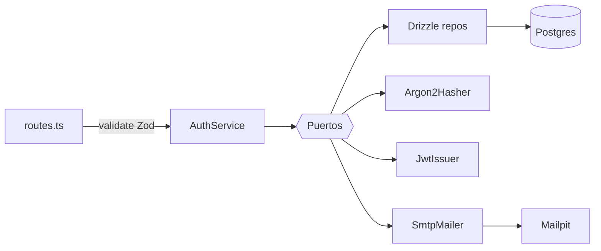

Esta es la entrega de **Node.js + TypeScript con Express** de la serie **Crear base API**. Si no han leído la [introducción](/post/crear-base-api-introduccion), les recomiendo pasar por ahí primero: allí están el contrato, las tablas, el `docker-compose.yml` y el script `e2e.sh` que uso para comprobar que todo funciona. Aquí me concentro en cómo se arma en Express.

¿Por qué empezar por Express? Porque no trae nada. No tiene contenedor de dependencias, ni validación, ni estructura de carpetas. Eso lo hace perfecto para ver las capas y la inyección de dependencias "a mano", sin magia. En la [siguiente entrega, NestJS](/post/crear-base-api-nestjs), vamos a ver lo mismo con un framework que sí lo trae todo, y la comparación se entiende mucho mejor.

El código lo escribí para esta serie y pasa las 28 comprobaciones de `e2e.sh` contra Postgres y Mailpit (probado el 25 de noviembre de 2026). Aún no está en un repositorio público, así que aquí va completo.

<a id="contenido"></a>

## Contenido

1. [Prerrequisitos](/post/crear-base-api-node-express#prerrequisitos)
2. [Qué estoy construyendo](/post/crear-base-api-node-express#que-estoy-construyendo)
3. [Instalación](/post/crear-base-api-node-express#instalacion)
4. [Carpetas y estructura](/post/crear-base-api-node-express#carpetas)
5. [SOLID, DRY y KISS en este proyecto](/post/crear-base-api-node-express#solid)
6. [Domain: errores, usuario y puertos](/post/crear-base-api-node-express#domain)
7. [Application: DTOs, correos y AuthService](/post/crear-base-api-node-express#application)
8. [Infrastructure: config, Drizzle, seguridad y SMTP](/post/crear-base-api-node-express#infrastructure)
9. [API: validación, errores y rutas](/post/crear-base-api-node-express#api)
10. [El composition root y el arranque](/post/crear-base-api-node-express#composition-root)
11. [Migraciones](/post/crear-base-api-node-express#migraciones)
12. [Pruebas unitarias](/post/crear-base-api-node-express#pruebas)
13. [Probarlo de punta a punta](/post/crear-base-api-node-express#probarlo)
14. [Cómo agrego otro endpoint de punta a punta](/post/crear-base-api-node-express#extender)
15. [Errores típicos y trampas](/post/crear-base-api-node-express#errores-tipicos)
16. [Dónde el código no coincide con el esquema](/post/crear-base-api-node-express#diferencias)
17. [Checklist](/post/crear-base-api-node-express#checklist)
18. [Resumen](/post/crear-base-api-node-express#resumen)
19. [Reto](/post/crear-base-api-node-express#reto)

<a id="prerrequisitos"></a>

## Prerrequisitos

- **Node.js 24** (la LTS activa). Yo lo probé con 24.22.1.
- **npm**, que viene con Node.
- **Docker** para Postgres y Mailpit, o los dos instalados a mano.
- **curl** y **jq** para el script de pruebas.

Compruebo las versiones:

```bash
node --version   # v24.x
npm --version
docker compose version
```

<a id="que-estoy-construyendo"></a>

## Qué estoy construyendo

La API del contrato común: nueve endpoints bajo `/api/v1/auth`, más `/health`, `/docs` y `/openapi.json`. Estas son las versiones que uso, todas verificadas en npm el 25 de noviembre de 2026:

| Paquete | Versión | Para qué |
|---|---|---|
| express | 5.3.0 | Servidor HTTP |
| zod | 4.6.7 | Validar cuerpos y variables de entorno |
| drizzle-orm / drizzle-kit | 0.45.4 / 0.31.11 | Consultas tipadas y migraciones |
| pg | 8.23.1 | Driver de Postgres |
| argon2 | 0.45.2 | Hash de contraseñas |
| jsonwebtoken | 9.0.3 | Firmar y validar JWT |
| nodemailer | 10.6.1 | SMTP |
| helmet | 8.3.0 | Cabeceras de seguridad |
| swagger-ui-express / yaml | 5.0.1 / 2.9.1 | Documentación en `/docs` |
| typescript | 6.0.3 | Compilador |
| tsx | 4.23.15 | Ejecutar TypeScript en desarrollo |
| vitest | 5.1.2 | Pruebas |

Dos decisiones que quiero explicar. Ya existe TypeScript 7, pero me quedo en la 6 porque es la que fija la plantilla de NestJS 12, y así las dos entregas de Node se pueden comparar sin ruido. Y uso **Drizzle** en vez de Prisma porque, el día que revisé, la etiqueta `latest` de Prisma apuntaba a una versión candidata (`8.0.0-rc`), y no quiero basar una plantilla en una versión que no es estable.

Este es el recorrido de una petición:



<a id="instalacion"></a>

## Instalación

Creo la carpeta y el `package.json`. Lo marco como módulo ES (`"type": "module"`) para usar `import` y `await` en el nivel superior, que me sirve para correr las migraciones antes de abrir el puerto.

```bash
mkdir node-express && cd node-express
npm init -y
npm pkg set type=module
```

Instalo las dependencias de producción con versión fija:

```bash
npm install express@5.3.0 zod@4.6.7 drizzle-orm@0.45.4 pg@8.23.1 argon2@0.45.2 \
  jsonwebtoken@9.0.3 nodemailer@10.6.1 helmet@8.3.0 swagger-ui-express@5.0.1 yaml@2.9.1
```

Y las de desarrollo, que son el compilador, los tipos, el ejecutor y las pruebas:

```bash
npm install -D typescript@6.0.3 tsx@4.23.15 vitest@5.1.2 drizzle-kit@0.31.11 \
  @types/node@24 @types/express @types/jsonwebtoken @types/nodemailer @types/pg @types/swagger-ui-express
```

`argon2` compila código nativo al instalarse. En Linux casi siempre trae binarios listos; si no, necesitan `build-essential` y Python.

Este es el `package.json` resultante, con los scripts que uso:

```json
{
  "name": "base-api-express",
  "version": "1.0.0",
  "description": "",
  "main": "index.js",
  "scripts": {
    "test": "vitest run",
    "dev": "tsx watch --env-file=.env src/main.ts",
    "build": "tsc -p tsconfig.json",
    "start": "node --env-file=.env dist/main.js",
    "db:generate": "drizzle-kit generate",
    "db:migrate": "drizzle-kit migrate"
  },
  "keywords": [],
  "author": "",
  "license": "ISC",
  "type": "module",
  "dependencies": {
    "argon2": "^0.45.2",
    "drizzle-orm": "^0.45.4",
    "express": "^5.3.0",
    "helmet": "^8.3.0",
    "jsonwebtoken": "^9.0.3",
    "nodemailer": "^10.6.1",
    "pg": "^8.23.1",
    "swagger-ui-express": "^5.0.1",
    "yaml": "^2.9.1",
    "zod": "^4.6.7"
  },
  "devDependencies": {
    "@types/express": "^5.0.6",
    "@types/jsonwebtoken": "^9.0.10",
    "@types/node": "^24.19.4",
    "@types/nodemailer": "^8.0.2",
    "@types/pg": "^8.23.1",
    "@types/swagger-ui-express": "^4.1.8",
    "drizzle-kit": "^0.31.11",
    "tsx": "^4.23.15",
    "typescript": "^6.0.3",
    "vitest": "^5.1.2"
  }
}
```

El script `dev` usa `--env-file=.env`, que Node trae de serie desde la versión 20. Ya no hace falta la librería `dotenv`.

El `tsconfig.json` usa `nodenext`, que obliga a escribir los imports con extensión `.js` aunque el archivo sea `.ts`. Al principio choca, pero es lo que Node espera en módulos ES:

```json
{
  "compilerOptions": {
    "target": "es2023",
    "module": "nodenext",
    "moduleResolution": "nodenext",
    "rootDir": "src",
    "outDir": "dist",
    "strict": true,
    "esModuleInterop": true,
    "skipLibCheck": true,
    "resolveJsonModule": true
  },
  "include": ["src"],
  "exclude": ["src/**/*.test.ts"]
}
```

Finalmente copio el `.env.example` común como `.env` y levanto los servicios desde la carpeta donde está el `docker-compose.yml`:

```bash
cp .env.example .env
docker compose up -d
```

<a id="carpetas"></a>

## Carpetas y estructura

```text
node-express/
├── drizzle/                     # migraciones SQL generadas
├── drizzle.config.ts
├── openapi.yaml                 # el contrato común, servido en /docs
├── package.json
├── tsconfig.json
└── src/
    ├── domain/                  # negocio puro, sin dependencias
    │   ├── errors.ts
    │   ├── ports.ts
    │   └── user.ts
    ├── application/             # casos de uso
    │   ├── auth-service.ts
    │   ├── auth-service.test.ts
    │   ├── dto.ts
    │   └── emails.ts
    ├── infrastructure/          # adaptadores
    │   ├── config.ts
    │   ├── mailer.ts
    │   ├── repositories.ts
    │   ├── schema.ts
    │   └── security.ts
    ├── api/                     # HTTP
    │   ├── errors.ts
    │   └── routes.ts
    ├── container.ts             # composition root
    ├── app.ts                   # arma Express
    └── main.ts                  # migra y escucha
```

La regla es que `domain/` no importa nada de las otras carpetas, `application/` solo importa de `domain/`, y nadie salvo `container.ts` conoce las clases concretas de `infrastructure/`.

<a id="solid"></a>

## SOLID, DRY y KISS en este proyecto

- **Responsabilidad única:** `routes.ts` solo traduce HTTP, `auth-service.ts` solo orquesta, `mailer.ts` solo envía y `emails.ts` solo arma textos.
- **Abierto/cerrado:** para cambiar Nodemailer por otro proveedor escribo otra clase que implemente `EmailSender` y la cambio en `container.ts`. El servicio no se toca.
- **Liskov:** en `auth-service.test.ts` los repositorios son `Map` en memoria y el servicio funciona igual.
- **Segregación de interfaces:** `ports.ts` tiene tres repositorios pequeños, no uno genérico.
- **Inversión de dependencias:** `AuthService` recibe un objeto `AuthDeps` con interfaces. No importa `pg`, ni `argon2`, ni `nodemailer`.
- **DRY:** `validatePassword` vive en `user.ts` y la usan registro, cambio y restablecimiento. Los códigos HTTP viven en una sola tabla en `api/errors.ts`.
- **KISS:** nada de librerías de DI ni decoradores. Un contenedor de 25 líneas.

<a id="domain"></a>

## Domain: errores, usuario y puertos

Bien, empiezo por adentro. Primero el error de negocio. En vez de lanzar errores HTTP desde el servicio, lanzo un `DomainError` con un `kind`. La capa HTTP decide qué código le toca. Así el servicio no sabe que existe HTTP.

```typescript
export type ErrorKind = 'validation' | 'conflict' | 'unauthorized' | 'forbidden' | 'invalid_token';

/** Error de negocio. La capa HTTP elige el código mirando `kind`. */
export class DomainError extends Error {
  constructor(
    readonly kind: ErrorKind,
    message: string,
  ) {
    super(message);
  }

  static validation = (msg: string) => new DomainError('validation', msg);
  static emailTaken = () => new DomainError('conflict', 'El correo ya está registrado');
  static invalidCredentials = () => new DomainError('unauthorized', 'Credenciales inválidas');
  static unauthorized = () => new DomainError('unauthorized', 'No autenticado');
  static emailNotVerified = () =>
    new DomainError('forbidden', 'Debes verificar tu correo antes de iniciar sesión');
  static invalidToken = () => new DomainError('invalid_token', 'El token es inválido o expiró');
}
```

Ahora el usuario y el value object `Email`. Fíjense en dos cosas. El constructor de `Email` es privado: la única forma de tener un `Email` es pasar por `parse`, que normaliza y valida. Y `validatePassword` cuenta caracteres con `[...raw].length` y no con `raw.length`, porque así un emoji cuenta como un carácter y no como dos.

```typescript
import { randomUUID } from 'node:crypto';
import { DomainError } from './errors.js';

/** Value object: correo normalizado y con forma válida. */
export class Email {
  private constructor(readonly value: string) {}

  static parse(raw: string): Email {
    const v = raw.trim().toLowerCase();
    const [local, domain] = v.split('@');
    const ok = v.length <= 254 && !!local && !!domain && domain.includes('.') && !domain.startsWith('.');
    if (!ok || v.split('@').length !== 2) throw DomainError.validation('email: formato inválido');
    return new Email(v);
  }

  equals(other: Email) {
    return this.value === other.value;
  }
}

/** Regla única de la serie: 8 a 72 caracteres. */
export function validatePassword(raw: string) {
  const len = [...raw].length;
  if (len < 8 || len > 72) throw DomainError.validation('password: debe tener entre 8 y 72 caracteres');
}

export class User {
  constructor(
    readonly id: string,
    readonly email: Email,
    public name: string,
    public passwordHash: string,
    public emailVerifiedAt: Date | null,
    readonly createdAt: Date,
    public updatedAt: Date,
  ) {}

  static register(email: Email, name: string, passwordHash: string, now: Date) {
    return new User(randomUUID(), email, name.trim(), passwordHash, null, now, now);
  }

  get isVerified() {
    return this.emailVerifiedAt !== null;
  }

  verifyEmail(now: Date) {
    if (!this.emailVerifiedAt) {
      this.emailVerifiedAt = now;
      this.updatedAt = now;
    }
  }

  changePassword(newHash: string, now: Date) {
    this.passwordHash = newHash;
    this.updatedAt = now;
  }
}

export type TokenPurpose = 'verify_email' | 'reset_password';

export interface RefreshToken {
  id: string;
  userId: string;
  tokenHash: string;
  expiresAt: Date;
  revokedAt: Date | null;
}

export interface OneTimeToken {
  id: string;
  userId: string;
  purpose: TokenPurpose;
  tokenHash: string;
  expiresAt: Date;
  usedAt: Date | null;
}
```

Los métodos `verifyEmail` y `changePassword` existen para que el estado cambie con nombres de negocio y no con asignaciones sueltas por todo el código.

Por último, los puertos. Son solo interfaces de TypeScript: desaparecen al compilar y no cuestan nada.

```typescript
import type { Email, OneTimeToken, RefreshToken, TokenPurpose, User } from './user.js';

// Puertos: lo que la aplicación necesita. Infrastructure los implementa.

export interface UserRepository {
  findByEmail(email: Email): Promise<User | null>;
  findById(id: string): Promise<User | null>;
  insert(user: User): Promise<void>;
  update(user: User): Promise<void>;
}

export interface RefreshTokenRepository {
  insert(token: RefreshToken): Promise<void>;
  findByHash(hash: string): Promise<RefreshToken | null>;
  revoke(id: string, at: Date): Promise<void>;
  revokeAllForUser(userId: string, at: Date): Promise<void>;
}

export interface OneTimeTokenRepository {
  insert(token: OneTimeToken): Promise<void>;
  findValid(hash: string, purpose: TokenPurpose, now: Date): Promise<OneTimeToken | null>;
  markUsed(id: string, at: Date): Promise<void>;
}

export interface PasswordHasher {
  hash(plain: string): Promise<string>;
  verify(plain: string, hash: string): Promise<boolean>;
}

export interface AccessTokenIssuer {
  issue(user: User): { token: string; expiresIn: number };
  /** Devuelve el id del usuario o lanza DomainError.unauthorized(). */
  validate(token: string): string;
}

/** Tokens opacos: el valor va al cliente y solo su SHA-256 a la base. */
export interface OpaqueTokens {
  generate(): { value: string; hash: string };
  hash(value: string): string;
}

export interface EmailMessage {
  to: string;
  subject: string;
  html: string;
  text: string;
}

export interface EmailSender {
  send(message: EmailMessage): Promise<void>;
}

export interface Clock {
  now(): Date;
}
```

Aquí hay una pequeña licencia: `AccessTokenIssuer` también valida el token. En los stacks con un framework de seguridad (Spring, .NET) la validación la hace el framework; en Express no hay framework, así que la pongo junto a la emisión para que el secreto viva en un solo lugar.

<a id="application"></a>

## Application: DTOs, correos y AuthService

Los DTOs (Data Transfer Objects, objetos que solo transportan datos) son esquemas de Zod. Zod valida en tiempo de ejecución y, con `z.infer`, me da el tipo de TypeScript gratis. Un solo lugar define la forma y el tipo.

```typescript
import { z } from 'zod';

const password = z.string().min(8, 'debe tener al menos 8 caracteres').max(72, 'máximo 72 caracteres');
const required = (label: string) => z.string().min(1, `${label} es obligatorio`);

export const RegisterSchema = z.object({
  email: z.email('formato inválido').max(254),
  password,
  name: z.string().trim().min(2, 'debe tener al menos 2 caracteres').max(100),
});
export const LoginSchema = z.object({ email: z.email('formato inválido'), password: required('password') });
export const RefreshSchema = z.object({ refreshToken: required('refreshToken') });
export const TokenSchema = z.object({ token: required('token') });
export const EmailSchema = z.object({ email: z.email('formato inválido') });
export const ChangePasswordSchema = z.object({ currentPassword: required('currentPassword'), newPassword: password });
export const ResetPasswordSchema = z.object({ token: required('token'), newPassword: password });

export type RegisterRequest = z.infer<typeof RegisterSchema>;
export type LoginRequest = z.infer<typeof LoginSchema>;
export type RefreshRequest = z.infer<typeof RefreshSchema>;
export type TokenRequest = z.infer<typeof TokenSchema>;
export type EmailRequest = z.infer<typeof EmailSchema>;
export type ChangePasswordRequest = z.infer<typeof ChangePasswordSchema>;
export type ResetPasswordRequest = z.infer<typeof ResetPasswordSchema>;

export interface TokenPairResponse {
  accessToken: string;
  refreshToken: string;
  tokenType: 'Bearer';
  expiresIn: number;
}

export interface UserResponse {
  id: string;
  email: string;
  name: string;
  emailVerified: boolean;
  createdAt: string;
}
```

Las plantillas de correo son funciones pequeñas. No uso un motor de plantillas porque son tres correos cortos, y así no agrego dependencias. Lo importante es `esc`, que escapa el nombre antes de meterlo en el HTML:

```typescript
import type { EmailMessage } from '../domain/ports.js';

// Plantillas de correo: texto del producto, sin nada de SMTP.

const esc = (s: string) =>
  s.replace(/&/g, '&amp;').replace(/</g, '&lt;').replace(/>/g, '&gt;').replace(/"/g, '&quot;');

const layout = (title: string, body: string) => `<!doctype html><html lang="es">
<body style="font-family:Arial,sans-serif;max-width:560px;margin:auto">
<h2>${title}</h2>${body}<hr><p style="color:#888;font-size:12px">Base API · Este correo se envió automáticamente.</p>
</body></html>`;

export const welcomeVerifyEmail = (to: string, name: string, link: string): EmailMessage => ({
  to,
  subject: 'Bienvenido, confirma tu correo',
  html: layout(
    `¡Hola, ${esc(name)}!`,
    `<p>Gracias por registrarte. Para activar tu cuenta confirma tu correo:</p>
<p><a href="${link}">Confirmar mi correo</a></p><p>El enlace vence en 24 horas.</p>`,
  ),
  text: `Hola, ${name}. Confirma tu correo aquí (vence en 24 horas): ${link}`,
});

export const resetPasswordEmail = (to: string, name: string, link: string): EmailMessage => ({
  to,
  subject: 'Restablece tu contraseña',
  html: layout(
    `Hola, ${esc(name)}`,
    `<p>Recibimos una solicitud para cambiar tu contraseña.</p>
<p><a href="${link}">Crear una contraseña nueva</a></p>
<p>El enlace vence en 30 minutos. Si no fuiste tú, ignora este correo.</p>`,
  ),
  text: `Hola, ${name}. Crea una contraseña nueva aquí (vence en 30 minutos): ${link}`,
});

export const notificationEmail = (to: string, name: string, subject: string, message: string): EmailMessage => ({
  to,
  subject,
  html: layout(`Hola, ${esc(name)}`, `<p>${esc(message)}</p>`),
  text: `Hola, ${name}. ${message}`,
});
```

Y ahora el corazón: `AuthService`. Recibe todas sus dependencias en el constructor, en un objeto `AuthDeps`, más unos ajustes (`AuthSettings`). Léanlo de arriba abajo, porque cada método es un endpoint del contrato:

```typescript
import { randomUUID } from 'node:crypto';
import { DomainError } from '../domain/errors.js';
import type {
  AccessTokenIssuer, Clock, EmailSender, OneTimeTokenRepository, OpaqueTokens, PasswordHasher,
  RefreshTokenRepository, UserRepository,
} from '../domain/ports.js';
import { Email, User, validatePassword, type TokenPurpose } from '../domain/user.js';
import type {
  ChangePasswordRequest, EmailRequest, LoginRequest, RefreshRequest, RegisterRequest,
  ResetPasswordRequest, TokenPairResponse, TokenRequest, UserResponse,
} from './dto.js';
import { notificationEmail, resetPasswordEmail, welcomeVerifyEmail } from './emails.js';

export interface AuthDeps {
  users: UserRepository;
  refreshTokens: RefreshTokenRepository;
  oneTimeTokens: OneTimeTokenRepository;
  hasher: PasswordHasher;
  accessTokens: AccessTokenIssuer;
  opaque: OpaqueTokens;
  mailer: EmailSender;
  clock: Clock;
}

export interface AuthSettings {
  appUrl: string;
  refreshTtlDays: number;
}

const HOUR = 60 * 60 * 1000;

export const toUserResponse = (u: User): UserResponse => ({
  id: u.id,
  email: u.email.value,
  name: u.name,
  emailVerified: u.isVerified,
  createdAt: u.createdAt.toISOString(),
});

/** Casos de uso de autenticación. Todo llega por constructor (inyección de dependencias). */
export class AuthService {
  constructor(
    private readonly d: AuthDeps,
    private readonly s: AuthSettings,
  ) {}

  async register(req: RegisterRequest): Promise<UserResponse> {
    const email = Email.parse(req.email);
    validatePassword(req.password);
    if (await this.d.users.findByEmail(email)) throw DomainError.emailTaken();
    const user = User.register(email, req.name, await this.d.hasher.hash(req.password), this.d.clock.now());
    await this.d.users.insert(user);
    const token = await this.oneTimeToken(user, 'verify_email', 24 * HOUR);
    const link = `${this.s.appUrl}/verify-email?token=${token}`;
    await this.d.mailer.send(welcomeVerifyEmail(user.email.value, user.name, link));
    return toUserResponse(user);
  }

  async verifyEmail(req: TokenRequest): Promise<void> {
    const now = this.d.clock.now();
    const ott = await this.d.oneTimeTokens.findValid(this.d.opaque.hash(req.token), 'verify_email', now);
    if (!ott) throw DomainError.invalidToken();
    const user = await this.userOr(ott.userId, DomainError.invalidToken);
    user.verifyEmail(now);
    await this.d.users.update(user);
    await this.d.oneTimeTokens.markUsed(ott.id, now);
  }

  async login(req: LoginRequest): Promise<TokenPairResponse> {
    let email: Email;
    try {
      email = Email.parse(req.email);
    } catch {
      throw DomainError.invalidCredentials();
    }
    const user = await this.d.users.findByEmail(email);
    // Mismo error si no existe o si la clave falla: no revelamos qué correos hay.
    if (!user || !(await this.d.hasher.verify(req.password, user.passwordHash))) {
      throw DomainError.invalidCredentials();
    }
    if (!user.isVerified) throw DomainError.emailNotVerified();
    return this.issuePair(user);
  }

  async refresh(req: RefreshRequest): Promise<TokenPairResponse> {
    const now = this.d.clock.now();
    const stored = await this.d.refreshTokens.findByHash(this.d.opaque.hash(req.refreshToken));
    if (!stored) throw DomainError.invalidToken();
    if (stored.revokedAt) {
      // Reuso de un token ya rotado: cerramos todas las sesiones del usuario.
      await this.d.refreshTokens.revokeAllForUser(stored.userId, now);
      throw DomainError.invalidToken();
    }
    if (stored.expiresAt <= now) throw DomainError.invalidToken();
    await this.d.refreshTokens.revoke(stored.id, now);
    return this.issuePair(await this.userOr(stored.userId, DomainError.invalidToken));
  }

  async logout(req: RefreshRequest): Promise<void> {
    const stored = await this.d.refreshTokens.findByHash(this.d.opaque.hash(req.refreshToken));
    if (stored && !stored.revokedAt) await this.d.refreshTokens.revoke(stored.id, this.d.clock.now());
  }

  async changePassword(userId: string, req: ChangePasswordRequest): Promise<void> {
    const user = await this.userOr(userId, DomainError.unauthorized);
    if (!(await this.d.hasher.verify(req.currentPassword, user.passwordHash))) {
      // 400 y no 401: la sesión es válida, lo que falla es el dato.
      throw DomainError.validation('currentPassword: no es correcta');
    }
    validatePassword(req.newPassword);
    const now = this.d.clock.now();
    user.changePassword(await this.d.hasher.hash(req.newPassword), now);
    await this.d.users.update(user);
    await this.d.refreshTokens.revokeAllForUser(user.id, now);
    await this.d.mailer.send(
      notificationEmail(user.email.value, user.name, 'Tu contraseña cambió',
        'La contraseña de tu cuenta se cambió hace un momento. Si no fuiste tú, restablécela de inmediato.'),
    );
  }

  async forgotPassword(req: EmailRequest): Promise<void> {
    const user = await this.d.users.findByEmail(Email.parse(req.email));
    if (!user) return; // siempre 202: no revelamos si el correo existe
    const token = await this.oneTimeToken(user, 'reset_password', HOUR / 2);
    const link = `${this.s.appUrl}/reset-password?token=${token}`;
    await this.d.mailer.send(resetPasswordEmail(user.email.value, user.name, link));
  }

  async resetPassword(req: ResetPasswordRequest): Promise<void> {
    validatePassword(req.newPassword);
    const now = this.d.clock.now();
    const ott = await this.d.oneTimeTokens.findValid(this.d.opaque.hash(req.token), 'reset_password', now);
    if (!ott) throw DomainError.invalidToken();
    const user = await this.userOr(ott.userId, DomainError.invalidToken);
    user.changePassword(await this.d.hasher.hash(req.newPassword), now);
    user.verifyEmail(now); // si leyó el correo, el correo es suyo
    await this.d.users.update(user);
    await this.d.oneTimeTokens.markUsed(ott.id, now);
    await this.d.refreshTokens.revokeAllForUser(user.id, now);
    await this.d.mailer.send(
      notificationEmail(user.email.value, user.name, 'Tu contraseña se restableció',
        'Restableciste tu contraseña. Cerramos tus sesiones abiertas por seguridad.'),
    );
  }

  async me(userId: string): Promise<UserResponse> {
    return toUserResponse(await this.userOr(userId, DomainError.unauthorized));
  }

  authenticate(bearer: string): string {
    return this.d.accessTokens.validate(bearer);
  }

  // ---- ayudantes privados ----

  private async issuePair(user: User): Promise<TokenPairResponse> {
    const { token, expiresIn } = this.d.accessTokens.issue(user);
    const { value, hash } = this.d.opaque.generate();
    await this.d.refreshTokens.insert({
      id: randomUUID(),
      userId: user.id,
      tokenHash: hash,
      expiresAt: new Date(this.d.clock.now().getTime() + this.s.refreshTtlDays * 24 * HOUR),
      revokedAt: null,
    });
    return { accessToken: token, refreshToken: value, tokenType: 'Bearer', expiresIn };
  }

  private async oneTimeToken(user: User, purpose: TokenPurpose, ttlMs: number): Promise<string> {
    const { value, hash } = this.d.opaque.generate();
    await this.d.oneTimeTokens.insert({
      id: randomUUID(),
      userId: user.id,
      purpose,
      tokenHash: hash,
      expiresAt: new Date(this.d.clock.now().getTime() + ttlMs),
      usedAt: null,
    });
    return value;
  }

  private async userOr(id: string, error: () => DomainError): Promise<User> {
    const user = await this.d.users.findById(id);
    if (!user) throw error();
    return user;
  }
}
```

Las partes que más importan:

- **`login`** responde el mismo `invalidCredentials` si el correo no existe o si la clave falla. Solo después de comprobar la clave mira si el correo está verificado, para no revelar qué cuentas existen sin verificar.
- **`refresh`** es la rotación con detección de reuso que expliqué en la introducción: si el token ya estaba revocado, revoca todos los del usuario y lanza error.
- **`forgotPassword`** no hace nada si el correo no existe, pero la ruta igual responde 202.
- **`resetPassword`** cambia la clave, verifica el correo (si recibió el enlace, el correo es suyo) y cierra todas las sesiones.
- **`authenticate`** es lo que usa el middleware de la API para validar el Bearer.

<a id="infrastructure"></a>

## Infrastructure: config, Drizzle, seguridad y SMTP

Primero la configuración. Valido `process.env` con Zod al arrancar. Si falta `DATABASE_URL` o `JWT_SECRET` es corto, la app no sube y dice exactamente qué falta.

```typescript
import { z } from 'zod';

const EnvSchema = z.object({
  PORT: z.coerce.number().default(8080),
  DATABASE_URL: z.string().min(1),
  JWT_SECRET: z.string().min(32, 'JWT_SECRET debe tener al menos 32 caracteres'),
  JWT_ISSUER: z.string().default('baseapi'),
  JWT_AUDIENCE: z.string().default('baseapi-clients'),
  JWT_ACCESS_TTL_MINUTES: z.coerce.number().default(15),
  REFRESH_TTL_DAYS: z.coerce.number().default(7),
  SMTP_HOST: z.string().default('127.0.0.1'),
  SMTP_PORT: z.coerce.number().default(1025),
  SMTP_FROM: z.string().default('Base API <no-reply@baseapi.local>'),
  APP_URL: z.string().default('http://localhost:4200'),
});

export type Config = z.infer<typeof EnvSchema>;

/** Valida el entorno al arrancar: si falta algo, la app no sube y dice qué falta. */
export function loadConfig(env = process.env): Config {
  const parsed = EnvSchema.safeParse(env);
  if (!parsed.success) {
    const issues = parsed.error.issues.map((i) => `${i.path.join('.')}: ${i.message}`).join('\n');
    throw new Error(`Configuración inválida:\n${issues}`);
  }
  return parsed.data;
}
```

El esquema de Drizzle describe las tablas en TypeScript. De aquí sale la migración y aquí se apoyan las consultas tipadas:

```typescript
import { index, char, pgTable, text, timestamp, uuid, varchar } from 'drizzle-orm/pg-core';

const ts = (name: string) => timestamp(name, { withTimezone: true });

export const users = pgTable('users', {
  id: uuid('id').primaryKey(),
  email: varchar('email', { length: 254 }).notNull().unique(),
  name: varchar('name', { length: 100 }).notNull(),
  passwordHash: text('password_hash').notNull(),
  emailVerifiedAt: ts('email_verified_at'),
  createdAt: ts('created_at').notNull().defaultNow(),
  updatedAt: ts('updated_at').notNull().defaultNow(),
});

export const refreshTokens = pgTable(
  'refresh_tokens',
  {
    id: uuid('id').primaryKey(),
    userId: uuid('user_id').notNull().references(() => users.id, { onDelete: 'cascade' }),
    tokenHash: char('token_hash', { length: 64 }).notNull().unique(),
    expiresAt: ts('expires_at').notNull(),
    revokedAt: ts('revoked_at'),
    createdAt: ts('created_at').notNull().defaultNow(),
  },
  (t) => [index('ix_refresh_tokens_user').on(t.userId)],
);

export const oneTimeTokens = pgTable(
  'one_time_tokens',
  {
    id: uuid('id').primaryKey(),
    userId: uuid('user_id').notNull().references(() => users.id, { onDelete: 'cascade' }),
    purpose: varchar('purpose', { length: 20 }).notNull(),
    tokenHash: char('token_hash', { length: 64 }).notNull().unique(),
    expiresAt: ts('expires_at').notNull(),
    usedAt: ts('used_at'),
    createdAt: ts('created_at').notNull().defaultNow(),
  },
  (t) => [index('ix_one_time_tokens_user').on(t.userId, t.purpose)],
);
```

La configuración de Drizzle Kit le dice dónde está el esquema y dónde dejar las migraciones:

```typescript
import { defineConfig } from 'drizzle-kit';

export default defineConfig({
  dialect: 'postgresql',
  schema: './src/infrastructure/schema.ts',
  out: './drizzle',
  dbCredentials: { url: process.env.DATABASE_URL! },
});
```

Los repositorios traducen entre filas y entidades. El detalle importante está en `insert` de usuarios: si dos registros con el mismo correo llegan al mismo tiempo, los dos pasan la comprobación del servicio, pero la base rechaza el segundo con el error `23505` (violación de unicidad). Lo atrapo y lo convierto en `emailTaken`, para que el cliente reciba un 409 y no un 500.

```typescript
import { and, eq, gt, isNull } from 'drizzle-orm';
import type { NodePgDatabase } from 'drizzle-orm/node-postgres';
import { DomainError } from '../domain/errors.js';
import type { OneTimeTokenRepository, RefreshTokenRepository, UserRepository } from '../domain/ports.js';
import { Email, User, type OneTimeToken, type RefreshToken, type TokenPurpose } from '../domain/user.js';
import { oneTimeTokens, refreshTokens, users } from './schema.js';

type Db = NodePgDatabase;
type UserRow = typeof users.$inferSelect;

const toUser = (r: UserRow) =>
  new User(r.id, Email.parse(r.email), r.name, r.passwordHash, r.emailVerifiedAt, r.createdAt, r.updatedAt);

export class DrizzleUserRepository implements UserRepository {
  constructor(private readonly db: Db) {}

  async findByEmail(email: Email) {
    const [row] = await this.db.select().from(users).where(eq(users.email, email.value));
    return row ? toUser(row) : null;
  }

  async findById(id: string) {
    const [row] = await this.db.select().from(users).where(eq(users.id, id));
    return row ? toUser(row) : null;
  }

  async insert(u: User) {
    try {
      await this.db.insert(users).values({
        id: u.id, email: u.email.value, name: u.name, passwordHash: u.passwordHash,
        emailVerifiedAt: u.emailVerifiedAt, createdAt: u.createdAt, updatedAt: u.updatedAt,
      });
    } catch (e) {
      // 23505 = unique_violation (dos registros simultáneos con el mismo correo)
      const code = (e as { code?: string; cause?: { code?: string } }).cause?.code ?? (e as { code?: string }).code;
      if (code === '23505') throw DomainError.emailTaken();
      throw e;
    }
  }

  async update(u: User) {
    await this.db
      .update(users)
      .set({ name: u.name, passwordHash: u.passwordHash, emailVerifiedAt: u.emailVerifiedAt, updatedAt: u.updatedAt })
      .where(eq(users.id, u.id));
  }
}

export class DrizzleRefreshTokenRepository implements RefreshTokenRepository {
  constructor(private readonly db: Db) {}

  async insert(t: RefreshToken) {
    await this.db.insert(refreshTokens).values({ id: t.id, userId: t.userId, tokenHash: t.tokenHash, expiresAt: t.expiresAt });
  }

  async findByHash(hash: string) {
    const [r] = await this.db.select().from(refreshTokens).where(eq(refreshTokens.tokenHash, hash));
    return r ? { id: r.id, userId: r.userId, tokenHash: r.tokenHash, expiresAt: r.expiresAt, revokedAt: r.revokedAt } : null;
  }

  async revoke(id: string, at: Date) {
    await this.db.update(refreshTokens).set({ revokedAt: at })
      .where(and(eq(refreshTokens.id, id), isNull(refreshTokens.revokedAt)));
  }

  async revokeAllForUser(userId: string, at: Date) {
    await this.db.update(refreshTokens).set({ revokedAt: at })
      .where(and(eq(refreshTokens.userId, userId), isNull(refreshTokens.revokedAt)));
  }
}

export class DrizzleOneTimeTokenRepository implements OneTimeTokenRepository {
  constructor(private readonly db: Db) {}

  async insert(t: OneTimeToken) {
    await this.db.insert(oneTimeTokens).values({
      id: t.id, userId: t.userId, purpose: t.purpose, tokenHash: t.tokenHash, expiresAt: t.expiresAt,
    });
  }

  async findValid(hash: string, purpose: TokenPurpose, now: Date) {
    const [r] = await this.db.select().from(oneTimeTokens).where(and(
      eq(oneTimeTokens.tokenHash, hash),
      eq(oneTimeTokens.purpose, purpose),
      isNull(oneTimeTokens.usedAt),
      gt(oneTimeTokens.expiresAt, now),
    ));
    return r ? { id: r.id, userId: r.userId, purpose, tokenHash: r.tokenHash, expiresAt: r.expiresAt, usedAt: r.usedAt } : null;
  }

  async markUsed(id: string, at: Date) {
    await this.db.update(oneTimeTokens).set({ usedAt: at }).where(eq(oneTimeTokens.id, id));
  }
}
```

La seguridad tiene cuatro piezas: Argon2id para claves, `jsonwebtoken` para el JWT, `crypto` de Node para los tokens opacos y un reloj.

```typescript
import { createHash, randomBytes } from 'node:crypto';
import argon2 from 'argon2';
import jwt from 'jsonwebtoken';
import { DomainError } from '../domain/errors.js';
import type { AccessTokenIssuer, Clock, OpaqueTokens, PasswordHasher } from '../domain/ports.js';
import type { User } from '../domain/user.js';

/** Argon2id con los parámetros por defecto de la librería. */
export class Argon2Hasher implements PasswordHasher {
  hash(plain: string) {
    return argon2.hash(plain, { type: argon2.argon2id });
  }

  async verify(plain: string, hash: string) {
    try {
      return await argon2.verify(hash, plain);
    } catch {
      return false; // hash mal formado = no coincide
    }
  }
}

export class JwtIssuer implements AccessTokenIssuer {
  constructor(
    private readonly secret: string,
    private readonly issuer: string,
    private readonly audience: string,
    private readonly ttlMinutes: number,
  ) {}

  issue(user: User) {
    const expiresIn = this.ttlMinutes * 60;
    const token = jwt.sign({ email: user.email.value }, this.secret, {
      algorithm: 'HS256', subject: user.id, issuer: this.issuer, audience: this.audience, expiresIn,
    });
    return { token, expiresIn };
  }

  validate(token: string) {
    try {
      const payload = jwt.verify(token, this.secret, {
        algorithms: ['HS256'], // lista cerrada: evita "alg: none"
        issuer: this.issuer,
        audience: this.audience,
      });
      if (typeof payload === 'string' || !payload.sub) throw new Error('sin sub');
      return payload.sub;
    } catch {
      throw DomainError.unauthorized();
    }
  }
}

export class RandomTokens implements OpaqueTokens {
  generate() {
    const value = randomBytes(32).toString('base64url');
    return { value, hash: this.hash(value) };
  }

  hash(value: string) {
    return createHash('sha256').update(value).digest('hex');
  }
}

export class SystemClock implements Clock {
  now() {
    return new Date();
  }
}
```

Fíjense en `algorithms: ['HS256']` dentro de `validate`. Esa lista cerrada es la que impide que alguien envíe un token con `alg: none`.

El adaptador de SMTP es casi nada, que es justo la idea:

```typescript
import nodemailer, { type Transporter } from 'nodemailer';
import type { EmailMessage, EmailSender } from '../domain/ports.js';

/** SMTP con Nodemailer. Sin TLS ni usuario: pensado para Mailpit en local. */
export class SmtpMailer implements EmailSender {
  private readonly transport: Transporter;

  constructor(host: string, port: number, private readonly from: string) {
    this.transport = nodemailer.createTransport({ host, port, secure: false });
  }

  async send(m: EmailMessage) {
    await this.transport.sendMail({ from: this.from, to: m.to, subject: m.subject, text: m.text, html: m.html });
  }
}
```

<a id="api"></a>

## API: validación, errores y rutas

`errors.ts` tiene dos piezas. `validate` es un middleware que pasa el cuerpo por un esquema de Zod. `errorHandler` traduce cualquier error a Problem Details. Express 5 ya captura las promesas rechazadas de los handlers `async`, así que no necesito envolver nada con `try/catch` ni instalar `express-async-errors`, como en Express 4.

```typescript
import type { ErrorRequestHandler, RequestHandler } from 'express';
import { ZodError, type ZodType } from 'zod';
import { DomainError, type ErrorKind } from '../domain/errors.js';

const STATUS: Record<ErrorKind, [number, string]> = {
  validation: [400, 'Datos inválidos'],
  conflict: [409, 'Conflicto'],
  unauthorized: [401, 'No autorizado'],
  forbidden: [403, 'Correo sin verificar'],
  invalid_token: [400, 'Token inválido'],
};

/** Valida req.body con Zod y deja el resultado tipado en req.body. */
export const validate =
  (schema: ZodType): RequestHandler =>
  (req, _res, next) => {
    req.body = schema.parse(req.body ?? {});
    next();
  };

/** Traduce cualquier error a Problem Details (RFC 9457). Express 5 ya captura los async. */
export const errorHandler: ErrorRequestHandler = (err, _req, res, _next) => {
  const send = (status: number, title: string, detail: string, extra: object = {}) =>
    res.status(status).type('application/problem+json').json({ type: 'about:blank', title, status, detail, ...extra });

  if (err instanceof ZodError) {
    const errors: Record<string, string[]> = {};
    for (const i of err.issues) (errors[i.path.join('.') || 'body'] ??= []).push(i.message);
    const detail = Object.entries(errors).map(([k, v]) => `${k}: ${v[0]}`).join('; ');
    return send(400, 'Datos inválidos', detail, { errors });
  }
  if (err instanceof DomainError) {
    const [status, title] = STATUS[err.kind];
    return send(status, title, err.message);
  }
  if (err?.type === 'entity.parse.failed') return send(400, 'Datos inválidos', 'El cuerpo no es un JSON válido');
  console.error(err);
  return send(500, 'Error interno', 'Ocurrió un error inesperado');
};
```

Las rutas quedan delgadas: validan, llaman al servicio y eligen el código. `requireAuth` lee el header `Authorization`, valida el token y deja el id del usuario en `res.locals.userId`.

```typescript
import { Router, type RequestHandler } from 'express';
import type { AuthService } from '../application/auth-service.js';
import {
  ChangePasswordSchema, EmailSchema, LoginSchema, RefreshSchema, RegisterSchema, ResetPasswordSchema, TokenSchema,
} from '../application/dto.js';
import { DomainError } from '../domain/errors.js';
import { validate } from './errors.js';

/** Middleware de JWT: valida el Bearer y deja el id en res.locals.userId. */
export const requireAuth =
  (auth: AuthService): RequestHandler =>
  (req, res, next) => {
    const header = req.headers.authorization ?? '';
    if (!header.startsWith('Bearer ')) throw DomainError.unauthorized();
    res.locals.userId = auth.authenticate(header.slice(7));
    next();
  };

export function authRoutes(auth: AuthService): Router {
  const r = Router();
  const mustAuth = requireAuth(auth);

  r.post('/register', validate(RegisterSchema), async (req, res) => {
    res.status(201).json(await auth.register(req.body));
  });
  r.post('/verify-email', validate(TokenSchema), async (req, res) => {
    await auth.verifyEmail(req.body);
    res.status(204).end();
  });
  r.post('/login', validate(LoginSchema), async (req, res) => {
    res.json(await auth.login(req.body));
  });
  r.post('/refresh', validate(RefreshSchema), async (req, res) => {
    res.json(await auth.refresh(req.body));
  });
  r.post('/logout', validate(RefreshSchema), async (req, res) => {
    await auth.logout(req.body);
    res.status(204).end();
  });
  r.post('/change-password', mustAuth, validate(ChangePasswordSchema), async (req, res) => {
    await auth.changePassword(res.locals.userId, req.body);
    res.status(204).end();
  });
  r.post('/forgot-password', validate(EmailSchema), async (req, res) => {
    await auth.forgotPassword(req.body);
    res.status(202).end();
  });
  r.post('/reset-password', validate(ResetPasswordSchema), async (req, res) => {
    await auth.resetPassword(req.body);
    res.status(204).end();
  });
  r.get('/me', mustAuth, async (_req, res) => {
    res.json(await auth.me(res.locals.userId));
  });
  return r;
}
```

<a id="composition-root"></a>

## El composition root y el arranque

Aquí está la inyección de dependencias sin librerías. `container.ts` es el único archivo que hace `new` de las clases concretas:

```typescript
import { drizzle } from 'drizzle-orm/node-postgres';
import pg from 'pg';
import { AuthService } from './application/auth-service.js';
import type { Config } from './infrastructure/config.js';
import { SmtpMailer } from './infrastructure/mailer.js';
import {
  DrizzleOneTimeTokenRepository, DrizzleRefreshTokenRepository, DrizzleUserRepository,
} from './infrastructure/repositories.js';
import { Argon2Hasher, JwtIssuer, RandomTokens, SystemClock } from './infrastructure/security.js';

/** Composition root: el único archivo que conoce las clases concretas. */
export function buildContainer(cfg: Config) {
  const pool = new pg.Pool({ connectionString: cfg.DATABASE_URL });
  const db = drizzle(pool);

  const auth = new AuthService(
    {
      users: new DrizzleUserRepository(db),
      refreshTokens: new DrizzleRefreshTokenRepository(db),
      oneTimeTokens: new DrizzleOneTimeTokenRepository(db),
      hasher: new Argon2Hasher(),
      accessTokens: new JwtIssuer(cfg.JWT_SECRET, cfg.JWT_ISSUER, cfg.JWT_AUDIENCE, cfg.JWT_ACCESS_TTL_MINUTES),
      opaque: new RandomTokens(),
      mailer: new SmtpMailer(cfg.SMTP_HOST, cfg.SMTP_PORT, cfg.SMTP_FROM),
      clock: new SystemClock(),
    },
    { appUrl: cfg.APP_URL, refreshTtlDays: cfg.REFRESH_TTL_DAYS },
  );

  return { auth, db, pool };
}
```

¿Se dan cuenta de lo que pasa? Un contenedor de DI, en el fondo, es esto: un lugar que construye el árbol de objetos una vez. NestJS, Spring y .NET lo automatizan, pero la idea es la misma.

`app.ts` arma Express. Recibe el servicio ya construido, así que en una prueba de integración puedo pasarle uno con dobles. Monto Swagger UI **antes** de `helmet`, porque la política de seguridad de contenido (CSP) de helmet bloquea los scripts en línea que usa Swagger UI.

```typescript
import { readFileSync } from 'node:fs';
import express from 'express';
import helmet from 'helmet';
import swaggerUi from 'swagger-ui-express';
import YAML from 'yaml';
import type { AuthService } from './application/auth-service.js';
import { errorHandler } from './api/errors.js';
import { authRoutes } from './api/routes.js';

/** Arma la app de Express. Recibe el servicio ya construido: fácil de probar. */
export function createApp(auth: AuthService) {
  const app = express();
  const spec = YAML.parse(readFileSync(new URL('../openapi.yaml', import.meta.url), 'utf8'));

  app.use('/docs', swaggerUi.serve, swaggerUi.setup(spec)); // antes de helmet: Swagger UI usa scripts en línea
  app.get('/openapi.json', (_req, res) => res.json(spec));
  app.use(helmet());
  app.use(express.json({ limit: '100kb' }));

  app.get('/health', (_req, res) => res.json({ status: 'ok' }));
  app.use('/api/v1/auth', authRoutes(auth));
  app.use(errorHandler);
  return app;
}
```

`main.ts` carga la configuración, construye el contenedor, aplica las migraciones pendientes y recién entonces escucha:

```typescript
import { migrate } from 'drizzle-orm/node-postgres/migrator';
import { createApp } from './app.js';
import { buildContainer } from './container.js';
import { loadConfig } from './infrastructure/config.js';

const cfg = loadConfig();
const { auth, db } = buildContainer(cfg);

// Aplica las migraciones pendientes de ./drizzle antes de abrir el puerto.
await migrate(db, { migrationsFolder: new URL('../drizzle', import.meta.url).pathname });

createApp(auth).listen(cfg.PORT, () => {
  console.log(`Base API escuchando en http://localhost:${cfg.PORT}`);
});
```

<a id="migraciones"></a>

## Migraciones

Con el esquema listo, genero la migración. Drizzle Kit compara `schema.ts` con su última foto (`drizzle/meta`) y escribe el SQL de diferencia:

```bash
npm run db:generate -- --name init
```

Eso crea `drizzle/0000_init.sql`, con las mismas tres tablas de la introducción. No necesito correr `db:migrate`, porque `main.ts` aplica las pendientes al arrancar. Si prefieren hacerlo como un paso aparte del despliegue, quiten el `migrate` de `main.ts` y usen `npm run db:migrate`.

<a id="pruebas"></a>

## Pruebas unitarias

Las pruebas del servicio no tocan Postgres ni SMTP. Cada puerto es un objeto con un `Map` detrás, y los correos se guardan en un arreglo para leerles el token.

```typescript
import { beforeEach, describe, expect, it } from 'vitest';
import { DomainError } from '../domain/errors.js';
import type { EmailMessage } from '../domain/ports.js';
import type { OneTimeToken, RefreshToken, User } from '../domain/user.js';
import { AuthService } from './auth-service.js';

// Dobles en memoria: prueban el caso de uso sin Postgres ni SMTP.
function setup() {
  const users = new Map<string, User>();
  const refresh = new Map<string, RefreshToken>();
  const ott = new Map<string, OneTimeToken>();
  const sent: EmailMessage[] = [];
  let seq = 0;

  const svc = new AuthService(
    {
      users: {
        findByEmail: async (e) => [...users.values()].find((u) => u.email.equals(e)) ?? null,
        findById: async (id) => users.get(id) ?? null,
        insert: async (u) => void users.set(u.id, u),
        update: async (u) => void users.set(u.id, u),
      },
      refreshTokens: {
        insert: async (t) => void refresh.set(t.tokenHash, t),
        findByHash: async (h) => refresh.get(h) ?? null,
        revoke: async (id, at) => refresh.forEach((t) => t.id === id && (t.revokedAt ??= at)),
        revokeAllForUser: async (uid, at) => refresh.forEach((t) => t.userId === uid && (t.revokedAt ??= at)),
      },
      oneTimeTokens: {
        insert: async (t) => void ott.set(t.tokenHash, t),
        findValid: async (h, p, now) => {
          const t = ott.get(h);
          return t && t.purpose === p && !t.usedAt && t.expiresAt > now ? t : null;
        },
        markUsed: async (id, at) => ott.forEach((t) => t.id === id && (t.usedAt = at)),
      },
      hasher: { hash: async (p) => `h:${p}`, verify: async (p, h) => h === `h:${p}` },
      accessTokens: {
        issue: (u) => ({ token: `jwt:${u.id}`, expiresIn: 900 }),
        validate: (t) => t.replace('jwt:', ''),
      },
      opaque: { generate: () => ({ value: `tok${++seq}`, hash: `sha:tok${seq}` }), hash: (v) => `sha:${v}` },
      mailer: { send: async (m) => void sent.push(m) },
      clock: { now: () => new Date() },
    },
    { appUrl: 'http://front', refreshTtlDays: 7 },
  );
  return { svc, sent };
}

const ana = { email: 'Ana@Correo.com', password: 'secreta123', name: 'Ana' };
const login = (password = 'secreta123') => ({ email: 'ana@correo.com', password });

describe('AuthService', () => {
  let ctx: ReturnType<typeof setup>;
  beforeEach(() => (ctx = setup()));

  it('registra, normaliza el correo y envía el enlace', async () => {
    const user = await ctx.svc.register(ana);
    expect(user.email).toBe('ana@correo.com');
    expect(ctx.sent[0].text).toContain('http://front/verify-email?token=tok1');
  });

  it('rechaza un correo repetido', async () => {
    await ctx.svc.register(ana);
    await expect(ctx.svc.register(ana)).rejects.toMatchObject({ kind: 'conflict' });
  });

  it('exige verificar el correo antes del login', async () => {
    await ctx.svc.register(ana);
    await expect(ctx.svc.login(login())).rejects.toBeInstanceOf(DomainError);
    await ctx.svc.verifyEmail({ token: 'tok1' });
    expect((await ctx.svc.login(login())).tokenType).toBe('Bearer');
  });

  it('detecta el reuso de un refresh token', async () => {
    await ctx.svc.register(ana);
    await ctx.svc.verifyEmail({ token: 'tok1' });
    const first = await ctx.svc.login(login());
    const second = await ctx.svc.refresh({ refreshToken: first.refreshToken });
    await expect(ctx.svc.refresh({ refreshToken: first.refreshToken })).rejects.toMatchObject({ kind: 'invalid_token' });
    await expect(ctx.svc.refresh({ refreshToken: second.refreshToken })).rejects.toMatchObject({ kind: 'invalid_token' });
  });

  it('restablece la contraseña con el token del correo', async () => {
    await ctx.svc.register(ana);
    await ctx.svc.verifyEmail({ token: 'tok1' });
    await ctx.svc.forgotPassword({ email: 'ana@correo.com' });
    await ctx.svc.resetPassword({ token: 'tok2', newPassword: 'nueva-clave-9' });
    expect((await ctx.svc.login(login('nueva-clave-9'))).accessToken).toMatch(/^jwt:/);
    expect(ctx.sent).toHaveLength(3);
  });
});
```

Las corro con:

```bash
npm test
```

```text
 RUN  v5.1.2 /…/node-express

 Test Files  1 passed (1)
      Tests  5 passed (5)
```

<a id="probarlo"></a>

## Probarlo de punta a punta

Arranco en modo desarrollo:

```bash
npm run dev
```

```text
Base API escuchando en http://localhost:8080
```

Pruebo el registro a mano:

```bash
curl -i -X POST http://localhost:8080/api/v1/auth/register \
  -H 'Content-Type: application/json' \
  -d '{"email":"Ana@Correo.com","password":"secreta123","name":"Ana"}'
```

```text
HTTP/1.1 201 Created
Content-Type: application/json; charset=utf-8

{"id":"6f1c...","email":"ana@correo.com","name":"Ana","emailVerified":false,"createdAt":"2026-11-25T..."}
```

Efectivamente, el correo quedó en minúsculas. Abro `http://localhost:8025` y ahí está el correo de bienvenida con el botón para confirmar. Si intento entrar sin confirmar, recibo el 403:

```bash
curl -s -X POST http://localhost:8080/api/v1/auth/login \
  -H 'Content-Type: application/json' -d '{"email":"ana@correo.com","password":"secreta123"}'
```

```json
{"type":"about:blank","title":"Correo sin verificar","status":403,"detail":"Debes verificar tu correo antes de iniciar sesión"}
```

Y para el recorrido completo, el script de la introducción:

```bash
../e2e.sh http://localhost:8080
```

```text
Contrato contra http://localhost:8080
  ✔ health (200)
  ✔ registro (201)
  ...
  ✔ refresh después de logout (400)
Listo: el contrato se cumple.
```

La documentación queda en `http://localhost:8080/docs`.

<a id="extender"></a>

## Cómo agrego otro endpoint de punta a punta

Vamos con `POST /resend-verification`, el del reto de la introducción:

1. **Contrato:** agrego la ruta a `openapi.yaml` (cuerpo `{email}`, 202).
2. **DTO:** reutilizo `EmailSchema`, no hace falta otro.
3. **Servicio:** un método nuevo en `AuthService`:

```typescript
async resendVerification(req: EmailRequest): Promise<void> {
  const user = await this.d.users.findByEmail(Email.parse(req.email));
  if (!user || user.isVerified) return; // 202 igual: no revelamos nada
  const token = await this.oneTimeToken(user, 'verify_email', 24 * HOUR);
  await this.d.mailer.send(welcomeVerifyEmail(user.email.value, user.name, `${this.s.appUrl}/verify-email?token=${token}`));
}
```

4. **Ruta:** en `routes.ts`:

```typescript
r.post('/resend-verification', validate(EmailSchema), async (req, res) => {
  await auth.resendVerification(req.body);
  res.status(202).end();
});
```

5. **Prueba unitaria:** un usuario sin verificar recibe un segundo correo; uno verificado no recibe nada.
6. **e2e:** agrego el paso y corro `../e2e.sh`.

Si necesitara una columna nueva, la agrego en `schema.ts`, corro `npm run db:generate -- --name lo-que-sea`, y `main.ts` la aplica al siguiente arranque.

<a id="errores-tipicos"></a>

## Errores típicos y trampas

- **`Error [ERR_MODULE_NOT_FOUND]` con un import sin `.js`.** Con `nodenext`, `import { x } from './user'` falla en tiempo de ejecución. Se escribe `'./user.js'`, aunque el archivo sea `.ts`.
- **"Greeting never received" de Nodemailer.** Me pasó con `SMTP_HOST=localhost`: Node resolvió a `::1` (IPv6) y Mailpit escuchaba en IPv4. Con `127.0.0.1` se arregla.
- **El `.env` no "hace caso".** Si en esa terminal hicieron `source .env` antes, las variables exportadas ganan sobre `--env-file`. Me pasó con un `SMTP_HOST` viejo. Abran una terminal nueva o hagan `unset`.
- **`source .env` falla con `SMTP_FROM`.** El valor lleva `<` y `>`; sin comillas, bash los interpreta como redirecciones.
- **Swagger UI en blanco.** Si `helmet()` va antes que `/docs`, la CSP bloquea sus scripts. Monten `/docs` primero o configuren la CSP.
- **Un 500 al registrar dos veces muy rápido.** Si olvidan atrapar el `23505` en el repositorio, la carrera entre dos registros termina en error interno.
- **`argon2` no instala.** Falta compilador nativo; en Debian o Ubuntu, `sudo apt install build-essential python3`.

<a id="diferencias"></a>

## Dónde el código no coincide con el esquema

- **`AccessTokenIssuer.validate` está en un puerto de dominio,** aunque validar el token es más bien una preocupación de la API. Lo dejé así por simplicidad; en NestJS esa parte la hace un guard.
- **Los correos son funciones en Application,** no un adaptador `EmailRenderer`. Si alguien de diseño tiene que editarlos, convendría moverlos a archivos con un motor como Handlebars, como hago en NestJS.
- **Las operaciones no van en una transacción.** Por ejemplo, en `resetPassword` se actualiza el usuario, se marca el token y se revocan sesiones en consultas separadas. Si la base cae a mitad de camino, puede quedar a medias. Drizzle soporta `db.transaction`, pero llevar la transacción hasta los puertos sin ensuciar el dominio pide un puerto `UnitOfWork`, y eso es para otra entrega.
- **`/docs` sirve el `openapi.yaml` escrito a mano,** no uno generado del código. Si cambio una ruta y olvido el YAML, la documentación miente. `e2e.sh` me protege del comportamiento, pero no de la documentación.

<a id="checklist"></a>

## Checklist

- [ ] Node 24 instalado y `"type": "module"` en `package.json`.
- [ ] Dependencias instaladas con las versiones de la tabla.
- [ ] `.env` con un `JWT_SECRET` propio de 32 caracteres o más.
- [ ] Postgres y Mailpit arriba.
- [ ] `npm test` pasa.
- [ ] `npm run dev` arranca y aplica la migración.
- [ ] `../e2e.sh http://localhost:8080` termina en "el contrato se cumple".
- [ ] `/docs` muestra el contrato.

<a id="resumen"></a>

## Resumen

Como acabamos de ver, Express no impone nada, y eso nos obliga a decidir todo: dónde va cada capa, cómo se validan los datos y cómo se conectan las piezas. La inyección de dependencias quedó en un `container.ts` de unas pocas líneas, la validación en Zod, la persistencia en Drizzle y los errores en un solo middleware que habla Problem Details.

Si bien es más trabajo que un framework completo, ahora sabemos exactamente qué hace cada línea. En la [siguiente entrega](/post/crear-base-api-nestjs) repetimos lo mismo en NestJS y vamos a ver cuánto de esto nos regala el framework. ¿Qué pieza de esta les costó más entender?

<a id="reto"></a>

## Reto

Para el archivo `src/app/features/challenges/challenges.data.ts`:

```ts
{
  slug: 'crear-base-api-express-rate-limit-login',
  title: 'Frena los ataques de fuerza bruta al login',
  summary: 'Agrega un límite de intentos por IP a /login en la API base de Express, con respuesta Problem Details.',
  difficulty: 'practice',
  tags: ['express', 'typescript', 'seguridad', 'crear-base-api'],
  language: 'TypeScript',
  articleSlug: 'crear-base-api-node-express',
  articleTitle: 'Crear base API: Node.js y TypeScript con Express 5',
  prompt: 'Escribe un middleware rateLimit(max, windowMs) sin librerías externas que cuente las peticiones por IP en una ventana de tiempo. Aplícalo solo a POST /login con 5 intentos por minuto. Al pasarse, responde 429 con Problem Details y la cabecera Retry-After en segundos.',
  hint: 'Un Map<string, { count: number; resetAt: number }> alcanza. La IP está en req.ip. Usa la misma forma de error que errorHandler.',
  solution: `import type { RequestHandler } from 'express';

export function rateLimit(max: number, windowMs: number): RequestHandler {
  const hits = new Map<string, { count: number; resetAt: number }>();
  return (req, res, next) => {
    const now = Date.now();
    const key = req.ip ?? 'desconocida';
    const entry = hits.get(key);
    if (!entry || entry.resetAt <= now) {
      hits.set(key, { count: 1, resetAt: now + windowMs });
      return next();
    }
    if (++entry.count > max) {
      res.setHeader('Retry-After', Math.ceil((entry.resetAt - now) / 1000));
      return res.status(429).type('application/problem+json').json({
        type: 'about:blank', title: 'Demasiadas peticiones', status: 429,
        detail: 'Espera un momento antes de volver a intentarlo',
      });
    }
    next();
  };
}

// routes.ts
r.post('/login', rateLimit(5, 60_000), validate(LoginSchema), async (req, res) => {
  res.json(await auth.login(req.body));
});`,
},
```
