¡Hola! Yo dibujo en MediBang Paint, y hace poco me topé con un problema muy de artista que programa. Tengo un proyecto llamado CharacterCustomCreatorApp: un editor tipo *paperdoll* (muñeca de papel), donde uno escoge prendas, peinados o expresiones y el personaje se arma por capas. Para alimentarlo, yo exportaba cada prenda a PNG a mano, una por una. Con decenas de carpetas, eso es una tarde perdida cada vez que cambio algo del dibujo. Así que me pregunté: ¿y si la app lee directamente el archivo `.mdp` del proyecto de MediBang?

Hoy vamos a ver, paso a paso, cómo leer un archivo `.mdp` en el navegador con **TypeScript puro**, la librería **fflate** para descomprimir y un **Web Worker** (un hilo aparte del navegador) dentro de **Angular 22.3**. Sin servidor, sin Python y sin subir el dibujo a ningún lado: el archivo nunca sale del computador de quien lo abre. Así que acompáñenme.

**De dónde sale el código.** Todo el código de este tutorial es del repo `FeithNoir/CharacterCustomCreatorApp`, rama `main`, commit `ba8f74d` (19 nov 2026). El repo es **privado**, así que no lo enlazo: enseño con fragmentos copiados tal cual. El `package.json` fija `@angular/core` en `^22.3.0` (el lock resuelve `22.3.0`), TypeScript `~6.0.2` (resuelve `6.0.3`), `fflate` `^0.8.2` (resuelve `0.8.3`) y Vitest `^5.0.0` (resuelve `5.1.1`). Las pruebas usan archivos `.mdp` **sintéticos** generados por código: aquí no aparece ningún dibujo mío ni el contenido de ningún proyecto real. Lo que no está en el repo lo marco como **Evolución**.

<a id="contenido"></a>

## Contenido

1. [El problema](/post/leer-archivos-mdp-medibang-navegador-typescript-fflate-web-worker-angular-22#problema)
2. [Prerrequisitos](/post/leer-archivos-mdp-medibang-navegador-typescript-fflate-web-worker-angular-22#prerrequisitos)
3. [Stack y arquitectura](/post/leer-archivos-mdp-medibang-navegador-typescript-fflate-web-worker-angular-22#arquitectura)
4. [El formato .mdp en una página](/post/leer-archivos-mdp-medibang-navegador-typescript-fflate-web-worker-angular-22#formato)
5. [Carpetas y principios](/post/leer-archivos-mdp-medibang-navegador-typescript-fflate-web-worker-angular-22#carpetas)
6. [Paso 1: los tipos](/post/leer-archivos-mdp-medibang-navegador-typescript-fflate-web-worker-angular-22#tipos)
7. [Paso 2: el lector binario](/post/leer-archivos-mdp-medibang-navegador-typescript-fflate-web-worker-angular-22#lector)
8. [Paso 3: del árbol de capas a prendas](/post/leer-archivos-mdp-medibang-navegador-typescript-fflate-web-worker-angular-22#plan)
9. [Paso 4: aplanar capas con modos de fusión](/post/leer-archivos-mdp-medibang-navegador-typescript-fflate-web-worker-angular-22#aplanar)
10. [Paso 5: el Web Worker en Angular 22](/post/leer-archivos-mdp-medibang-navegador-typescript-fflate-web-worker-angular-22#worker)
11. [Probarlo](/post/leer-archivos-mdp-medibang-navegador-typescript-fflate-web-worker-angular-22#probar)
12. [Decisiones técnicas](/post/leer-archivos-mdp-medibang-navegador-typescript-fflate-web-worker-angular-22#decisiones)
13. [Cómo agrego otro modo de fusión](/post/leer-archivos-mdp-medibang-navegador-typescript-fflate-web-worker-angular-22#extender)
14. [Errores típicos y trampas](/post/leer-archivos-mdp-medibang-navegador-typescript-fflate-web-worker-angular-22#errores)
15. [Dónde el código no cubre todo](/post/leer-archivos-mdp-medibang-navegador-typescript-fflate-web-worker-angular-22#limites)
16. [Qué aprendí](/post/leer-archivos-mdp-medibang-navegador-typescript-fflate-web-worker-angular-22#aprendi)
17. [Siguientes pasos (Evolución)](/post/leer-archivos-mdp-medibang-navegador-typescript-fflate-web-worker-angular-22#siguientes)
18. [Checklist, resumen y enlaces](/post/leer-archivos-mdp-medibang-navegador-typescript-fflate-web-worker-angular-22#resumen)

<a id="problema"></a>

## 1. El problema

Un proyecto de MediBang no es una imagen: es un árbol de carpetas y capas. En mi caso, cada prenda vive en su propia carpeta, con una capa de color base y otra de línea (*line art*), a veces con capas de sombra recortadas encima. Para el editor, en cambio, cada prenda tiene que ser **un solo PNG** con transparencia, en la posición correcta del lienzo.

Entonces el trabajo tiene tres partes:

1. **Leer** el archivo binario y entender su estructura.
2. **Decidir** qué carpeta es qué (cuerpo, prendas de arriba, de abajo, expresiones…).
3. **Aplanar** cada carpeta en una imagen, respetando opacidad, modos de fusión y máscaras de recorte, como lo haría MediBang.

¿Y por qué no en el hilo principal? Porque una capa del tamaño de un lienzo de 3600 × 4800 píxeles ocupa, sin comprimir, 3600 × 4800 × 4 bytes: unos 69 MB. Hacer eso con decenas de capas en el hilo de la interfaz congela la pestaña. De ahí el Web Worker.

Bien, ya tenemos el problema claro. Ahora vamos a ver qué necesito instalado.

<a id="prerrequisitos"></a>

## 2. Prerrequisitos

- **Node.js**: en mi máquina corrí todo con `v24.22.1`.
- **npm**: el `package.json` declara `"packageManager": "npm@11.21.1"`.
- **Angular CLI 22.3** (viene en las `devDependencies`, se usa con `npx ng`).

```bash
node --version
npx ng version
```

La única dependencia de *runtime* que agrega este lector es fflate:

```bash
npm install fflate
```

<a id="arquitectura"></a>

## 3. Stack y arquitectura

| Pieza | Versión (lock) | Rol |
| --- | --- | --- |
| Angular | 22.3.0 | App *zoneless*, componentes standalone, signals |
| TypeScript | 6.0.3 | Lector binario con `DataView` |
| fflate | 0.8.3 | `unzlibSync` para los chunks y los tiles |
| Vitest | 5.1.1 | Pruebas con `.mdp` sintéticos |

El flujo, de punta a punta:

```mermaid
flowchart LR
  F[File .mdp] -->|arrayBuffer transferido| W[mdp.worker.ts]
  W --> P[parseMdp<br/>cabecera, XML, chunks PAC]
  P --> PL[planImport<br/>árbol → prendas]
  PL --> R[runImport<br/>por cada prenda]
  R --> D[decodeLayerRaster<br/>tiles zlib, BGRA→RGBA]
  D --> FL[flattenLayers<br/>opacidad, fusión, recorte]
  FL --> E[OffscreenCanvas → PNG Blob]
  E -->|postMessage| S[MdpImportService]
  S --> ST[CharacterSource<br/>URLs de objeto]
```



La idea central: el hilo principal **solo** recibe un PNG pequeño por prenda. Todo lo pesado ocurre en el worker y se descarta al terminar.

<a id="formato"></a>

## 4. El formato .mdp en una página

MediBang Paint (y FireAlpaca) guardan los proyectos en un contenedor llamado **MDIPACK**. Me guié por la documentación comunitaria en [github.com/rsuzaki/mdp_format/wiki](https://github.com/rsuzaki/mdp_format/wiki) y la comprobé contra un proyecto real guardado por MediBang Paint Pro. Resumido:

```text
offset 0   "mdipack " (8 bytes)       también aparece como "mdipack\0"
offset 8   u32 versión
offset 12  u32 tamaño del bloque XML
offset 16  u32 tamaño del bloque binario
offset 20  XML (UTF-8)                <Mdiapp width height dpi …><Layers><Layer …/> …
después    bloque binario = chunks "PAC " repetidos
```

Cada **chunk PAC** tiene una cabecera de 132 bytes:

| offset | significado |
| --- | --- |
| 0 | `"PAC "` |
| 4 | tamaño del chunk (cabecera + datos, alineado a 4 bytes) |
| 8 | tipo de *stream*: `0` sin comprimir, `1` zlib |
| 12 | tamaño de los datos guardados |
| 16 | tamaño descomprimido |
| 68 | nombre del chunk, 64 bytes rellenos con NUL (`layer12img`, `thumb`, …) |

Y el XML conecta todo: cada `<Layer bin="layer12img">` dice en qué chunk están sus píxeles. Dentro de ese chunk, los píxeles van en **tiles** (cuadritos, normalmente de 128 × 128), cada uno comprimido con zlib. Los tiles vacíos simplemente no están.

Dos cosas que solo descubrí con un archivo real, y que están anotadas en el repo:

- Los tiles de 32 bits son **BGRA** (azul, verde, rojo, alfa), aunque la wiki diga «ARGB».
- Las capas hermanas se guardan **de abajo hacia arriba**.

Muy bien, ya tenemos el mapa. Ahora vamos a la estructura del código.

<a id="carpetas"></a>

## 5. Carpetas y principios

```text
src/app/core/mdp/
├── mdp-types.ts             # tipos: capa, chunk, documento, raster, error
├── mdp-format.ts            # lector binario: parseMdp, readChunk, decodeLayerRaster
├── mdp-plan.ts              # árbol de capas → plan de prendas (sin píxeles)
├── mdp-composite.ts         # aplanado: opacidad, fusión, recorte, recorte de bordes
├── mdp-render.ts            # une plan + lector + aplanado; lo usan worker y plan B
├── mdp-encode.ts            # PNG con OffscreenCanvas
├── mdp-encode-dom.ts        # PNG con <canvas> si no hay OffscreenCanvas
├── mdp-worker-protocol.ts   # mensajes worker ↔ servicio
├── mdp.worker.ts            # el Web Worker
├── mdp-import.service.ts    # servicio Angular: worker o hilo principal
└── *.spec.ts                # pruebas Vitest
src/app/testing/synthetic-mdp.ts   # genera .mdp falsos para las pruebas
```

Principios, con nombre y apellido:

- **SRP (una responsabilidad).** `mdp-format.ts` no sabe qué es una «prenda»; `mdp-plan.ts` no toca píxeles; `mdp-composite.ts` no sabe que existe MediBang.
- **DRY.** `runImport` en `mdp-render.ts` es el mismo para el worker y para el plan B en el hilo principal. No hay dos versiones del algoritmo.
- **KISS.** El XML se lee con dos expresiones regulares, no con un parser DOM: los workers no tienen `DOMParser`, y las etiquetas `<Layer …/>` son planas.

<a id="tipos"></a>

## 6. Paso 1: los tipos

Empiezo por los tipos, porque el resto del código se apoya en ellos. Este es `mdp-types.ts` completo:

```typescript
/** RGBA pixels (straight alpha) positioned in canvas coordinates. */
export interface Raster {
  /** Canvas-space X of the left edge (can be negative). */
  x: number;
  y: number;
  width: number;
  height: number;
  data: Uint8ClampedArray<ArrayBuffer>;
}

export interface MdpLayer {
  id: number;
  parentId: number;
  name: string;
  /** 'folder', '32bpp', '8bpp' or '1bpp'. */
  type: string;
  /** Name of the PAC chunk holding the pixels (not for folders). */
  bin: string;
  ofsx: number;
  ofsy: number;
  width: number;
  height: number;
  mode: string;
  /** 0..255 */
  alpha: number;
  visible: boolean;
  locked: boolean;
  clipping: boolean;
  /** Position of the <Layer> tag in the XML (siblings are listed bottom → top). */
  xmlIndex: number;
}

export interface ChunkRef {
  name: string;
  /** 0 = stored, 1 = zlib. */
  streamType: number;
  /** Absolute payload offset in the file. */
  offset: number;
  streamSize: number;
  outSize: number;
}

export interface MdpDocument {
  version: number;
  width: number;
  height: number;
  dpi: number;
  layers: MdpLayer[];
  byId: Map<number, MdpLayer>;
  /** Children per parent id (-1 = root), ordered bottom → top. */
  children: Map<number, MdpLayer[]>;
  chunks: Map<string, ChunkRef>;
  /** The whole file. */
  data: Uint8Array;
}

export class MdpError extends Error {
  constructor(message: string) {
    super(message);
    this.name = 'MdpError';
  }
}
```

El detalle que más me sirvió: `Raster` guarda `x` e `y` en coordenadas del lienzo. Así, cada capa decodificada ocupa solo el área donde tiene píxeles, pero sigue sabiendo dónde va.

<a id="lector"></a>

## 7. Paso 2: el lector binario

Este es el corazón del tutorial: `mdp-format.ts`, completo y tal cual está en el repo:

```typescript
import { unzlibSync } from 'fflate';
import { ChunkRef, MdpDocument, MdpError, MdpLayer, Raster } from './mdp-types';

/**
 * Reader for the MDIPACK container used by MediBang Paint / FireAlpaca (.mdp).
 * Layout: https://github.com/rsuzaki/mdp_format/wiki  (verified against MediBang Paint Pro rev 92).
 *
 *   header (20 B) | mdi XML | mdibin = sequence of "PAC " chunks
 *   layer pixels  = tiles (default 128x128), each zlib-compressed BGRA (32bpp) / alpha (8bpp)
 */
const HEADER_SIZE = 20;
const PAC_HEADER_SIZE = 132;
const MAGICS = ['mdipack ', 'mdipack\u0000'];
const MAX_TILE_DIM = 2048;

const view = (d: Uint8Array) => new DataView(d.buffer, d.byteOffset, d.byteLength);

function ascii(d: Uint8Array, start: number, end: number): string {
  let s = '';
  for (let i = start; i < end; i++) s += String.fromCharCode(d[i]);
  return s;
}

function decodeEntities(s: string): string {
  return s
    .replace(/&#x([0-9a-f]+);/gi, (_, h: string) => String.fromCodePoint(parseInt(h, 16)))
    .replace(/&#(\d+);/g, (_, n: string) => String.fromCodePoint(parseInt(n, 10)))
    .replace(/&lt;/g, '<')
    .replace(/&gt;/g, '>')
    .replace(/&quot;/g, '"')
    .replace(/&apos;/g, "'")
    .replace(/&amp;/g, '&');
}

function attrs(tag: string): Record<string, string> {
  const out: Record<string, string> = {};
  const re = /([A-Za-z_][\w:.-]*)="([^"]*)"/g;
  let m: RegExpExecArray | null;
  while ((m = re.exec(tag))) out[m[1]] = decodeEntities(m[2]);
  return out;
}

const num = (v: string | undefined, d: number) => {
  const n = v === undefined ? NaN : Number(v);
  return Number.isFinite(n) ? n : d;
};

function parseLayers(xml: string): {
  width: number;
  height: number;
  dpi: number;
  layers: MdpLayer[];
} {
  const app = attrs(xml.match(/<Mdiapp\s+([^>]*)>/)?.[1] ?? '');
  const layers: MdpLayer[] = [];
  const re = /<Layer\s+([^>]*?)\/?>/g;
  let m: RegExpExecArray | null;
  while ((m = re.exec(xml))) {
    const a = attrs(m[1]);
    const id = num(a['id'], -1);
    layers.push({
      id,
      parentId: num(a['parentId'], -1),
      name: a['name'] ?? `layer_${id}`,
      type: a['type'] ?? '32bpp',
      bin: a['bin'] ?? '',
      ofsx: num(a['ofsx'], 0),
      ofsy: num(a['ofsy'], 0),
      width: num(a['width'], 0),
      height: num(a['height'], 0),
      mode: (a['mode'] ?? 'normal').toLowerCase(),
      alpha: num(a['alpha'], 255),
      visible: (a['visible'] ?? 'true') === 'true',
      locked: (a['locked'] ?? 'false') === 'true',
      clipping: (a['clipping'] ?? 'false') === 'true',
      xmlIndex: layers.length,
    });
  }
  return {
    width: num(app['width'], 0),
    height: num(app['height'], 0),
    dpi: num(app['dpi'], 0),
    layers,
  };
}

/** Parses the container structure. Pixel data stays compressed until {@link decodeLayerRaster}. */
export function parseMdp(data: Uint8Array): MdpDocument {
  if (data.length < HEADER_SIZE) throw new MdpError('The file is too small to be a .mdp project.');
  if (!MAGICS.includes(ascii(data, 0, 8))) {
    throw new MdpError(
      'This is not a MediBang/FireAlpaca .mdp file (missing "mdipack" signature).',
    );
  }
  const dv = view(data);
  const version = dv.getUint32(8, true);
  const mdiSize = dv.getUint32(12, true);
  const mdibinSize = dv.getUint32(16, true);
  if (HEADER_SIZE + mdiSize + mdibinSize > data.length) {
    throw new MdpError('The .mdp file is truncated or damaged.');
  }

  const xml = new TextDecoder('utf-8').decode(data.subarray(HEADER_SIZE, HEADER_SIZE + mdiSize));
  const meta = parseLayers(xml);
  if (!meta.width || !meta.height) throw new MdpError('The .mdp file has no canvas size.');

  const chunks = new Map<string, ChunkRef>();
  const binStart = HEADER_SIZE + mdiSize;
  const binEnd = binStart + mdibinSize;
  let off = binStart;
  while (off + PAC_HEADER_SIZE <= binEnd) {
    if (ascii(data, off, off + 4) !== 'PAC ')
      throw new MdpError(`Unexpected data at byte ${off}; the file may be damaged.`);
    const chunkSize = dv.getUint32(off + 4, true);
    const streamType = dv.getUint32(off + 8, true);
    const streamSize = dv.getUint32(off + 12, true);
    const outSize = dv.getUint32(off + 16, true);
    const name = ascii(data, off + 68, off + PAC_HEADER_SIZE).replace(/\0[\s\S]*$/, '');
    if (off + PAC_HEADER_SIZE + streamSize > binEnd)
      throw new MdpError(`Chunk "${name}" is truncated.`);
    chunks.set(name, { name, streamType, offset: off + PAC_HEADER_SIZE, streamSize, outSize });
    off += chunkSize || PAC_HEADER_SIZE + streamSize;
  }

  const byId = new Map<number, MdpLayer>();
  const children = new Map<number, MdpLayer[]>();
  for (const l of meta.layers) byId.set(l.id, l);
  for (const l of meta.layers) {
    const parent = byId.has(l.parentId) ? l.parentId : -1;
    const list = children.get(parent) ?? [];
    list.push(l);
    children.set(parent, list);
  }
  return {
    version,
    width: meta.width,
    height: meta.height,
    dpi: meta.dpi,
    layers: meta.layers,
    byId,
    children,
    chunks,
    data,
  };
}

/** Returns the (decompressed) payload of a PAC chunk. */
export function readChunk(doc: MdpDocument, name: string): Uint8Array | undefined {
  const ref = doc.chunks.get(name);
  if (!ref) return undefined;
  const raw = doc.data.subarray(ref.offset, ref.offset + ref.streamSize);
  if (ref.streamType === 0) return raw;
  if (ref.streamType === 1) {
    const out = unzlibSync(raw);
    return out;
  }
  throw new MdpError(`Chunk "${name}" uses an unsupported stream type (${ref.streamType}).`);
}

export interface DecodedLayer {
  raster: Raster | null;
  warnings: string[];
}

/**
 * Decodes the tiles of a raster layer into one RGBA raster that covers only the area holding tiles.
 * Returns `raster: null` for layers without pixels. Unsupported tile codecs are reported as warnings.
 */
export function decodeLayerRaster(doc: MdpDocument, layer: MdpLayer): DecodedLayer {
  const warnings: string[] = [];
  if (layer.type === 'folder') return { raster: null, warnings };
  if (layer.type !== '32bpp' && layer.type !== '8bpp') {
    warnings.push(
      `Layer "${layer.name}" is ${layer.type}, which is not supported and was skipped.`,
    );
    return { raster: null, warnings };
  }
  let payload: Uint8Array | undefined;
  try {
    payload = readChunk(doc, layer.bin);
  } catch (e) {
    warnings.push(`Layer "${layer.name}" could not be decompressed: ${(e as Error).message}`);
    return { raster: null, warnings };
  }
  if (!payload || payload.length < 8) return { raster: null, warnings };

  const dv = view(payload);
  const dim = dv.getUint32(4, true);
  if (dim < 1 || dim > MAX_TILE_DIM) {
    warnings.push(`Layer "${layer.name}" has an invalid tile size (${dim}).`);
    return { raster: null, warnings };
  }
  const bytesPerPixel = layer.type === '32bpp' ? 4 : 1;
  const expected = dim * dim * bytesPerPixel;

  interface Tile {
    col: number;
    row: number;
    data: Uint8Array;
  }
  const tiles: Tile[] = [];
  let pos = 8;
  let unsupported = 0;
  while (pos + 16 <= payload.length) {
    const col = dv.getUint32(pos, true);
    const row = dv.getUint32(pos + 4, true);
    const codec = dv.getUint32(pos + 8, true);
    const size = dv.getUint32(pos + 12, true);
    pos += 16;
    if (pos + size > payload.length) {
      warnings.push(`Layer "${layer.name}" has a truncated tile.`);
      break;
    }
    const raw = payload.subarray(pos, pos + size);
    pos += size;
    pos += (4 - (pos % 4)) % 4;
    if (codec !== 0) {
      unsupported++;
      continue;
    }
    try {
      const t = unzlibSync(raw);
      if (t.length !== expected) {
        warnings.push(`Layer "${layer.name}": tile ${col},${row} has an unexpected size.`);
        continue;
      }
      tiles.push({ col, row, data: t });
    } catch {
      warnings.push(`Layer "${layer.name}": tile ${col},${row} is corrupt.`);
    }
  }
  if (unsupported) {
    warnings.push(
      `Layer "${layer.name}": ${unsupported} tile(s) use an unsupported compression (only zlib is supported).`,
    );
  }
  if (!tiles.length) return { raster: null, warnings };

  let minCol = Infinity,
    minRow = Infinity,
    maxCol = -1,
    maxRow = -1;
  for (const t of tiles) {
    minCol = Math.min(minCol, t.col);
    minRow = Math.min(minRow, t.row);
    maxCol = Math.max(maxCol, t.col);
    maxRow = Math.max(maxRow, t.row);
  }
  const lx0 = minCol * dim;
  const ly0 = minRow * dim;
  const lx1 = Math.min((maxCol + 1) * dim, layer.width);
  const ly1 = Math.min((maxRow + 1) * dim, layer.height);
  const w = lx1 - lx0;
  const h = ly1 - ly0;
  if (w <= 0 || h <= 0) return { raster: null, warnings };

  const out = new Uint8ClampedArray(w * h * 4);
  for (const t of tiles) {
    const x0 = t.col * dim;
    const y0 = t.row * dim;
    const tw = Math.min(x0 + dim, lx1) - x0;
    const th = Math.min(y0 + dim, ly1) - y0;
    if (tw <= 0 || th <= 0) continue;
    for (let y = 0; y < th; y++) {
      let d = ((y0 - ly0 + y) * w + (x0 - lx0)) * 4;
      let s = y * dim * bytesPerPixel;
      if (bytesPerPixel === 4) {
        for (let x = 0; x < tw; x++, d += 4, s += 4) {
          // Tiles are BGRA.
          out[d] = t.data[s + 2];
          out[d + 1] = t.data[s + 1];
          out[d + 2] = t.data[s];
          out[d + 3] = t.data[s + 3];
        }
      } else {
        for (let x = 0; x < tw; x++, d += 4, s += 1) out[d + 3] = t.data[s];
      }
    }
  }
  return {
    raster: { x: layer.ofsx + lx0, y: layer.ofsy + ly0, width: w, height: h, data: out },
    warnings,
  };
}
```

Vamos por partes, porque aquí hay varias ideas que sirven para cualquier formato binario:

- **`DataView` con *little-endian*.** `dv.getUint32(8, true)`: el `true` dice que el número viene con el byte menos significativo primero. Si se les olvida, leen tamaños absurdos.
- **`view` respeta `byteOffset`.** Un `Uint8Array` puede ser una «ventana» sobre un buffer más grande (eso pasa con `subarray`). Crear el `DataView` con `d.buffer, d.byteOffset, d.byteLength` evita leer desde el inicio equivocado.
- **Validar antes de confiar.** Si la firma no es `mdipack`, o si cabecera + XML + binario es más largo que el archivo, lanzo un `MdpError` con un mensaje en palabras normales. Así la interfaz puede decir «el archivo está dañado» en vez de reventar.
- **Índice de chunks perezoso.** `parseMdp` solo recorre las cabeceras PAC y guarda dónde empieza cada una (`ChunkRef`). Los píxeles se quedan comprimidos hasta que alguien pide esa capa con `decodeLayerRaster`. Es lo que permite procesar prenda por prenda sin tener todo descomprimido a la vez.
- **Árbol a partir de una lista plana.** El XML trae las capas en una lista; `parentId` dice quién es el padre. Construyo `children` (un `Map` de padre → hijos) una sola vez. Si un `parentId` apunta a algo que no existe, la capa cuelga de la raíz en vez de perderse.
- **Tiles defensivos.** Cada tile se valida: tamaño de tile entre 1 y 2048, tamaño descomprimido exacto, y padding a 4 bytes (`pos += (4 - (pos % 4)) % 4`). Un tile malo genera un aviso, no un crash.
- **BGRA → RGBA.** El bucle intercambia el byte 0 y el 2. Las capas de 8 bits son una máscara de alfa y solo escriben el canal 3.

<a id="plan"></a>

## 8. Paso 3: del árbol de capas a prendas

Con el documento leído, falta decidir qué es una prenda. Esa lógica vive en `mdp-plan.ts` (300 líneas). No la copio completa porque buena parte es una tabla de alias de nombres de carpeta; muestro las dos ideas que importan.

**Primera idea: orden de apilado por recorrido en preorden.** Como las hermanas vienen de abajo hacia arriba, numerar el árbol en preorden (primero el padre, luego sus hijos en orden) le da a cada capa un número `z` que respeta el anidamiento:

```typescript
  const order = new Map<number, number>();
  const seen = new Set<number>();
  let counter = 0;
  const number = (l: MdpLayer) => {
    if (seen.has(l.id)) return;
    seen.add(l.id);
    order.set(l.id, counter++);
    for (const c of doc.children.get(l.id) ?? []) number(c);
  };
  for (const l of doc.children.get(-1) ?? []) number(l);
```

**Segunda idea: clasificar carpetas por nombre.** La función `classifyFolderName` busca el nombre (en minúsculas, sin espacios al borde) en una tabla de alias: `body`/`base` es el cuerpo, `tops`/`shirts` son prendas de arriba, `bottoms`/`skirts` de abajo, `eyes` y `mouth` dentro de `expressions`, `head`/`hats`, `weapons`, entre otros. Las reglas, en palabras normales:

- Cada **subcarpeta de una carpeta de categoría** es una prenda, y todas sus capas visibles se aplanan en un PNG.
- La carpeta **Body** se convierte en la base que siempre está.
- Las carpetas desconocidas se vuelven su propia categoría (`x:<nombre>`), y las capas sueltas van a «Other layers».
- Las carpetas «organizadoras» (que solo contienen otras carpetas) se expanden.
- Una prenda viene **seleccionada por defecto** si ella y todos sus ancestros estaban visibles en MediBang. O sea: lo que el artista dejó encendido es lo que se ve al abrir.

Lo bonito de separar el plan es que se puede probar sin píxeles. Con el `.mdp` sintético de las pruebas (un personaje «Hero» con Body, Clothes/Tops, Clothes/Bottoms, Expressions/Eyes y una carpeta desconocida «Wings & Tail»), el plan sale así (corrida real, más abajo en *Probarlo*):

```text
base: Body | items: 6 | grupos: Tops(2), Bottoms(1), Eyes(2), Wings & Tail(1)
```

<a id="aplanar"></a>

## 9. Paso 4: aplanar capas con modos de fusión

Una prenda suele ser color base + línea + sombras en modo multiplicar recortadas a la capa de color. Para que el PNG se vea como en MediBang, `mdp-composite.ts` implementa la mezcla. Primero, la tabla de modos de fusión *separables* (los que operan canal por canal):

```typescript
type Channel = (cb: number, cs: number) => number;

/** Separable blend functions on 0..1 colour channels. */
const BLEND: Record<string, Channel> = {
  multiply: (cb, cs) => cb * cs,
  screen: (cb, cs) => cb + cs - cb * cs,
  overlay: (cb, cs) => (cb <= 0.5 ? 2 * cb * cs : 1 - 2 * (1 - cb) * (1 - cs)),
  darken: (cb, cs) => Math.min(cb, cs),
  lighten: (cb, cs) => Math.max(cb, cs),
  add: (cb, cs) => Math.min(1, cb + cs),
  lineardodge: (cb, cs) => Math.min(1, cb + cs),
  colordodge: (cb, cs) => (cb === 0 ? 0 : cs >= 1 ? 1 : Math.min(1, cb / (1 - cs))),
  colorburn: (cb, cs) => (cb >= 1 ? 1 : cs <= 0 ? 0 : 1 - Math.min(1, (1 - cb) / cs)),
  hardlight: (cb, cs) => (cs <= 0.5 ? 2 * cb * cs : 1 - 2 * (1 - cb) * (1 - cs)),
  difference: (cb, cs) => Math.abs(cb - cs),
};
```

Luego la función que mezcla una capa sobre otra. Los dos casos importantes son la mezcla normal (*source-over*) y la mezcla «atop», que es la que necesitan las **máscaras de recorte** (*clipping*): la capa de arriba solo pinta donde la de abajo ya tiene píxeles.

```typescript
/**
 * Blends `src` over `dst` (both straight alpha). When `atop` is set the destination alpha is
 * preserved, which is what clipping masks need.
 */
function blendInto(dst: Buf, src: Raster, opacity: number, mode: string, atop: boolean): void {
  const fn = BLEND[normalizeMode(mode)];
  const x0 = Math.max(dst.x, src.x);
  const y0 = Math.max(dst.y, src.y);
  const x1 = Math.min(dst.x + dst.width, src.x + src.width);
  const y1 = Math.min(dst.y + dst.height, src.y + src.height);
  for (let y = y0; y < y1; y++) {
    let s = ((y - src.y) * src.width + (x0 - src.x)) * 4;
    let d = ((y - dst.y) * dst.width + (x0 - dst.x)) * 4;
    for (let x = x0; x < x1; x++, s += 4, d += 4) {
      const sa = (src.data[s + 3] / 255) * opacity;
      if (sa <= 0) continue;
      const ba = dst.data[d + 3] / 255;
      if (atop && ba <= 0) continue;
      const ra = atop ? ba : sa + ba * (1 - sa);
      if (ra <= 0) continue;
      for (let c = 0; c < 3; c++) {
        const cs = src.data[s + c] / 255;
        const cb = dst.data[d + c] / 255;
        let cr: number;
        if (!fn) {
          cr = atop ? cs * sa + cb * (1 - sa) : (cs * sa + cb * ba * (1 - sa)) / ra;
        } else {
          const mixed = (1 - ba) * cs + ba * fn(cb, cs);
          cr = atop ? mixed * sa + cb * (1 - sa) : (mixed * sa + cb * ba * (1 - sa)) / ra;
        }
        dst.data[d + c] = cr * 255;
      }
      dst.data[d + 3] = ra * 255;
    }
  }
}
```

Y la función que recorre las capas de abajo hacia arriba, agrupa cada capa base con las capas recortadas encima, y al final recorta los bordes transparentes:

```typescript
/**
 * Flattens layers (listed bottom → top) into a single trimmed raster. Supports opacity, the common
 * separable blend modes and clipping masks. Returns null when nothing visible remains.
 */
export function flattenLayers(layers: BlendLayer[]): Raster | null {
  const list = layers.filter((l) => l.raster.width > 0 && l.raster.height > 0 && l.opacity > 0);
  if (!list.length) return null;

  let x0 = Infinity,
    y0 = Infinity,
    x1 = -Infinity,
    y1 = -Infinity;
  for (const l of list) {
    x0 = Math.min(x0, l.raster.x);
    y0 = Math.min(y0, l.raster.y);
    x1 = Math.max(x1, l.raster.x + l.raster.width);
    y1 = Math.max(y1, l.raster.y + l.raster.height);
  }
  const acc: Buf = {
    x: x0,
    y: y0,
    width: x1 - x0,
    height: y1 - y0,
    data: new Uint8ClampedArray((x1 - x0) * (y1 - y0) * 4),
  };

  for (let i = 0; i < list.length; i++) {
    const base = list[i];
    const clips: BlendLayer[] = [];
    while (i + 1 < list.length && list[i + 1].clipping && !base.clipping) clips.push(list[++i]);
    if (!clips.length) {
      blendInto(acc, base.raster, base.opacity, base.mode, false);
      continue;
    }
    // Render the base plus its clipped layers separately, then place the result at the base's opacity/mode.
    const g: Buf = {
      x: base.raster.x,
      y: base.raster.y,
      width: base.raster.width,
      height: base.raster.height,
      data: new Uint8ClampedArray(base.raster.data),
    };
    for (const c of clips) blendInto(g, c.raster, c.opacity, c.mode, true);
    blendInto(
      acc,
      { ...g, data: g.data as Uint8ClampedArray<ArrayBuffer> },
      base.opacity,
      base.mode,
      false,
    );
  }
  return trimRaster({ ...acc, data: acc.data as Uint8ClampedArray<ArrayBuffer> });
}
```

¿Por qué renderizar la base con sus recortes en un buffer aparte (`g`) y después mezclarlo? Porque en MediBang la opacidad y el modo de la capa base se aplican al grupo entero, no a cada sombra por separado. Si lo hiciera todo directo sobre el acumulador, una sombra recortada se «saldría» de la base cuando la base tiene menos de 100 % de opacidad.

Para unir el lector con el aplanado está `mdp-render.ts`, que es el mismo para el worker y para el plan B:

```typescript
import { BlendLayer, flattenLayers } from './mdp-composite';
import { decodeLayerRaster } from './mdp-format';
import { ImportPlan, PlanItem } from './mdp-plan';
import { MdpDocument, Raster } from './mdp-types';

/** Decodes and flattens one plan item into a single trimmed raster. */
export function renderPlanItem(
  doc: MdpDocument,
  item: PlanItem,
): { raster: Raster | null; warnings: string[] } {
  const warnings: string[] = [];
  const layers: BlendLayer[] = [];
  for (const pl of item.layers) {
    const layer = doc.byId.get(pl.layerId);
    if (!layer) continue;
    const decoded = decodeLayerRaster(doc, layer);
    warnings.push(...decoded.warnings);
    if (decoded.raster) {
      layers.push({
        raster: decoded.raster,
        opacity: pl.opacity,
        mode: layer.mode,
        clipping: layer.clipping,
      });
    }
  }
  return { raster: flattenLayers(layers), warnings };
}

export interface ImportHooks {
  onPlan(plan: ImportPlan): void;
  /** Called for every item that has pixels, base art included. */
  onItem(item: PlanItem, raster: Raster, index: number, total: number): Promise<void> | void;
  onSkipped?(item: PlanItem, index: number, total: number): void;
  isCancelled?(): boolean;
  /** Lets a main-thread caller yield between items. */
  yieldToUi?(): Promise<void>;
}

/** Runs a whole import: plan, then render every item. Shared by the web worker and the fallback path. */
export async function runImport(
  doc: MdpDocument,
  plan: ImportPlan,
  hooks: ImportHooks,
): Promise<string[]> {
  const warnings = [...plan.warnings];
  const all = plan.base ? [plan.base, ...plan.items] : plan.items;
  hooks.onPlan(plan);
  for (let i = 0; i < all.length; i++) {
    if (hooks.isCancelled?.()) break;
    const { raster, warnings: w } = renderPlanItem(doc, all[i]);
    warnings.push(...w);
    if (raster) await hooks.onItem(all[i], raster, i, all.length);
    else hooks.onSkipped?.(all[i], i, all.length);
    await hooks.yieldToUi?.();
  }
  return [...new Set(warnings)];
}
```

<a id="worker"></a>

## 10. Paso 5: el Web Worker en Angular 22

Angular necesita saber que hay workers. En `angular.json`, dentro de las opciones de build, está la línea:

```json
"webWorkerTsConfig": "tsconfig.worker.json"
```

Y el `tsconfig.worker.json` le da al worker su propio `lib` (sin DOM, con `webworker`):

```json
/* Web worker config: referenced via "webWorkerTsConfig" in angular.json. */
{
  "extends": "./tsconfig.json",
  "compilerOptions": {
    "outDir": "./out-tsc/worker",
    "lib": ["es2022", "webworker"],
    "types": []
  },
  "include": ["src/**/*.worker.ts"]
}
```

Los mensajes entre el servicio y el worker están tipados en `mdp-worker-protocol.ts`. Me gusta tenerlos en un archivo aparte porque es el «contrato» entre dos mundos:

```typescript
import type { ImportPlan } from './mdp-plan';

export type WorkerRequest = { type: 'import'; buffer: ArrayBuffer } | { type: 'cancel' };

export interface ItemRect {
  x: number;
  y: number;
  w: number;
  h: number;
}

export type WorkerResponse =
  | { type: 'plan'; plan: ImportPlan }
  | { type: 'item'; itemId: string; rect: ItemRect; blob: Blob; index: number; total: number }
  | { type: 'skipped'; itemId: string; index: number; total: number }
  | { type: 'done'; warnings: string[]; cancelled: boolean }
  | { type: 'error'; message: string };
```

El worker en sí es corto. Recibe el buffer, corre todo y va mandando un PNG por prenda:

```typescript
/// <reference lib="webworker" />
import { encodeRasterOffscreen } from './mdp-encode';
import { parseMdp } from './mdp-format';
import { planImport } from './mdp-plan';
import { runImport } from './mdp-render';
import type { WorkerRequest, WorkerResponse } from './mdp-worker-protocol';

let cancelled = false;

const post = (msg: WorkerResponse) => postMessage(msg);

addEventListener('message', async (ev: MessageEvent<WorkerRequest>) => {
  const msg = ev.data;
  if (msg.type === 'cancel') {
    cancelled = true;
    return;
  }
  cancelled = false;
  try {
    const doc = parseMdp(new Uint8Array(msg.buffer));
    const plan = planImport(doc);
    const warnings = await runImport(doc, plan, {
      onPlan: (p) => post({ type: 'plan', plan: p }),
      onItem: async (item, raster, index, total) => {
        const blob = await encodeRasterOffscreen(raster);
        post({
          type: 'item',
          itemId: item.id,
          rect: { x: raster.x, y: raster.y, w: raster.width, h: raster.height },
          blob,
          index,
          total,
        });
      },
      onSkipped: (item, index, total) => post({ type: 'skipped', itemId: item.id, index, total }),
      isCancelled: () => cancelled,
    });
    post({ type: 'done', warnings, cancelled });
  } catch (e) {
    post({ type: 'error', message: e instanceof Error ? e.message : String(e) });
  }
});
```

El PNG se codifica dentro del worker con `OffscreenCanvas` (`mdp-encode.ts`):

```typescript
import { Raster } from './mdp-types';

/** True when PNG encoding can run inside a web worker. */
export const canEncodeInWorker = (): boolean =>
  typeof OffscreenCanvas !== 'undefined' && typeof Worker !== 'undefined';

/** Encodes a raster as PNG with OffscreenCanvas (works in workers and on the main thread). */
export async function encodeRasterOffscreen(r: Raster): Promise<Blob> {
  const c = new OffscreenCanvas(r.width, r.height);
  c.getContext('2d')!.putImageData(new ImageData(r.data, r.width, r.height), 0, 0);
  return c.convertToBlob({ type: 'image/png' });
}
```

Del lado de Angular, `MdpImportService` decide si usa el worker o el plan B. Este es el método público:

```typescript
  async import(
    file: File,
    onProgress: (p: ImportProgress) => void = () => undefined,
  ): Promise<CharacterSource> {
    const buffer = await file.arrayBuffer();
    const blobs = new Map<string, { blob: Blob; rect: ItemRect }>();
    let plan!: ImportPlan;
    let warnings: string[];

    if (canEncodeInWorker()) {
      ({ warnings } = await this.runInWorker(
        buffer,
        onProgress,
        (p) => (plan = p),
        (id, blob, rect) => blobs.set(id, { blob, rect }),
      ));
    } else {
      const doc = parseMdp(new Uint8Array(buffer));
      const p = planImport(doc);
      warnings = await runImport(doc, p, {
        onPlan: (x) => (plan = x),
        onItem: async (item, raster, index, total) => {
          blobs.set(item.id, {
            blob: await encodeRasterOnMainThread(raster),
            rect: { x: raster.x, y: raster.y, w: raster.width, h: raster.height },
          });
          onProgress({ done: index + 1, total });
        },
        onSkipped: (_i, index, total) => onProgress({ done: index + 1, total }),
        yieldToUi: () => new Promise((r) => setTimeout(r)),
      });
    }
    return buildMdpSource(file, plan, blobs, warnings);
  }
```

Y este es el que habla con el worker:

```typescript
  private runInWorker(
    buffer: ArrayBuffer,
    onProgress: (p: ImportProgress) => void,
    onPlan: (p: ImportPlan) => void,
    onItem: (id: string, blob: Blob, rect: ItemRect) => void,
  ): Promise<{ warnings: string[] }> {
    this.worker?.terminate();
    const worker = new Worker(new URL('./mdp.worker', import.meta.url), { type: 'module' });
    this.worker = worker;
    return new Promise((resolve, reject) => {
      const finish = () => {
        worker.terminate();
        if (this.worker === worker) this.worker = null;
      };
      worker.onmessage = (ev: MessageEvent<WorkerResponse>) => {
        const m = ev.data;
        switch (m.type) {
          case 'plan':
            onPlan(m.plan);
            break;
          case 'item':
            onItem(m.itemId, m.blob, m.rect);
            onProgress({ done: m.index + 1, total: m.total });
            break;
          case 'skipped':
            onProgress({ done: m.index + 1, total: m.total });
            break;
          case 'done':
            finish();
            if (m.cancelled) reject(new Error('Import cancelled.'));
            else resolve({ warnings: m.warnings });
            break;
          case 'error':
            finish();
            reject(new Error(m.message));
            break;
        }
      };
      worker.onerror = (e) => {
        finish();
        reject(new Error(e.message || 'The import worker crashed.'));
      };
      worker.postMessage({ type: 'import', buffer } satisfies WorkerRequest, [buffer]);
    });
  }
}
```

Tres detalles que valen oro:

- **`new Worker(new URL('./mdp.worker', import.meta.url), { type: 'module' })`.** Esa forma exacta es la que el builder de Angular reconoce para empaquetar el worker como un archivo aparte.
- **El buffer se transfiere, no se copia.** El segundo argumento de `postMessage(..., [buffer])` mueve la propiedad del `ArrayBuffer` al worker. Con archivos de cientos de MB, copiar sería doblar la memoria.
- **Cancelar sin matar a lo bruto.** `cancel()` manda `{ type: 'cancel' }`; el worker revisa `isCancelled()` entre prendas y termina limpio con `done` y `cancelled: true`.

Si el navegador no tiene `OffscreenCanvas` o `Worker` (algunos Safari viejos), el servicio corre `runImport` en el hilo principal y cede el control entre prendas con `yieldToUi: () => new Promise((r) => setTimeout(r))`, para que la barra de progreso se mueva. El PNG, en ese caso, sale de `mdp-encode-dom.ts`:

```typescript
import { encodeRasterOffscreen } from './mdp-encode';
import { Raster } from './mdp-types';

/** Main-thread PNG encoder: OffscreenCanvas when present, otherwise a DOM canvas (older Safari). */
export async function encodeRasterOnMainThread(r: Raster): Promise<Blob> {
  if (typeof OffscreenCanvas !== 'undefined') return encodeRasterOffscreen(r);
  const c = document.createElement('canvas');
  c.width = r.width;
  c.height = r.height;
  c.getContext('2d')!.putImageData(new ImageData(r.data, r.width, r.height), 0, 0);
  return new Promise((resolve, reject) =>
    c.toBlob((b) => (b ? resolve(b) : reject(new Error('PNG encoding failed'))), 'image/png'),
  );
}
```

<a id="probar"></a>

## 11. Probarlo

Las pruebas usan `buildSyntheticMdp`, en `src/app/testing/synthetic-mdp.ts`, que arma un `.mdp` válido desde cero: XML, chunks PAC, tiles BGRA comprimidos con `zlibSync`. Por ejemplo, esta prueba (de `mdp-format.spec.ts`) comprueba el cambio de BGRA a RGBA, el recorte al área de tiles y el desplazamiento de la capa:

```typescript
  it('converts BGRA tiles to RGBA, crops to the tile bounds and applies the layer offset', () => {
    const data = buildSyntheticMdp({
      width: 20,
      height: 20,
      layers: [
        {
          id: 1,
          name: 'L',
          ofsx: 3,
          ofsy: 5,
          width: 10,
          height: 10,
          pixel: rect(4, 4, 6, 6, [10, 20, 30, 200]),
        },
      ],
    });
    const doc = parseMdp(data);
    const { raster, warnings } = decodeLayerRaster(doc, doc.byId.get(1)!);
    expect(warnings).toEqual([]);
    // Pixels live in tile (1,1) of a 4px grid -> layer-local x:4..8, canvas x = 3 + 4
    expect(raster).toMatchObject({ x: 7, y: 9, width: 4, height: 4 });
    expect(px(raster!, 0, 0)).toEqual([10, 20, 30, 200]);
```

Corro toda la suite:

```bash
npx ng test --no-watch
```

Salida real (20 nov 2026):

```text
 RUN  v5.1.1 <raíz del proyecto>

 Test Files  9 passed (9)
      Tests  60 passed (60)
```

Además, para ver el lector «en crudo», escribí un script de prueba **fuera del repo** (no está en el repositorio) que genera el `.mdp` sintético de las pruebas y lo pasa por el lector, el plan y el render de la primera prenda:

```typescript
import { buildSyntheticMdp, sampleWardrobe } from './src/app/testing/synthetic-mdp';
import { parseMdp, decodeLayerRaster } from './src/app/core/mdp/mdp-format';
import { planImport } from './src/app/core/mdp/mdp-plan';
import { renderPlanItem } from './src/app/core/mdp/mdp-render';

const bytes = buildSyntheticMdp(sampleWardrobe());
console.log('bytes:', bytes.length, 'firma:', JSON.stringify(new TextDecoder().decode(bytes.subarray(0, 8))));
const doc = parseMdp(bytes);
console.log('lienzo:', doc.width, 'x', doc.height, '| capas:', doc.layers.length, '| chunks:', doc.chunks.size);
console.log('raíz:', doc.children.get(-1)!.map((l) => l.name));
const plan = planImport(doc);
console.log('base:', plan.base?.name, '| items:', plan.items.length, '| grupos:', plan.groups.map((g) => `${g.label}(${g.itemIds.length})`).join(', '));
console.log('avisos:', plan.warnings);
const first = plan.items[0];
const r = renderPlanItem(doc, first);
console.log('primer item:', first.name, first.categoryId, 'z=', first.z, '->', r.raster && { x: r.raster.x, y: r.raster.y, w: r.raster.width, h: r.raster.height });
```

Lo corrí con `tsx` y salió:

```text
bytes: 6513 firma: "mdipack "
lienzo: 16 x 24 | capas: 24 | chunks: 10
raíz: [ 'Hero' ]
base: Body | items: 6 | grupos: Tops(2), Bottoms(1), Eyes(2), Wings & Tail(1)
avisos: []
primer item: Red Shirt top z= 7 -> { x: 4, y: 6, w: 8, h: 6 }
```

¿Qué nos dice? Que un archivo de 6.513 bytes con 24 entradas de capa produce 10 chunks (las carpetas no tienen píxeles, y algunas capas sí), que el plan encuentra el cuerpo y 6 prendas en 4 grupos, y que la camisa roja se aplana en un rectángulo de 8 × 6 píxeles colocado en (4, 6), que es exactamente donde el generador pintó su color base.

<a id="decisiones"></a>

## 12. Decisiones técnicas

Estas están documentadas en `docs/files/decisions.md` del repo; aquí las cuento con su porqué.

**1. Leer el .mdp en el navegador, no en Tauri o Python.** El formato es un contenedor sencillo con tiles zlib. Un lector compacto en TypeScript funciona en cualquier navegador y mantiene la app estática (se despliega como archivos, sin servidor). Tauri o Python siguen siendo posibles más adelante, pero suman empaquetado.

**2. fflate en vez de `DecompressionStream`.** Los tiles son pequeños y muchos (decenas de miles en un proyecto grande). Una descompresión síncrona es mucho más rápida que abrir un *stream* por tile, y además corre en Node, así que las pruebas de Vitest no necesitan navegador.

```typescript
const t = unzlibSync(raw);
```

**3. Aplanar por prenda, dentro de un worker.** El navegador solo guarda un PNG pequeño por prenda, en vez de unas cien capas del tamaño del lienzo.

```typescript
const blob = await encodeRasterOffscreen(raster);
post({ type: 'item', itemId: item.id, rect: { x: raster.x, y: raster.y, w: raster.width, h: raster.height }, blob, index, total });
```

**4. Respetar el orden del documento al apilar.** En vez de imponer un orden fijo de categorías (cuerpo, luego ropa, luego cabeza), uso el `z` del recorrido en preorden. Así se respeta el orden que el artista ya decidió en MediBang.

<a id="extender"></a>

## 13. Cómo agrego otro modo de fusión de punta a punta

Supongamos que quiero soportar «soft light». Como es separable, el camino es corto:

1. Agregar la función a la tabla `BLEND` en `mdp-composite.ts`, con el nombre normalizado (minúsculas, sin espacios ni guiones), por ejemplo `softlight: (cb, cs) => …`.
2. Si MediBang lo nombra distinto en el XML, agregar el alias en `MODE_ALIASES`.
3. No hay que tocar nada más: `isKnownBlendMode` lee la misma tabla, así que el plan deja de emitir el aviso «not supported» para ese modo, y `SUPPORTED_BLEND_MODES` lo incluye solo.
4. Escribir una prueba en `mdp-composite.spec.ts` con dos `fill` de un píxel y el valor esperado calculado a mano.

**Evolución:** esto no está en el repo; los modos que hoy soporta son los once de la tabla de arriba más `normal` y `through`.

<a id="errores"></a>

## 14. Errores típicos y trampas

- **Creer en «ARGB».** La wiki habla de ARGB, pero los tiles reales son BGRA. Si los leen como ARGB, los personajes salen azules y transparentes donde no deben.
- **Olvidar el padding de 4 bytes** entre tiles. El siguiente tile se lee corrido y todo lo que sigue es basura.
- **Leer el `DataView` desde el inicio del buffer** cuando el `Uint8Array` es un `subarray`. Por eso existe la función `view`.
- **Copiar en vez de transferir** el `ArrayBuffer` al worker. Funciona, pero dobla la memoria.
- **Usar `DOMParser` en el worker.** No existe ahí. Por eso el XML se lee con expresiones regulares.
- **Mezclar la opacidad de la base con cada recorte por separado.** Las sombras se salen de la base. La solución es el buffer aparte de `flattenLayers`.
- **Probar con archivos reales en el repo.** Un `.mdp` real puede pesar mucho y contiene el dibujo. Las pruebas usan archivos sintéticos; los proyectos reales nunca se suben.

<a id="limites"></a>

## 15. Dónde el código no cubre todo

Siendo honesto con lo que hay hoy en el repo (lo dice también `docs/files/mdp-format.md`):

- Solo se soportan tiles **zlib** (codec 0). La wiki describe Snappy y FastLZ; si aparecen, cada tile se salta con un aviso.
- No se soportan capas de 1 bit, máscaras de capa, capas vectoriales o de texto, ni modos de fusión no separables (como «color» o «luminosidad»). Cada caso produce una nota en la lista de avisos de importación, no un error.
- La opacidad de las carpetas se aplica a las capas de adentro, pero sus modos de fusión se tratan como normales o *pass-through*.
- El recorte funciona dentro de una prenda. Una capa recortada que «cruce» de una carpeta de prenda a otra no está soportada.
- Durante el desarrollo, el render se comparó con una referencia independiente en Python sobre un proyecto real, y coincidió salvo en una fracción mínima de píxeles de borde (diferencias de antialiasing). Esa comparación no está automatizada en el repo.

<a id="aprendi"></a>

## 16. Qué aprendí

- **Un formato binario se lee con paciencia y un archivo de prueba propio.** La wiki me dio el mapa, pero dos detalles (BGRA y el orden de las hermanas) solo aparecieron con un archivo real.
- **Generar archivos falsos es la mejor inversión.** `buildSyntheticMdp` me deja probar todo el lector sin un solo dibujo en el repo, y en Node, sin navegador.
- **Separar «qué» de «cómo».** El plan (qué carpetas son prendas) no toca píxeles, y por eso se puede probar y ajustar rápido.
- **Los workers no son difíciles, el contrato sí.** Tener los mensajes tipados en un archivo aparte hizo que el worker y el servicio no se desincronizaran.
- **La memoria manda.** La decisión más importante no fue de código bonito sino de cuántos bytes viven a la vez en la pestaña.

<a id="siguientes"></a>

## 17. Siguientes pasos (Evolución)

Nada de esto está en el repo todavía:

- Soporte para tiles **Snappy/FastLZ** si aparecen en archivos de otras versiones de MediBang o FireAlpaca.
- Modos de fusión no separables (color, saturación, luminosidad).
- Automatizar la comparación contra una referencia como prueba de regresión con un archivo sintético grande.
- Medir el tiempo de importación por prenda y mostrarlo en la interfaz.
- Una versión de escritorio (Tauri) que lea la carpeta del proyecto y se actualice sola al guardar en MediBang.

<a id="resumen"></a>

## 18. Checklist, resumen y enlaces

**Checklist**

- [ ] `fflate` instalado.
- [ ] Tipos (`mdp-types.ts`) antes que el lector.
- [ ] `parseMdp` valida firma y tamaños, y construye el índice de chunks.
- [ ] `decodeLayerRaster` maneja padding, BGRA y tiles inválidos.
- [ ] Plan separado de los píxeles.
- [ ] `flattenLayers` con recorte en buffer aparte.
- [ ] `webWorkerTsConfig` en `angular.json` y `tsconfig.worker.json`.
- [ ] Buffer transferido al worker, no copiado.
- [ ] Plan B en el hilo principal.
- [ ] Pruebas con `.mdp` sintéticos, nunca con proyectos reales.

**Resumen.** Como acabamos de ver, leer un `.mdp` de MediBang en el navegador es cuestión de tres capas de código bien separadas: un lector binario que respeta el contenedor MDIPACK, un plan que traduce carpetas en prendas, y un aplanado que imita opacidad, fusión y recortes. Metido en un Web Worker de Angular 22, el hilo de la interfaz solo recibe un PNG por prenda, y el dibujo nunca sale del computador de quien lo abre.

**Enlaces**

- Repo: privado (`FeithNoir/CharacterCustomCreatorApp`), sin enlace; el código está en los fragmentos de este artículo.
- Demo: no hay demo pública registrada.
- Documentación comunitaria del formato: [github.com/rsuzaki/mdp_format/wiki](https://github.com/rsuzaki/mdp_format/wiki)
- fflate: [github.com/101arrowz/fflate](https://github.com/101arrowz/fflate)
- Web Workers en Angular: [angular.dev/ecosystem/web-workers](https://angular.dev/ecosystem/web-workers)

Muchas gracias por acompañarme en esta bitácora. Nos vemos en la próxima.
