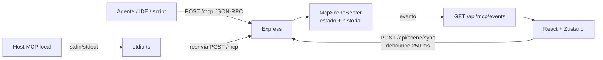

¡Hola! Hace unos días me pasó algo curioso con Woodheart Café, mi novela visual. Para no inventar espacios que solo funcionan en pantalla, quise tener planos reales del café: dónde está la barra, cuántas mesas caben, por dónde entra la luz. Y ya que estaba, quise que un agente de IA me ayudara a maquetar esos planos. De ahí salió **Atelier Criollo**, un editor *local-first* (que trabaja primero en el computador de uno) de planos 2D y espacios 3D con React, Three.js y Zustand.

Pero este artículo no es sobre el editor. Es sobre una técnica concreta: **cómo exponer el estado de una app web a agentes de IA con un servidor MCP propio**. MCP (*Model Context Protocol*) es un protocolo para que asistentes y agentes puedan descubrir y llamar «herramientas» de otra aplicación. Hoy vamos a ver cómo escribí, a mano y sin SDK, un servidor que habla JSON-RPC por HTTP, un puente por stdio para los hosts que lanzan procesos locales, y una sincronización con el navegador por SSE para que lo que hace el agente se vea en vivo. Así que acompáñenme.

**De dónde sale el código.** Todo viene del repo `FeithNoir/Atelier-Criollo`, rama `main`, commit `8aed22a` (19 nov 2026). El repo es **privado**, así que no lo enlazo: enseño con fragmentos copiados tal cual. La demo pública está en [ateliercriollo.vercel.app](https://ateliercriollo.vercel.app/) (respondió 200 el 20 nov 2026). Ojo: la demo de Vercel es solo la SPA; el servidor MCP corre **en local** (en la demo, `/.well-known/mcp.json` responde 404). El `package.json` declara React `^19.0.1` (el lock resuelve `19.3.1`), Zustand `^5.1.0` (`5.1.0`), Express `^4.21.2` (`4.22.3`), Three.js `^0.187.0`, Vite `^8.3.0` (`8.3.8`), TypeScript `^7.0.2` y tsx `^4.21.0` (`4.23.15`). Todas las salidas de este artículo son de correr el servidor en mi máquina el 20 nov 2026. Lo que no está en el repo lo marco como **Evolución**.

<a id="contenido"></a>

## Contenido

1. [El problema](/post/servidor-mcp-propio-react-zustand-json-rpc-http-stdio-sse#problema)
2. [Prerrequisitos](/post/servidor-mcp-propio-react-zustand-json-rpc-http-stdio-sse#prerrequisitos)
3. [Stack y arquitectura](/post/servidor-mcp-propio-react-zustand-json-rpc-http-stdio-sse#arquitectura)
4. [Carpetas y principios](/post/servidor-mcp-propio-react-zustand-json-rpc-http-stdio-sse#carpetas)
5. [Paso 1: describir herramientas con JSON Schema](/post/servidor-mcp-propio-react-zustand-json-rpc-http-stdio-sse#herramientas)
6. [Paso 2: el estado y el historial en el servidor](/post/servidor-mcp-propio-react-zustand-json-rpc-http-stdio-sse#estado)
7. [Paso 3: el despachador JSON-RPC](/post/servidor-mcp-propio-react-zustand-json-rpc-http-stdio-sse#jsonrpc)
8. [Paso 4: una herramienta con validación de dominio](/post/servidor-mcp-propio-react-zustand-json-rpc-http-stdio-sse#place)
9. [Paso 5: Express con descubrimiento, JSON-RPC y SSE](/post/servidor-mcp-propio-react-zustand-json-rpc-http-stdio-sse#express)
10. [Paso 6: el puente stdio](/post/servidor-mcp-propio-react-zustand-json-rpc-http-stdio-sse#stdio)
11. [Paso 7: el navegador escucha y responde](/post/servidor-mcp-propio-react-zustand-json-rpc-http-stdio-sse#navegador)
12. [Probarlo con curl](/post/servidor-mcp-propio-react-zustand-json-rpc-http-stdio-sse#probar)
13. [Decisiones técnicas](/post/servidor-mcp-propio-react-zustand-json-rpc-http-stdio-sse#decisiones)
14. [Cómo agrego otra herramienta](/post/servidor-mcp-propio-react-zustand-json-rpc-http-stdio-sse#otra)
15. [Errores típicos y trampas](/post/servidor-mcp-propio-react-zustand-json-rpc-http-stdio-sse#errores)
16. [Dónde el código no coincide con el ideal](/post/servidor-mcp-propio-react-zustand-json-rpc-http-stdio-sse#ideal)
17. [Qué aprendí](/post/servidor-mcp-propio-react-zustand-json-rpc-http-stdio-sse#aprendi)
18. [Siguientes pasos, checklist y enlaces](/post/servidor-mcp-propio-react-zustand-json-rpc-http-stdio-sse#resumen)

<a id="problema"></a>

## 1. El problema

Un editor como este guarda todo en el navegador: muros, muebles, luces, el piso, el ánimo de la iluminación. Eso está muy bien para una persona con el mouse, pero un agente de IA no tiene mouse. ¿Cómo hago para que un agente pueda preguntar «qué hay en la escena», «qué muebles existen» o «pon una matera en (3,5; 0,5)», y que yo lo vea aparecer en la pantalla?

Necesito resolver tres cosas:

- **Un contrato**: qué herramientas existen y qué parámetros aceptan, en un formato que un agente pueda leer solo.
- **Un transporte**: por dónde llegan las llamadas (HTTP para scripts, stdio para los hosts que lanzan un proceso local).
- **Una sincronización**: que lo que cambia el agente llegue al navegador y lo que cambio yo en el navegador llegue al servidor, sin que se reboten los cambios en un bucle infinito.

Bien, ya tenemos el problema. Ahora vamos a ver qué necesito instalado.

<a id="prerrequisitos"></a>

## 2. Prerrequisitos

- Node.js (yo corrí todo con `v24.22.1`).
- npm. Para instalar usé `npm ci` sobre el `package-lock.json` del repo y funcionó; la guía del repo sugiere `npm install --legacy-peer-deps`.
- `curl` para probar.

```bash
node --version
npm ci
```

Los scripts que importan aquí, del `package.json`:

```json
"dev": "tsx server.ts",
"mcp": "tsx src/mcp/stdio.ts",
```

`tsx` ejecuta TypeScript directo en Node, sin compilar antes. Es lo que permite que el mismo archivo `mcpHandler.ts` lo usen el servidor HTTP y el puente stdio.

<a id="arquitectura"></a>

## 3. Stack y arquitectura

| Pieza | Rol |
| --- | --- |
| React 19 + Zustand 5 | Interfaz y estado del editor (`usePlannerStore`) |
| Three.js | Vista 3D (no la toco en este tutorial) |
| Express 4 | Sirve la SPA (Vite en desarrollo) y la superficie MCP |
| `McpSceneServer` | Estado de la escena en el servidor, historial y herramientas |
| SSE | Empuja cambios del servidor al navegador |
| stdio | Puente para hosts MCP que lanzan un proceso |

Así fluye todo:



La pieza clave es que **hay una sola fuente de estado compartida** en el servidor (`McpSceneServer`), y tanto el agente como el navegador la leen y la escriben.

<a id="carpetas"></a>

## 4. Carpetas y principios

```text
server.ts                 # HTTP: descubrimiento, POST /mcp, REST de escena, SSE, Vite/estáticos
src/mcp/
├── mcpTools.ts           # catálogo de herramientas con JSON Schema (solo datos)
├── mcpHandler.ts         # McpSceneServer: estado, historial, JSON-RPC, herramientas
└── stdio.ts              # puente stdin/stdout → HTTP (o en proceso)
src/App.tsx               # EventSource + envío con debounce
src/store/usePlannerStore.ts  # applyRemoteScene
src/services/GridManager.ts   # colisiones (lo reutiliza el servidor)
```

- **SRP.** `mcpTools.ts` es solo una lista de definiciones; no ejecuta nada. `mcpHandler.ts` ejecuta; `server.ts` solo transporta.
- **DRY.** La regla de colisiones vive en `GridManager` y la usan igual el editor y el servidor MCP. Un agente no puede poner un mueble donde una persona tampoco podría.
- **KISS.** Sin SDK de MCP: el protocolo, en lo que esta app necesita, son unos pocos métodos JSON-RPC, y escribirlos a mano me dejó entender cada byte que viaja.

<a id="herramientas"></a>

## 5. Paso 1: describir herramientas con JSON Schema

Un agente decide qué herramienta llamar leyendo su nombre, su descripción y su esquema de entrada. Por eso este archivo es, en la práctica, la «documentación» que lee la IA. Empieza con el tipo y la primera herramienta:

```typescript
export interface McpToolDefinition {
  name: string;
  description: string;
  inputSchema: Record<string, unknown>;
}

export const MCP_TOOLS: McpToolDefinition[] = [
  {
    name: 'get_scene_state',
    description:
      'Inspect the current 3D room layout including project metadata, walls, placed furniture/architectural/light assets, floor style, lighting mood, day/night mode, exposure, and ambient intensity.',
    inputSchema: {
      type: 'object',
      properties: {},
      additionalProperties: false,
    },
  },
```

Y esta es la definición de `place_asset`, la más interesante:

```typescript
  {
    name: 'place_asset',
    description:
      'Place an asset or light primitive at coordinates (x, z) on the floor grid. Validates bounds and furniture collisions (lights and floor rugs may sit with furniture).',
    inputSchema: {
      type: 'object',
      properties: {
        assetType: { type: 'string', description: 'Asset type ID from list_catalog.' },
        x: { type: 'number', minimum: -8, maximum: 8 },
        z: { type: 'number', minimum: -8, maximum: 8 },
        rotationY: { type: 'number', description: 'Y-axis rotation in radians.' },
        tintColor: { type: 'string', description: 'Hex tint or light color.' },
        lightIntensity: { type: 'number', minimum: 0.1, maximum: 8 },
        tiltAngle: { type: 'number', minimum: -35, maximum: 35, description: 'Poster inclination tilt in degrees.' },
        label: { type: 'string' },
      },
      required: ['assetType', 'x', 'z'],
      additionalProperties: false,
    },
  },
```

Fíjense en dos cosas. Primero, la descripción le explica al agente una regla del dominio («las luces y los tapetes pueden quedar con muebles»), no solo qué hace. Segundo, el esquema pone límites (`minimum: -8, maximum: 8`) y `additionalProperties: false`. Más adelante vamos a ver qué tanto de eso se valida de verdad en el servidor.

En total son 13 herramientas: `get_scene_state`, `list_catalog`, `list_interior_templates`, `apply_interior_template`, `add_wall`, `update_wall`, `place_asset`, `update_asset`, `delete_entities`, `set_lighting`, `set_floor_style`, `undo` y `redo`.

<a id="estado"></a>

## 6. Paso 2: el estado y el historial en el servidor

Los tipos del protocolo y de los eventos van al inicio de `mcpHandler.ts`:

```typescript
export interface McpSceneState extends RoomProjectData {
  dayNightMode: DayNightMode;
  sceneExposure: number;
  ambientIntensity: number;
}

export interface SceneBroadcastEvent {
  source: 'mcp' | 'browser';
  clientId?: string;
  scene: McpSceneState;
}

export interface JsonRpcRequest {
  jsonrpc?: string;
  id?: string | number | null;
  method: string;
  params?: Record<string, unknown>;
}

export interface JsonRpcResponse {
  jsonrpc: '2.0';
  id: string | number | null;
  result?: unknown;
  error?: { code: number; message: string; data?: unknown };
}
```

Y esta es la parte de la clase que guarda el estado, avisa a los suscriptores y lleva el historial:

```typescript
export class McpSceneServer {
  private state: McpSceneState;
  private past: McpSceneState[] = [];
  private future: McpSceneState[] = [];
  private listeners = new Set<(event: SceneBroadcastEvent) => void>();

  constructor() {
    this.state = {
      ...structuredClone(DEFAULT_PROJECT),
      dayNightMode: 'day',
      sceneExposure: 1.08,
      ambientIntensity: 0.65,
    };
  }

  public getState(): McpSceneState {
    return structuredClone(this.state);
  }

  public subscribe(listener: (event: SceneBroadcastEvent) => void): () => void {
    this.listeners.add(listener);
    return () => this.listeners.delete(listener);
  }

  private emit(source: 'mcp' | 'browser', clientId?: string): void {
    const snapshot = this.getState();
    for (const listener of this.listeners) {
      listener({ source, clientId, scene: snapshot });
    }
  }

  private commit(next: McpSceneState): void {
    this.past = [...this.past.slice(-24), structuredClone(this.state)];
    this.future = [];
    this.state = { ...next, updatedAt: Date.now() };
    this.emit('mcp');
  }

  public syncFromClient(partial: Partial<McpSceneState>, clientId?: string): McpSceneState {
    this.state = {
      ...this.state,
      ...partial,
      walls: partial.walls ? structuredClone(partial.walls) : this.state.walls,
      assets: partial.assets ? structuredClone(partial.assets) : this.state.assets,
      updatedAt: Date.now(),
    };
    this.emit('browser', clientId);
    return this.getState();
  }
```

Lo que hace cada método:

- **`getState`** devuelve siempre una copia con `structuredClone`. Así nadie de afuera puede mutar el estado por accidente.
- **`subscribe`** registra una función y devuelve otra para desuscribirse. Es el patrón que después usa el endpoint SSE.
- **`commit`** es la única puerta para cambios hechos por herramientas: guarda el estado anterior en `past` (máximo 25 entradas, por el `slice(-24)` más el que entra), vacía `future`, sella `updatedAt` y emite el evento con `source: 'mcp'`.
- **`syncFromClient`** es la puerta para cambios que vienen del navegador. **No** pasa por `commit`, a propósito: el historial del servidor es de las acciones del agente, y el navegador tiene su propio historial en Zustand.

<a id="jsonrpc"></a>

## 7. Paso 3: el despachador JSON-RPC

JSON-RPC 2.0 es un formato muy simple: llega `{ jsonrpc, id, method, params }` y se responde `{ jsonrpc, id, result }` o `{ jsonrpc, id, error }`. Si el mensaje no trae `id`, es una **notificación** y no se responde nada. Este es el despachador completo:

```typescript
  public async handleJsonRpc(raw: unknown): Promise<JsonRpcResponse | null> {
    if (!raw || typeof raw !== 'object') {
      return { jsonrpc: '2.0', id: null, error: { code: -32600, message: 'Invalid Request' } };
    }
    const req = raw as JsonRpcRequest;
    const isNotification = req.id === undefined;
    const id = req.id ?? null;

    try {
      const result = this.dispatchMethod(req.method, req.params ?? {});
      if (isNotification) return null;
      return { jsonrpc: '2.0', id, result };
    } catch (err) {
      if (isNotification) return null;
      const message = err instanceof Error ? err.message : 'Internal MCP error';
      const code = message.startsWith('Method not found') ? -32601 : -32602;
      return { jsonrpc: '2.0', id, error: { code, message } };
    }
  }

  private dispatchMethod(method: string, params: Record<string, unknown>): unknown {
    switch (method) {
      case 'initialize':
        return {
          protocolVersion: '2024-11-05',
          capabilities: {
            tools: { listChanged: false },
            resources: { subscribe: false, listChanged: false },
          },
          serverInfo: { name: 'atelier-criollo-mcp', version: '1.0.0' },
        };
      case 'notifications/initialized':
      case 'ping':
        return {};
      case 'tools/list':
        return { tools: MCP_TOOLS };
      case 'tools/call': {
        const name = String(params.name ?? '');
        const args = (params.arguments as Record<string, unknown> | undefined) ?? {};
        try {
          const data = this.executeTool(name, args);
          return { content: [{ type: 'text', text: JSON.stringify(data, null, 2) }] };
        } catch (err) {
          const msg = err instanceof Error ? err.message : String(err);
          return { isError: true, content: [{ type: 'text', text: msg }] };
        }
      }
      case 'resources/list':
        return {
          resources: [
            { uri: 'atelier://scene/current', name: 'Current Room Scene', mimeType: 'application/json' },
            { uri: 'atelier://catalog/items', name: 'Asset Catalog', mimeType: 'application/json' },
            { uri: 'atelier://templates/interiors', name: 'Interior Templates', mimeType: 'application/json' },
          ],
        };
      case 'resources/read': {
        const uri = String(params.uri ?? '');
        if (uri === 'atelier://scene/current') {
          return { contents: [{ uri, mimeType: 'application/json', text: JSON.stringify(this.getState(), null, 2) }] };
        }
        if (uri === 'atelier://catalog/items') {
          return { contents: [{ uri, mimeType: 'application/json', text: JSON.stringify(ASSET_DEFINITIONS, null, 2) }] };
        }
        if (uri === 'atelier://templates/interiors') {
          const summaries = INTERIOR_TEMPLATES.map((t) => ({ id: t.id, name: t.name, theme: t.theme, subtitle: t.subtitle }));
          return { contents: [{ uri, mimeType: 'application/json', text: JSON.stringify(summaries, null, 2) }] };
        }
        throw new Error(`Unknown resource URI: ${uri}`);
      }
      default:
        throw new Error(`Method not found: ${method}`);
    }
  }
```

Puntos clave:

- **Notificaciones.** `isNotification = req.id === undefined` y, si lo es, devuelvo `null`. El servidor HTTP traduce ese `null` a un `202` sin cuerpo.
- **Dos niveles de error.** Un método que no existe es un error de protocolo (`-32601`). Pero si la *herramienta* falla (por ejemplo, un mueble que choca con un muro), la respuesta es un `result` con `isError: true` y el mensaje en `content`. Esa diferencia importa: el agente recibe el motivo y puede corregir, en vez de ver un error genérico.
- **Resultados como texto.** `tools/call` devuelve el dato serializado con `JSON.stringify(data, null, 2)` dentro de `content: [{ type: 'text', … }]`, que es la forma que esperan los clientes MCP.
- **Recursos.** Además de herramientas, expongo tres recursos de solo lectura con URIs propias (`atelier://scene/current`, `atelier://catalog/items`, `atelier://templates/interiors`).

<a id="place"></a>

## 8. Paso 4: una herramienta con validación de dominio

Esta es la ejecución de `place_asset`:

```typescript
      case 'place_asset': {
        const assetType = args.assetType as AssetType;
        const def = getAssetDefinition(assetType);
        const x = Number(args.x);
        const z = Number(args.z);
        const rotationY = Number(args.rotationY ?? 0);
        const collision = gridManager.checkPlacementCollision(
          { assetType, x, z, rotationY, scale: 1 },
          this.state.walls,
          this.state.assets,
        );
        if (collision.collides) {
          throw new Error(`Placement blocked: ${collision.reason}`);
        }
        const defaultIntensity =
          def.category === 'lights'
            ? assetType === 'ambient-light'
              ? 0.6
              : assetType === 'spot-light'
                ? 3.2
                : 2.4
            : undefined;
        const defaultTilt = assetType === 'poster' ? 12 : undefined;
        const asset: PlacedAsset = {
          id: `asset-${Date.now()}-${Math.random().toString(36).slice(2, 6)}`,
          assetType,
          x,
          z,
          rotationY,
          scale: 1,
          tintColor: typeof args.tintColor === 'string' ? args.tintColor : def.defaultTint,
          label: typeof args.label === 'string' ? args.label : def.name,
          lightIntensity: args.lightIntensity !== undefined ? Number(args.lightIntensity) : defaultIntensity,
          ...(args.tiltAngle !== undefined ? { tiltAngle: Number(args.tiltAngle) } : defaultTilt !== undefined ? { tiltAngle: defaultTilt } : {}),
        };
        this.commit({ ...this.state, assets: [...this.state.assets, asset] });
        return asset;
      }
```

¿Qué pasa aquí? Primero busco la definición del mueble (`getAssetDefinition` lanza `Unknown asset type` si no existe). Después le pregunto a `GridManager` si hay colisión, con los mismos muros y muebles del estado. Si choca, lanzo `Placement blocked: <motivo>`, que el despachador convierte en `isError: true`. Si no, armo el objeto con valores por defecto sensatos (la intensidad de luz según el tipo, la inclinación de los pósters) y hago `commit`.

Esta es la parte de la regla de colisiones que se ejecuta para el caso de los muros:

```typescript
  public checkPlacementCollision(
    candidate: {
      id?: string;
      assetType: AssetType;
      x: number;
      z: number;
      rotationY: number;
      scale: number;
    },
    walls: WallSegment[],
    assets: PlacedAsset[],
  ): CollisionResult {
    const def = getAssetDefinition(candidate.assetType);
    const [hw, hd] = this.getRotatedHalfExtents(candidate.assetType, candidate.rotationY, candidate.scale);

    if (!this.isWithinBounds(candidate.x, candidate.z, hw, hd)) {
      return { collides: true, reason: 'out-of-bounds' };
    }
    if (def.category === 'lights') {
      return { collides: false };
    }

    // Wall clearance uses a slightly padded footprint radius
    const radius = this.assetCollisionRadius(candidate.assetType, candidate.rotationY, candidate.scale);
    for (const wall of walls) {
      const dist = pointToSegmentDist(candidate.x, candidate.z, wall.x1, wall.z1, wall.x2, wall.z2);
      if (dist < wall.thickness / 2 + radius + 0.04) {
        return { collides: true, reason: 'wall-overlap' };
      }
    }
```

En palabras normales: si se sale de los límites, `out-of-bounds`; las luces nunca chocan; y si el centro del mueble queda a menos de «medio grosor del muro + radio del mueble + 4 cm» de algún muro, `wall-overlap`.

Y así funcionan deshacer y rehacer del lado del servidor:

```typescript
      case 'undo': {
        if (this.past.length === 0) return { undone: false, reason: 'Nothing to undo' };
        const prev = this.past[this.past.length - 1];
        this.past = this.past.slice(0, -1);
        this.future = [structuredClone(this.state), ...this.future.slice(0, 24)];
        this.state = prev;
        this.emit('mcp');
        return { undone: true };
      }

      case 'redo': {
        if (this.future.length === 0) return { redone: false, reason: 'Nothing to redo' };
        const next = this.future[0];
        this.future = this.future.slice(1);
        this.past = [...this.past.slice(-24), structuredClone(this.state)];
        this.state = next;
        this.emit('mcp');
        return { redone: true };
      }
```

<a id="express"></a>

## 9. Paso 5: Express con descubrimiento, JSON-RPC y SSE

Ahora el transporte. Este es `server.ts` completo:

```typescript
import http from 'node:http';
import path from 'node:path';
import express from 'express';
import { mcpServer } from './src/mcp/mcpHandler';
import { MCP_TOOLS } from './src/mcp/mcpTools';

async function startServer() {
  const app = express();
  const httpServer = http.createServer(app);
  const port = Number(process.env.PORT) || 3000;

  app.use(express.json({ limit: '15mb' }));

  const discoveryPayload = () => ({
    name: 'atelier-criollo-mcp',
    version: '1.0.0',
    protocolVersion: '2024-11-05',
    description: 'Model Context Protocol entry for Atelier Criollo 3D Floor Planner & Interior Editor.',
    endpoints: {
      jsonRpc: '/mcp',
      eventsSse: '/api/mcp/events',
      sceneRest: '/api/scene',
      stdioCommand: 'npm run mcp',
    },
    tools: MCP_TOOLS.map((t) => ({ name: t.name, description: t.description })),
  });

  app.get('/.well-known/mcp.json', (_req, res) => {
    res.json(discoveryPayload());
  });

  app.get('/mcp', (_req, res) => {
    res.json(discoveryPayload());
  });

  app.post('/mcp', async (req, res) => {
    const body = req.body;
    if (Array.isArray(body)) {
      const results = (await Promise.all(body.map((item) => mcpServer.handleJsonRpc(item)))).filter(
        (r) => r !== null,
      );
      if (results.length === 0) {
        res.status(202).end();
        return;
      }
      res.json(results);
      return;
    }

    const result = await mcpServer.handleJsonRpc(body);
    if (result === null) {
      res.status(202).end();
      return;
    }
    res.json(result);
  });

  app.get('/api/scene', (_req, res) => {
    res.json(mcpServer.getState());
  });

  app.post('/api/scene/sync', (req, res) => {
    const { scene, clientId } = (req.body ?? {}) as {
      scene?: Record<string, unknown>;
      clientId?: string;
    };
    if (!scene || typeof scene !== 'object') {
      res.status(400).json({ error: 'Missing scene payload' });
      return;
    }
    const updated = mcpServer.syncFromClient(scene, clientId);
    res.json({ ok: true, updatedAt: updated.updatedAt });
  });

  app.get('/api/mcp/events', (req, res) => {
    res.setHeader('Content-Type', 'text/event-stream');
    res.setHeader('Cache-Control', 'no-cache');
    res.setHeader('Connection', 'keep-alive');
    res.flushHeaders?.();

    res.write(`event: init\ndata: ${JSON.stringify(mcpServer.getState())}\n\n`);

    const unsubscribe = mcpServer.subscribe((evt) => {
      res.write(`data: ${JSON.stringify(evt)}\n\n`);
    });

    const keepAlive = setInterval(() => {
      res.write(': ping\n\n');
    }, 25000);

    req.on('close', () => {
      clearInterval(keepAlive);
      unsubscribe();
    });
  });

  if (process.env.NODE_ENV !== 'production') {
    const { createServer: createViteServer } = await import('vite');
    const vite = await createViteServer({
      server: {
        middlewareMode: true,
        allowedHosts: true,
        ws: { server: httpServer },
        hmr: process.env.DISABLE_HMR !== 'true',
      },
      appType: 'spa',
    });
    app.use(vite.middlewares);
  } else {
    const distDir = path.resolve(process.cwd(), 'dist');
    app.use(express.static(distDir));
    app.get('*', (_req, res) => {
      res.sendFile(path.join(distDir, 'index.html'));
    });
  }

  httpServer.listen(port, '0.0.0.0', () => {
    console.log(`Atelier Criollo server + MCP running on http://0.0.0.0:${port}`);
  });
}

void startServer();
```

Las rutas, una por una:

- **`GET /.well-known/mcp.json`** (y `GET /mcp`): un documento de **descubrimiento** con nombre, versión, endpoints y la lista de herramientas. Es una convención de este proyecto para que un humano o un script encuentre todo de un vistazo.
- **`POST /mcp`**: recibe JSON-RPC. Acepta también **lotes** (un arreglo de mensajes); si todo el lote eran notificaciones, responde `202`.
- **`GET /api/scene`** y **`POST /api/scene/sync`**: REST simple para que el navegador lea y empuje la escena.
- **`GET /api/mcp/events`**: SSE (*Server-Sent Events*, un canal donde el servidor empuja texto al navegador por una conexión HTTP abierta). Al conectar manda un evento `init` con el estado completo; después, cada cambio. Un comentario `: ping` cada 25 segundos mantiene viva la conexión, y al cerrarse limpio el intervalo y la suscripción.
- En desarrollo, Vite corre como *middleware* dentro del mismo Express, así la SPA y el MCP comparten puerto y no hay líos de CORS.

<a id="stdio"></a>

## 10. Paso 6: el puente stdio

Muchos hosts MCP no hablan HTTP: lanzan un proceso y se comunican por stdin/stdout, un mensaje JSON por línea. Para ellos está `src/mcp/stdio.ts`:

```typescript
import readline from 'node:readline';
import { mcpServer } from './mcpHandler';

const liveUrl = `http://127.0.0.1:${process.env.PORT || 3000}/mcp`;

async function processLine(line: string): Promise<void> {
  const trimmed = line.trim();
  if (!trimmed) return;

  let payload: unknown;
  try {
    payload = JSON.parse(trimmed);
  } catch {
    process.stdout.write(
      `${JSON.stringify({ jsonrpc: '2.0', id: null, error: { code: -32700, message: 'Parse error' } })}\n`,
    );
    return;
  }

  try {
    const res = await fetch(liveUrl, {
      method: 'POST',
      headers: { 'Content-Type': 'application/json' },
      body: trimmed,
    });
    if (res.status === 202) return;
    if (res.ok) {
      const text = await res.text();
      if (text.trim()) process.stdout.write(`${text}\n`);
      return;
    }
  } catch {
    // Dev server not running; execute against standalone in-process scene state.
  }

  const localRes = await mcpServer.handleJsonRpc(payload);
  if (localRes !== null) {
    process.stdout.write(`${JSON.stringify(localRes)}\n`);
  }
}

const rl = readline.createInterface({ input: process.stdin, crlfDelay: Infinity });
rl.on('line', (line) => {
  void processLine(line);
});
```

La idea es muy práctica: **primero intento reenviar** al servidor vivo en `http://127.0.0.1:$PORT/mcp`. Si funciona, el agente toca la misma escena que estoy viendo en el navegador. Si el servidor no está corriendo, caigo a un `McpSceneServer` **en proceso**, con su propio estado. Así el host nunca se queda colgado, aunque en ese modo los cambios no lleguen a ningún navegador.

<a id="navegador"></a>

## 11. Paso 7: el navegador escucha y responde

Del lado de React, cada pestaña se inventa un identificador al montar:

```typescript
  const clientIdRef = useRef<string>(
    typeof crypto !== 'undefined' && crypto.randomUUID
      ? crypto.randomUUID()
      : `client-${Math.random().toString(36).slice(2)}`,
  );
  const applyingRemoteRef = useRef(false);
```

Y este efecto de `App.tsx` hace las dos direcciones de la sincronización:

```typescript
  useEffect(() => {
    const source = new EventSource('/api/mcp/events');
    source.onmessage = (event) => {
      try {
        const payload = JSON.parse(event.data) as {
          source?: 'mcp' | 'browser';
          clientId?: string;
          scene?: Parameters<ReturnType<typeof usePlannerStore.getState>['applyRemoteScene']>[0];
        };
        if (!payload.scene) return;
        if (payload.source === 'browser' && payload.clientId === clientIdRef.current) return;
        applyingRemoteRef.current = true;
        usePlannerStore.getState().applyRemoteScene(payload.scene);
        setTimeout(() => {
          applyingRemoteRef.current = false;
        }, 0);
      } catch {
        // Ignore malformed SSE frames
      }
    };

    let timer: ReturnType<typeof setTimeout> | null = null;
    const unsubscribe = usePlannerStore.subscribe((state, prev) => {
      if (applyingRemoteRef.current) return;
      const changed =
        state.walls !== prev.walls ||
        state.assets !== prev.assets ||
        state.floorStyle !== prev.floorStyle ||
        state.lightingMood !== prev.lightingMood ||
        state.dayNightMode !== prev.dayNightMode ||
        state.sceneExposure !== prev.sceneExposure ||
        state.ambientIntensity !== prev.ambientIntensity ||
        state.projectId !== prev.projectId ||
        state.projectName !== prev.projectName;
      if (!changed) return;

      if (timer) clearTimeout(timer);
      timer = setTimeout(() => {
        const s = usePlannerStore.getState();
        void fetch('/api/scene/sync', {
          method: 'POST',
          headers: { 'Content-Type': 'application/json' },
          body: JSON.stringify({
            clientId: clientIdRef.current,
            scene: {
              id: s.projectId,
              name: s.projectName,
              floorStyle: s.floorStyle,
              lightingMood: s.lightingMood,
              dayNightMode: s.dayNightMode,
              sceneExposure: s.sceneExposure,
              ambientIntensity: s.ambientIntensity,
              walls: s.walls,
              assets: s.assets,
            },
          }),
        }).catch(() => undefined);
      }, 250);
    });

    return () => {
      if (timer) clearTimeout(timer);
      unsubscribe();
      source.close();
    };
  }, []);
```

Aquí está el truco para no crear un bucle de eco. ¿Qué pasaría sin protección? El servidor manda una escena, el store la aplica, el store cambia, la suscripción la manda de vuelta al servidor, el servidor la emite otra vez… y así para siempre. Lo evito con dos frenos:

1. **El `clientId`.** Si el evento viene del navegador y trae *mi* `clientId`, lo ignoro: es mi propio cambio de vuelta.
2. **La bandera `applyingRemoteRef`.** Mientras aplico una escena remota, la suscripción del store no envía nada. La bandera se baja con `setTimeout(…, 0)`, cuando ya pasó la actualización.

Además, el envío tiene un *debounce* (espera) de 250 ms: si arrastro un mueble, no mando cien POST, mando uno cuando me quedo quieto. Y solo envío si cambió algo de la escena (muros, muebles, piso, luces, proyecto), no si cambió la selección o el modo de vista.

Para cerrar, el store aplica la escena remota así:

```typescript
  applyRemoteScene: (scene) =>
    set((s) => {
      const walls = scene.walls ?? s.walls;
      const assets = scene.assets ?? s.assets;
      const validIds = s.selectedIds.filter((id) => walls.some((w) => w.id === id) || assets.some((a) => a.id === id));
      const next = {
        ...s,
        projectId: scene.id ?? s.projectId, projectName: scene.name ?? s.projectName,
        floorStyle: scene.floorStyle ?? s.floorStyle, lightingMood: scene.lightingMood ?? s.lightingMood,
        dayNightMode: scene.dayNightMode ?? s.dayNightMode,
        sceneExposure: scene.sceneExposure ?? s.sceneExposure,
        ambientIntensity: scene.ambientIntensity ?? s.ambientIntensity,
        walls, assets, selectedIds: validIds, ...deriveSingle(validIds, walls, assets),
        currentActionLabel: 'Synced from MCP', currentTimestamp: Date.now(),
        statusMessage: 'Synced from MCP',
      };
      syncDraft(next);
      return next;
    }),
```

Fíjense en `validIds`: si el agente borró algo que yo tenía seleccionado, la selección se limpia sola. Y la etiqueta «Synced from MCP» queda en la línea de tiempo del historial, para que yo sepa qué cambio vino de afuera.

<a id="probar"></a>

## 12. Probarlo con curl

Levanto el servidor en otro puerto para no chocar con nada:

```bash
PORT=3077 DISABLE_HMR=true npx tsx server.ts
```

```text
Atelier Criollo server + MCP running on http://0.0.0.0:3077
```

(Antes de esa línea, Vite imprime un aviso sobre `__dirname` en `vite.config.ts` y el `configLoader: 'native'`; no afecta al MCP.)

**Descubrimiento:**

```bash
curl -s localhost:3077/.well-known/mcp.json
```

```json
{
    "name": "atelier-criollo-mcp",
    "version": "1.0.0",
    "protocolVersion": "2024-11-05",
    "description": "Model Context Protocol entry for Atelier Criollo 3D Floor Planner & Interior Editor.",
    "endpoints": {
        "jsonRpc": "/mcp",
        "eventsSse": "/api/mcp/events",
        "sceneRest": "/api/scene",
        "stdioCommand": "npm run mcp"
    },
    "tools": [ ... 13 herramientas ... ]
}
```

**Handshake (`initialize`):**

```bash
curl -s -X POST localhost:3077/mcp -H 'Content-Type: application/json' \
  -d '{"jsonrpc":"2.0","id":1,"method":"initialize","params":{}}'
```

```json
{"jsonrpc":"2.0","id":1,"result":{"protocolVersion":"2024-11-05","capabilities":{"tools":{"listChanged":false},"resources":{"subscribe":false,"listChanged":false}},"serverInfo":{"name":"atelier-criollo-mcp","version":"1.0.0"}}}
```

**Una herramienta que funciona:**

```bash
curl -s -X POST localhost:3077/mcp -H 'Content-Type: application/json' \
  -d '{"jsonrpc":"2.0","id":5,"method":"tools/call","params":{"name":"set_floor_style","arguments":{"floorStyle":"terracotta-tile"}}}'
```

```json
{"jsonrpc":"2.0","id":5,"result":{"content":[{"type":"text","text":"{\n  \"floorStyle\": \"terracotta-tile\"\n}"}]}}
```

**Errores de dos niveles:**

```text
# herramienta que falla → result con isError
{"jsonrpc":"2.0","id":4,"result":{"isError":true,"content":[{"type":"text","text":"Unknown asset type: nonexistent"}]}}

# método que no existe → error JSON-RPC
{"jsonrpc":"2.0","id":6,"error":{"code":-32601,"message":"Method not found: nope"}}
```

**Una notificación** (`notifications/initialized`, sin `id`) devolvió `202` sin cuerpo, y **`undo`** devolvió `{"undone": true}`.

**Lo que vio el canal SSE** mientras hacía esas llamadas (recorto cada línea):

```text
event: init
data: {"id":"salon-el-dorado","name":"Salón El Dorado","updatedAt":1795184832425,"floorStyle":"hydraulic-mosaic",...

data: {"source":"mcp","scene":{"id":"salon-el-dorado",...,"floorStyle":"terracotta-tile",...

data: {"source":"mcp","scene":{"id":"salon-el-dorado",...,"floorStyle":"hydraulic-mosaic",...
```

O sea: estado inicial, el cambio de piso, y el `undo` que lo devolvió al mosaico hidráulico. Exactamente lo que el navegador recibe para redibujar.

**El puente stdio**, con el servidor corriendo:

```bash
printf '%s\n' \
  '{"jsonrpc":"2.0","id":3,"method":"tools/call","params":{"name":"place_asset","arguments":{"assetType":"monstera-planter","x":-4.6,"z":-3.9}}}' \
  '{"jsonrpc":"2.0","id":4,"method":"tools/call","params":{"name":"place_asset","arguments":{"assetType":"monstera-planter","x":3.5,"z":0.5,"label":"Monstera del rincón"}}}' \
  | PORT=3077 npx tsx src/mcp/stdio.ts
```

```json
{"jsonrpc":"2.0","id":3,"result":{"isError":true,"content":[{"type":"text","text":"Placement blocked: wall-overlap"}]}}
{"jsonrpc":"2.0","id":4,"result":{"content":[{"type":"text","text":"{\n  \"id\": \"asset-1795184872477-78hl\",\n  \"assetType\": \"monstera-planter\",\n  \"x\": 3.5,\n  \"z\": 0.5,\n  \"rotationY\": 0,\n  \"scale\": 1,\n  \"tintColor\": \"#1F6E58\",\n  \"label\": \"Monstera del rincón\"\n}"}]}}
```

La primera matera quedó pegada a la esquina donde se juntan los muros de la plantilla «Salón El Dorado» (el muro norte va de (−5, −4) a (5, −4)), así que el servidor la rechazó con el motivo. La segunda sí entró. ¡Pum! Una matera puesta por un «agente» desde la terminal.

<a id="decisiones"></a>

## 13. Decisiones técnicas

**1. Escribir el protocolo a mano en vez de usar un SDK.** Para lo que esta app necesita (handshake, listar y llamar herramientas, leer recursos), son unos pocos métodos. Escribirlos me dejó controlar los errores de dominio y entender el protocolo. El costo: lo que el SDK resuelve solo (validar esquemas, transportes oficiales) lo tengo que cuidar yo.

```typescript
case 'tools/list':
  return { tools: MCP_TOOLS };
```

**2. Errores de herramienta como `isError`, no como error de protocolo.** Así el agente lee «Placement blocked: wall-overlap» y puede mover el mueble, en vez de abandonar.

```typescript
return { isError: true, content: [{ type: 'text', text: msg }] };
```

**3. Un estado compartido en el servidor con SSE hacia el navegador.** El agente y yo trabajamos sobre lo mismo y lo veo en vivo. SSE alcanza porque el canal servidor → navegador es de una sola vía; la otra dirección va por POST.

```typescript
res.write(`event: init\ndata: ${JSON.stringify(mcpServer.getState())}\n\n`);
```

**4. stdio que reenvía al servidor vivo, con plan B en proceso.** Un solo comando (`npm run mcp`) sirve tanto si el editor está abierto como si no.

```typescript
const liveUrl = `http://127.0.0.1:${process.env.PORT || 3000}/mcp`;
```

<a id="otra"></a>

## 14. Cómo agrego otra herramienta de punta a punta

Supongamos una herramienta `rename_project` que cambie el nombre del proyecto. Los pasos serían:

1. **Definirla** en `MCP_TOOLS` (`mcpTools.ts`): `name`, una descripción que le diga al agente *cuándo* usarla, y un `inputSchema` con `name` requerido y `additionalProperties: false`.
2. **Ejecutarla** en `executeTool` (`mcpHandler.ts`): un `case 'rename_project'` que valide el texto (no vacío, largo razonable) y haga `this.commit({ ...this.state, name })`.
3. **Nada más en el transporte.** `tools/list` lee `MCP_TOOLS`, el descubrimiento también, y el SSE ya emite el cambio porque `commit` llama a `emit`.
4. **En el navegador**, `applyRemoteScene` ya copia `scene.name` a `projectName`, así que el nombre nuevo aparece solo.
5. **Probarla** con `curl` como en la sección anterior, y revisar que el evento SSE llegue.

**Evolución:** `rename_project` no existe en el repo; es el ejemplo para mostrar el camino.

<a id="errores"></a>

## 15. Errores típicos y trampas

- **El bucle de eco.** Sin `clientId` y sin la bandera `applyingRemoteRef`, el navegador y el servidor se rebotan la escena para siempre.
- **Responder a notificaciones.** Un mensaje sin `id` no lleva respuesta. Si le responden, algunos clientes se confunden.
- **Olvidar el `: ping` del SSE.** Proxies y navegadores cierran conexiones que pasan mucho tiempo calladas.
- **No limpiar al cerrar.** Si `req.on('close')` no desuscribe, cada pestaña cerrada deja un listener vivo escribiendo a una conexión muerta.
- **Escribir logs en stdout en el puente stdio.** stdout es el canal del protocolo; cualquier `console.log` extra rompe el JSON que lee el host. En `stdio.ts` solo se escribe JSON.
- **Pensar que la demo de Vercel trae el MCP.** No: Vercel sirve la SPA estática. El MCP necesita `npm run dev` en local.
- **Nombres de tipos de mueble inventados.** Probé `potted-palm` y el servidor respondió `Unknown asset type: potted-palm`. Por eso conviene que el agente llame `list_catalog` primero (en la categoría `plants` aparecen, por ejemplo, `monstera-planter`, `hanging-fern`, `cafe-herb-trough` y `tropical-palm`).

<a id="ideal"></a>

## 16. Dónde el código no coincide con el ideal

Siendo honesto con lo que hay hoy:

- **El `inputSchema` no se valida en el servidor.** Las herramientas convierten con `Number(args.x1)` y siguen. Algunas reglas sí se revisan a mano (límites y colisiones en `place_asset`, largo mínimo de 0,25 m en `add_wall`), pero un `height` fuera de rango en `add_wall`, por ejemplo, no se rechaza.
- **El transporte HTTP es una versión simplificada.** El servidor anuncia el protocolo `2024-11-05` y responde JSON directo en `POST /mcp`. No implementa sesiones ni el transporte HTTP formal del estándar, así que un cliente MCP por HTTP estricto podría no conectarse. No lo probé con un host MCP real en esta sesión; para hosts, el camino más seguro es el puente stdio, que usa un mensaje JSON por línea.
- **No hay autenticación.** El servidor escucha en `0.0.0.0`. En local está bien; expuesto en una red, cualquiera podría mover muebles.
- **El estado del servidor vive en memoria.** Si reinicio el servidor, vuelve a la escena por defecto; lo persistente está en el IndexedDB del navegador.
- **`syncFromClient` acepta lo que llegue** dentro de `scene` y lo mezcla con el estado, sin validar su forma.

<a id="aprendi"></a>

## 17. Qué aprendí

- **La descripción de una herramienta es interfaz de usuario**, solo que el usuario es un modelo. Escribirla bien ahorra llamadas fallidas.
- **Separar errores de protocolo de errores de dominio** cambia mucho la experiencia del agente.
- **SSE es subestimado.** Para empujar cambios a una sola vía, es más simple que WebSockets y funciona con HTTP normal.
- **Los bucles de eco aparecen siempre** que dos lados sincronizan. Hay que diseñar el freno desde el principio.
- **Reutilizar las reglas del editor en el servidor** (las colisiones de `GridManager`) evita que el agente pueda hacer cosas que una persona no podría.

<a id="resumen"></a>

## 18. Siguientes pasos, checklist y enlaces

**Siguientes pasos (Evolución, nada de esto está en el repo):**

- Validar `arguments` contra el `inputSchema` antes de ejecutar (por ejemplo, con un validador de JSON Schema).
- Implementar el transporte HTTP formal del estándar o migrar al SDK oficial, y probarlo con un host MCP real.
- Un token simple para el endpoint cuando no sea `127.0.0.1`.
- Persistir el estado del servidor o tomarlo del navegador al arrancar.
- Pruebas automáticas del despachador con mensajes JSON-RPC grabados.

**Checklist**

- [ ] Herramientas descritas con nombre, descripción útil y JSON Schema.
- [ ] Un solo `commit` para cambios del agente, con historial acotado.
- [ ] Notificaciones sin respuesta (`202`).
- [ ] Errores de herramienta con `isError`, de protocolo con `error`.
- [ ] Descubrimiento en `/.well-known/mcp.json`.
- [ ] SSE con `init`, `: ping` y limpieza al cerrar.
- [ ] Puente stdio que reenvía y tiene plan B.
- [ ] Navegador con `clientId`, bandera anti-eco y *debounce*.
- [ ] Probado con curl.

**Resumen.** Como acabamos de ver, exponer el estado de una app React a un agente no exige un framework gigante. Con una lista de herramientas en JSON Schema, un despachador JSON-RPC, un puente stdio y un canal SSE, el agente y yo trabajamos sobre la misma escena y yo veo cada cambio en vivo. Lo que falta, sobre todo validar esquemas y usar el transporte formal, queda anotado como siguiente corte.

**Enlaces**

- Demo pública (solo la SPA, sin MCP): [https://ateliercriollo.vercel.app/](https://ateliercriollo.vercel.app/)
- Repo: privado (`FeithNoir/Atelier-Criollo`), sin enlace; el código está en los fragmentos de este artículo.
- Model Context Protocol: [https://modelcontextprotocol.io](https://modelcontextprotocol.io)
- JSON-RPC 2.0: [https://www.jsonrpc.org/specification](https://www.jsonrpc.org/specification)
- Server-Sent Events (MDN): [https://developer.mozilla.org/es/docs/Web/API/Server-sent_events](https://developer.mozilla.org/es/docs/Web/API/Server-sent_events)

Muchas gracias por acompañarme. Nos estaremos viendo en la próxima bitácora.
